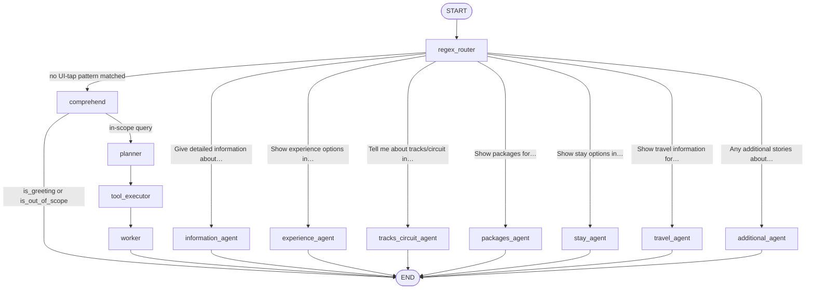
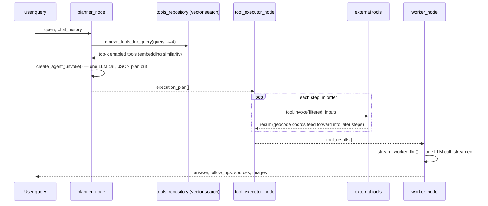
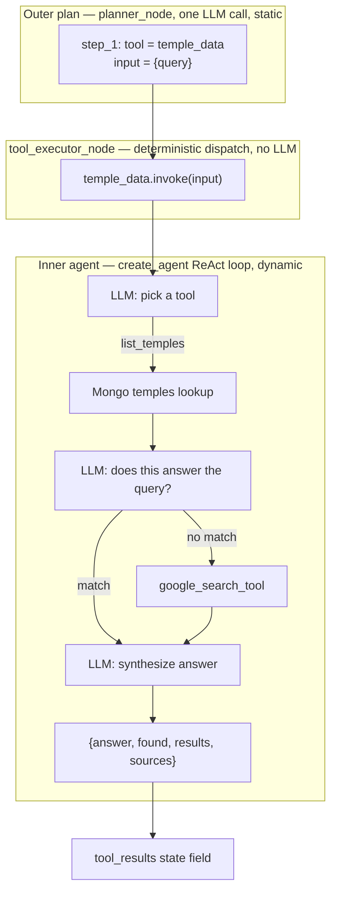
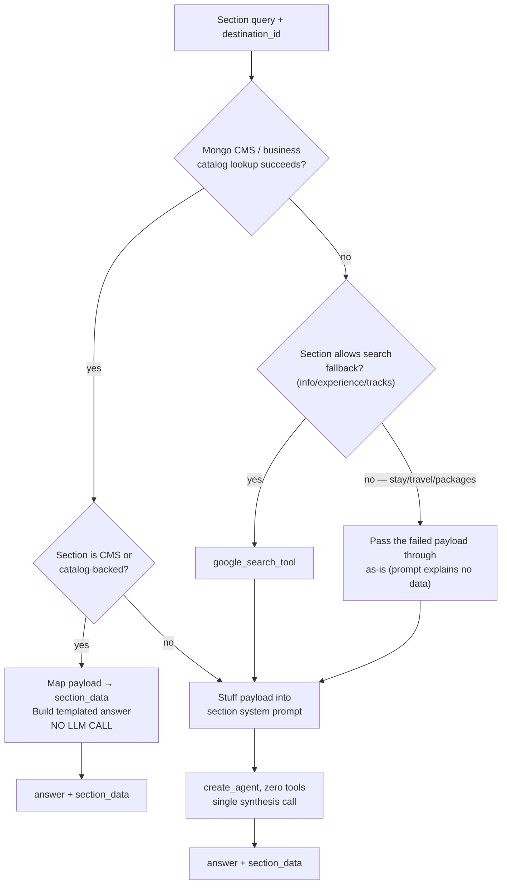

# Agentic Architecture

How this service composes LangGraph into a working agent system: the graph topology, the reasoning strategies layered on top of it, and why those strategies were chosen where they were.

## 1. Classification

This is not a single canonical agent pattern (a plain ReAct loop, a plain supervisor, a plain RAG chain). It is a **composite architecture**: a deterministic router feeding two independent, mutually-exclusive execution paths, one of which runs a **Plan → Execute → Synthesize** pipeline (ReWOO-style — the plan is produced once, up front, with no interleaved observation) and the other a bank of **narrow, prompt-stuffed single-shot agents**. Nested inside the plan-execute path, two "tools" are themselves full **ReAct agents**, giving the system two levels of agency running two different strategies at once. A recurring, deliberate motif ties it together: **push every decision as far toward deterministic code as it will go, and only spend an LLM call when the deterministic layers run out.**

Five agentic strategies coexist, each earning its place on cost/latency/determinism grounds:

| Layer | Strategy | Why this one |
|---|---|---|
| Entry | Deterministic regex router | Zero-latency, zero-cost dispatch for known UI-generated prompts |
| Intent gate | Single-shot structured-output classifier | Cheap guardrail before committing to the expensive path |
| Main path | Plan-and-Execute (ReWOO-style) | One planning call instead of N interleaved reasoning turns |
| Tool selection | RAG over a tool-description vector index | Keeps the planner's tool registry small and query-relevant |
| Two specific tools | Nested ReAct agent-as-tool | Only these two need adaptive, multi-step retrieval |
| Section fast-path | Prompt-stuffed single-shot agents | Structured UI requests don't need tool-calling uncertainty |

## 2. Graph Topology

The compiled `StateGraph` has one entry point and two disjoint sub-graphs that never rejoin except at `START`/`END`. There is no node that both paths pass through after the router.

Two structural choices stand out:

- **The router runs before any LLM is invoked.** `regex_router` is pure pattern matching plus a Mongo lookup for a previously-saved destination; it never calls the model. Every request pays this cost regardless of which path it takes, but the cost is negligible, and it lets seven of the eight destinations short-circuit straight past the classifier and planner entirely.
- **`comprehend` is a guardrail with a trapdoor, not a pass-through step.** Its conditional edge (`_next_after_comprehend`) routes greetings and out-of-scope queries directly to `END`, persisting only the acknowledgement. The planner, tool executor, and worker — the expensive part of the graph — are never constructed for that turn.

## 3. Main Path: Plan → Execute → Synthesize

The conversational path is a three-stage pipeline, not a ReAct loop. This distinction matters architecturally:

- A **ReAct agent** interleaves reasoning and action: LLM call → tool call → LLM sees the result → LLM decides the next tool call → … The number of LLM calls is unbounded and depends on what the tools return.
- This system's **planner** makes exactly one LLM call and emits a complete, ordered list of tool invocations before any tool has run. **`tool_executor`** then runs that list start to finish with zero LLM involvement — it is pure orchestration code. **`worker`** makes one more LLM call to read all the collected tool output and synthesize the final answer.

This buys three things at the cost of adaptivity: the total LLM-call count for a turn is bounded (2, versus an unbounded ReAct loop), the plan is inspectable and loggable as a single artifact before anything runs (this is what streams to the UI as `planner_progress`), and a bad tool result can't cause the model to spiral into extra retries — the executor just records the error and moves on (`tool_executor.py:186` catches per-tool exceptions and returns `{"error": ...}` rather than aborting the plan).

The trade-off is real: the planner cannot react to what a tool actually returns. A `google_geocode` step can't be added mid-flight if the plan didn't call for it — which is why `tool_executor` does the one piece of adaptive wiring itself, outside the LLM: it forwards the last resolved `{latitude, longitude}` from a `google_geocode` or `user_location` step into a later `google_places` step's `nearby_search` input (`tool_executor.py:219-235`). That's a hand-coded, single-purpose data dependency substituting for what a ReAct loop would have handled by observing the geocode result and re-planning.

### 3.1 RAG over the tool registry

The planner doesn't see a static list of every tool. `tools_repository.retrieve_tools_for_query` embeds the user query and runs a `$vectorSearch` against a `DigiDevalaya_tools` Mongo Atlas collection, returning the top-4 semantically relevant, enabled tools; only if that returns nothing does the planner fall back to the full static registry in `tools_description.py`. This is retrieval applied to the *tool-selection* problem rather than the document-answer problem — it keeps the planner's system prompt small and reduces the chance the model invents a tool name that isn't actually registered, since the registry it sees is generated per-query rather than memorized.

### 3.2 Nested agency: agents as tools

Two entries in the tool registry — `temple_data` and `ritual_offerings` — are not thin API wrappers. Each is a full `create_agent` ReAct loop in its own right, given two tools (a Mongo lookup and `google_search_tool`) and told to check Mongo first, fall back to search if the results don't match, and synthesize its own answer (`tools/search_agent_runner.py:139-176`). From the planner's point of view this is one opaque step in a flat plan; underneath, the outer executor is calling into an inner agent that runs its own multi-turn think-act-observe cycle.

This is a deliberate two-tier split: the *outer* system stays plan-and-execute because most steps (search, places, routes, geocode) are single deterministic API calls with no need for adaptive retry. The *inner* system is ReAct specifically because "check the curated Mongo collection, and only fall back to open web search if it misses" is exactly the kind of conditional, result-dependent branching that a static plan can't express in one shot. Rather than making the whole graph adaptive to support two tools, adaptivity is contained inside those two tools.

## 4. Section Fast-Path: Prompt-Stuffed Single-Shot Agents

The seven `*_agent` nodes (`information`, `experience`, `tracks_circuit`, `packages`, `stay`, `travel`, `additional`) serve fixed UI actions — "Show stay options in {destination}" and similar tap-generated prompts detected by regex before `comprehend` ever runs. They share one code path, `_run_section_agent` in `nodes/section_agents.py`, parameterized by `section_key`.

Structurally these are the opposite of the main path's tool-calling model: each `create_agent` here is built with **`tools=[]`**. Data isn't fetched by letting the model call a tool — it's fetched deterministically first (Mongo CMS lookup, or a Google Search/Places call keyed off the section) and then interpolated directly into the system prompt as a JSON blob (`_build_system_prompt`, `nodes/section_agents.py:55-72`). The model's only job is to read that payload and emit the answer plus a normalized `section_data` structure — a single LLM call with no tool-selection uncertainty, because for a fixed UI action the data source is already known.

### 4.1 Deterministic-first cascade

Within that resolution step, a cascade tries to avoid the LLM call altogether:

`_mongo_direct_response` (`nodes/section_agents.py:536-598`) is the concrete mechanism: when the destination's CMS document or business catalog entry already has the data in the shape the frontend needs, the node maps it straight into `section_data` and builds a templated answer string — the LLM is skipped entirely for that turn. This same "deterministic source before generative synthesis" instinct shows up at the top of the graph too (the regex router bypassing the classifier) and inside the nested search agents (Mongo before web search); it's the load-bearing cost-control pattern of the whole system, applied at three different altitudes.

## 5. State Model

`GraphState` (`graph/state.py`) is one flat `TypedDict(total=False)` shared by every node — there are no `Annotated[list, operator.add]` reducers, no per-node sub-state, no subgraphs with isolated schemas. Every node returns a partial dict, and LangGraph merges it into the running state by shallow key overwrite between supersteps (`build_graph` in `graph/graph.py:35-63`).

This works cleanly here because the topology guarantees no two nodes ever write the same key in the same superstep — the two sub-graphs are mutually exclusive, and within each sub-graph execution is strictly sequential (`START → regex_router → {comprehend|section_agent} → …`, never a fan-out to parallel branches). A reducer-based accumulation model would be necessary the moment two nodes could legitimately write to, say, `tool_results` concurrently; nothing here does. The state doubles as the SSE payload contract: `stream_chat_events` (`graph/graph.py:118-296`) reads back the same keys (`answer`, `sources`, `section_data`, `execution_plan`, …) that the nodes wrote, so the shape of `GraphState` is effectively the wire format too.

## 6. Streaming as an Out-of-Band Channel

The graph produces two independent output streams that get merged only in the orchestration shell, not inside the graph:

```mermaid
flowchart LR
    subgraph Graph["Compiled StateGraph — pure state transforms"]
        WN[worker_node] -->|llm.stream chunks,<br/>token by token| SWL[stream_worker_llm]
        SWL -->|get_stream_writer&#40;&#41;<br/>custom event| CUSTOM[("custom" stream_mode)]
        WN -->|return dict once complete| UPD[("updates" stream_mode)]
    end

    subgraph Shell["stream_chat_events — orchestration shell"]
        CUSTOM --> DELTA["worker_delta events<br/>(word-batched via DeltaBatcher)"]
        UPD --> NODE["per-node completion events<br/>(answer, sources, section_data…)"]
        NODE --> PERSIST["chat_repository.append_exchange<br/>(Mongo side effect)"]
    end

    DELTA --> SSE[app.py SSE envelope]
    NODE --> SSE
    SSE --> CLIENT[Client]
```

`stream_worker_llm` (`streaming/worker_stream.py`) writes token deltas through LangGraph's `get_stream_writer()` as **custom events**, separate from the state-update channel the graph normally emits on. `DeltaBatcher` coalesces those into ~4-word chunks before they reach the writer, trading a small amount of latency for far fewer SSE frames. The generator in `graph.py` consumes `stream(state, stream_mode=["updates", "custom"])` and interleaves both channels back into one sequence of `(node_name, payload)` tuples that `app.py` turns into SSE envelopes.

The deliberate part of this design: **persistence and SSE formatting live in `stream_chat_events`, not in any graph node.** `_persist_exchange` is called from the generator after each terminal node fires, not from `worker_node` or the section-agent nodes themselves. That keeps the compiled graph a pure function of state — testable without a database, without an HTTP layer, without knowledge of the wire protocol — and pushes all I/O to the edges of the system. It also means the graph itself carries no memory: `get_graph()` is a plain `lru_cache`-backed singleton compiled **without a checkpointer**. Conversation memory is not LangGraph state persistence at all; it's `chat_repository.get_recent_messages` reloading history from Mongo into `state["chat_history"]` at the start of every call to `stream_chat_events`. There is no resumability, replay, or time-travel from a checkpoint — continuity is entirely the external repository's responsibility.

## 7. Structured-Output Contract

Every LLM-facing node treats the model's response as an untrusted, possibly-malformed channel rather than a typed return value. Three defenses stack:

1. **Schema-in-prompt, not function-calling.** Prompts embed an `output response {{ … }}` JSON block; `load_output_schema` (`utils/llm.py:34-46`) parses that block out of the prompt file itself, so the expected shape and the instructions travel together in one file rather than being defined twice.
2. **Defensive extraction.** `parse_llm_json` (`utils/llm.py:58-83`) strips markdown code fences, slices between the first `{` and last `}`, and falls back to `ast.literal_eval` before giving up — because `response_format={"type": "json_object"}` constrains validity of the JSON but not exactly where in the text it appears.
3. **Merge-over-default, not replace.** `merge_output` (`utils/llm.py:86-93`) starts from the schema's default template and overlays only the keys the model actually returned, recursively for nested dicts. A partial or missing field degrades to a safe default instead of a `KeyError` propagating into the SSE stream.

## 8. Cross-Cutting Observability

`log_node_execution` (`utils/node_logging.py:126-145`) wraps every node function uniformly, logging its state-output payload and re-raising (with a log line) on unhandled exceptions. `invoke_llm` and `stream_worker_llm` separately log call start/completion/duration around every model invocation. This isn't an agentic pattern in itself, but it's what makes the composite architecture debuggable in practice: because the system is a cascade of many small deterministic-or-LLM decision points rather than one opaque agent loop, being able to see which layer of the cascade a given turn actually resolved at (regex hit? Mongo direct? search fallback? full LLM synthesis?) is what makes the cost-control design verifiable rather than assumed.

