# Parent-Child Workflow Pattern — Design & Implementation Guide

**Status:** Proposed  
**Scope:** `keehoo_ai_kruise_backend`  
**Pattern:** Upload Job → Parent Graph → Fan-out to N Child Graphs (one per record)

---

## Table of Contents

1. [Problem Statement](#1-problem-statement)
2. [Current State — What Already Works](#2-current-state--what-already-works)
3. [Target Architecture](#3-target-architecture)
4. [Gap Analysis](#4-gap-analysis)
5. [Architectural Changes Required](#5-architectural-changes-required)
6. [Data Model Changes](#6-data-model-changes)
7. [New Components](#7-new-components)
8. [Sequence Flows](#8-sequence-flows)
9. [Effort Estimation](#9-effort-estimation)
10. [Implementation Phases](#10-implementation-phases)
11. [Constraints and Risks](#11-constraints-and-risks)

---

## 1. Problem Statement

The target pattern is:

```
Upload Job #1001
       ↓
Parent Graph
       ↓
Read CSV (10,000 rows)
       ↓
Fan-out → Child Graph G001 (Employee E001)
        → Child Graph G002 (Employee E002)
        → ...
        → Child Graph G10000 (Employee E10000)
```

Each child graph:
- Owns one business record (one employee)
- Runs independently with its own state
- Can pause for human approval (HITL)
- Resumes via callback when approved
- Reports completion back to the parent

The parent graph:
- Waits for all (or a quorum of) children to finish
- Aggregates results
- Continues its own downstream logic

---

## 2. Current State — What Already Works

The foundation for this pattern already exists. The following five capabilities are production-ready.

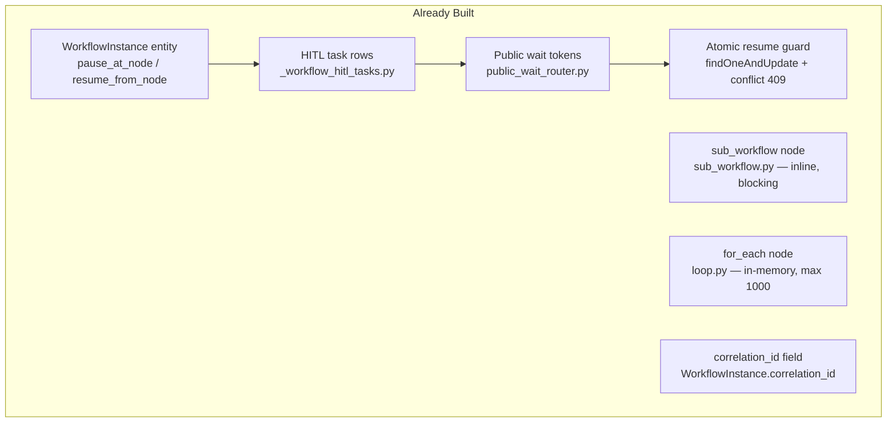

| Capability | File | Notes |
|---|---|---|
| Instance lifecycle (pause/resume/complete) | `executions/domain/entities.py` | Solid — `pause_at_node`, `resume_from_node`, `complete`, `fail` |
| HITL tasks + completion data | `_workflow_hitl_tasks.py` | Stores every approval decision as a row |
| Public tokenized resume | `public_wait_router.py` | GET + POST `/public/wait/{token}` |
| Idempotent resume (atomic claim) | `_workflow_execution.py:358` | `findOneAndUpdate` with status guard → HTTP 409 on conflict |
| Sub-workflow invocation | `node_handlers/sub_workflow.py` | Runs ONE child synchronously |
| Iteration | `node_handlers/loop.py` | `for_each` (max 1000), `repeat` |
| Record identity | `WorkflowInstance.correlation_id` | Present but not uniquely enforced |

---

## 3. Target Architecture

### 3.1 High-Level Flow

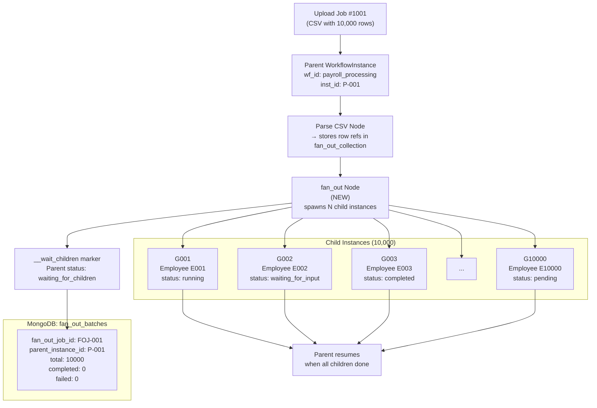

### 3.2 Child Instance with HITL

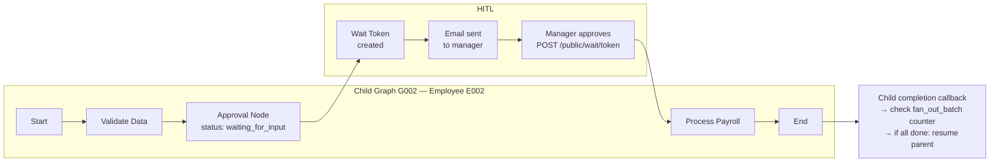

---

## 4. Gap Analysis

### What Is Missing Today

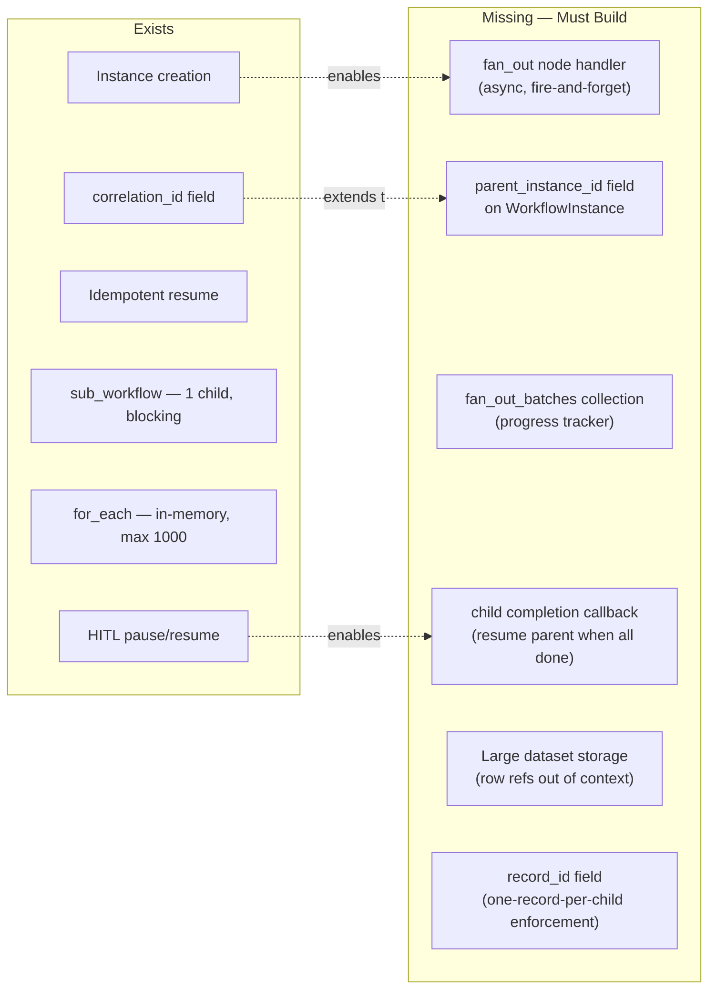

| Gap | Severity | Reason |
|---|---|---|
| No `fan_out` node | **Blocker** | `sub_workflow` is synchronous and one-at-a-time |
| `for_each` cap is 1,000 | **Blocker** | Hard limit at `loop.py:28`; fails at row 1,001 |
| `sub_workflow` rejects paused children | **Blocker** | `sub_workflow.py:73` raises `ValueError` if child HITL pauses |
| No `parent_instance_id` on entity | **Required** | Children cannot notify parent without this link |
| No fan-out progress tracker | **Required** | Parent cannot know when all children are done |
| Context size limit 512KB | **Required** | 10,000 rows inline in context will hit `_CONTEXT_MAX_BYTES` |
| No child completion hook | **Required** | Nothing triggers parent resume today |

---

## 5. Architectural Changes Required

### 5.1 Overview

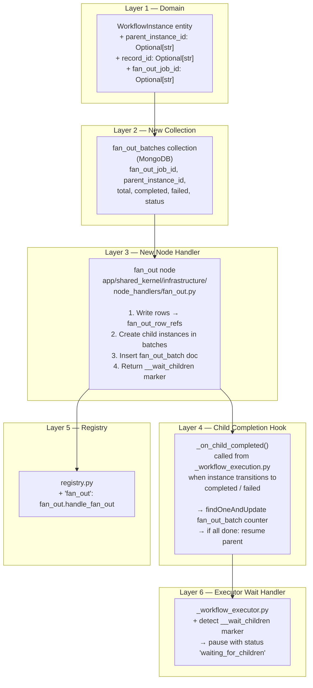

### 5.2 Changes to Existing Files

| File | Change Type | What Changes |
|---|---|---|
| `executions/domain/entities.py` | **Extend** | Add `parent_instance_id`, `record_id`, `fan_out_job_id` fields |
| `executions/infrastructure/adapters/driven/persistence/repository.py` | **Extend** | Map new fields in `_doc_to_entity` / `_entity_to_doc` |
| `shared_kernel/infrastructure/node_handlers/registry.py` | **Extend** | Register `"fan_out": fan_out.handle_fan_out` |
| `workflows/infrastructure/adapters/driven/persistence/_workflow_executor.py` | **Extend** | Detect `__wait_children` context marker → `pause_at_node` with status `waiting_for_children` |
| `workflows/infrastructure/adapters/driven/persistence/_workflow_execution.py` | **Extend** | Call `_on_child_completed()` at the end of `run_instance()` when instance is a child |
| `node_handlers/loop.py` | **Optional** | Raise `_HARD_MAX_ITERATIONS` or bypass for fan-out use case |

### 5.3 New Files to Create

| File | Purpose |
|---|---|
| `shared_kernel/infrastructure/node_handlers/fan_out.py` | New node handler — fan-out logic |
| `shared_kernel/infrastructure/fan_out_service.py` | Batch creation, progress tracking, parent resume |
| MongoDB migration | Add indexes on `parent_instance_id`, `fan_out_job_id` |

---

## 6. Data Model Changes

### 6.1 WorkflowInstance Entity

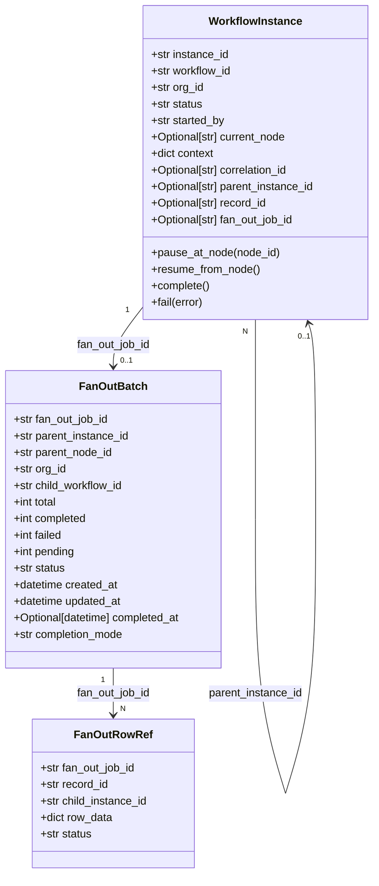

### 6.2 MongoDB Indexes Required

```
// New indexes
workflow_instances: { parent_instance_id: 1, status: 1 }
workflow_instances: { fan_out_job_id: 1 }
workflow_instances: { record_id: 1, workflow_id: 1, org_id: 1 }  // enforces 1-record-1-instance

fan_out_batches: { fan_out_job_id: 1 }          // unique
fan_out_batches: { parent_instance_id: 1 }

fan_out_row_refs: { fan_out_job_id: 1, record_id: 1 }   // unique
fan_out_row_refs: { child_instance_id: 1 }
```

---

## 7. New Components

### 7.1 `fan_out` Node Handler

**File:** `app/shared_kernel/infrastructure/node_handlers/fan_out.py`

**Node config (set in canvas):**
```json
{
  "child_workflow_id": "wf_employee_payroll",
  "array_key": "employees",
  "record_id_key": "employee_id",
  "context_keys": ["employee_id", "name", "department", "salary"],
  "batch_size": 50,
  "completion_mode": "all_of"
}
```

**Execution logic:**

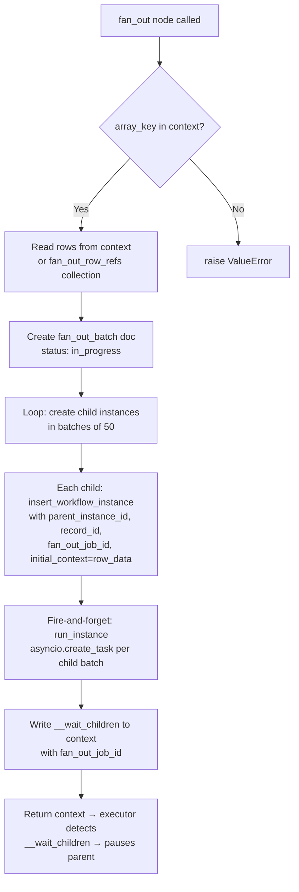

### 7.2 Child Completion Callback

**File:** `app/shared_kernel/infrastructure/fan_out_service.py`

Called from `_workflow_execution.py` at every instance terminal state transition.

```mermaid
flowchart TD
    A["Instance reaches terminal state<br>(completed / failed / cancelled)"]
    B{Has parent_instance_id<br>and fan_out_job_id?}
    C[Skip — not a child instance]
    D["findOneAndUpdate fan_out_batch<br>$inc: completed or failed<br>atomic — no race condition"]
    E{All children done?<br>completed + failed == total}
    F[Leave parent waiting]
    G[Resume parent instance<br>run_instance(parent_instance_id,<br>skip_current=True)]

    A --> B
    B -->|No| C
    B -->|Yes| D
    D --> E
    E -->|No| F
    E -->|Yes| G
```

### 7.3 Parent Executor — `__wait_children` Detection

**File:** `_workflow_executor.py` (extend existing wait detection block)

```python
# Existing pattern already handles __wait_approval, __wait_form
# Add:
if "__wait_children" in context:
    fan_out_job_id = context["__wait_children"].get("fan_out_job_id")
    await db.workflow_instances.update_one(
        {"instance_id": instance_id},
        {"$set": {"status": "waiting_for_children", "fan_out_job_id": fan_out_job_id}}
    )
    return  # parent is now paused
```

---

## 8. Sequence Flows

### 8.1 Full Fan-Out Lifecycle

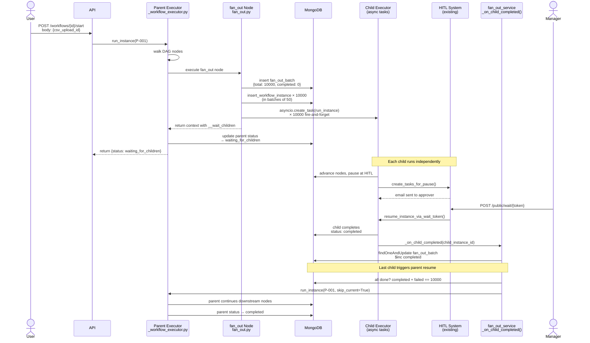

### 8.2 Partial Failure Handling

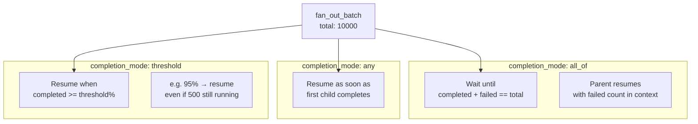

---

## 9. Effort Estimation

### Summary

| Work Item | Effort | Risk |
|---|---|---|
| Domain entity changes (`parent_instance_id`, `record_id`, `fan_out_job_id`) | 0.5 day | Low |
| Repository mapping updates | 0.5 day | Low |
| `fan_out_batches` collection + indexes | 0.5 day | Low |
| `fan_out.py` node handler | 2 days | Medium |
| `fan_out_service.py` — completion callback + parent resume | 2 days | Medium–High |
| `_workflow_executor.py` — `__wait_children` detection | 0.5 day | Low |
| `_workflow_execution.py` — hook child terminal transitions | 1 day | Medium |
| Registry registration | 0.5 day | Low |
| Large dataset: row ref storage (avoid 512KB context limit) | 1 day | Medium |
| Tests (unit + integration) | 2 days | Medium |
| **Total** | **~10.5 days** | |

### Effort Breakdown by Layer

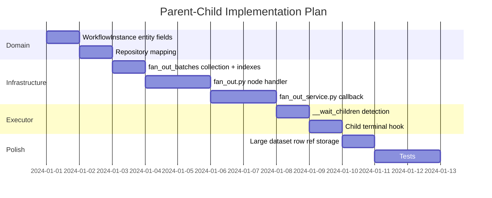

---

## 10. Implementation Phases

### Phase 1 — Domain Foundation (1.5 days)
Extend `WorkflowInstance` with `parent_instance_id`, `record_id`, `fan_out_job_id`. Update repository mappers. Create MongoDB indexes. No behaviour change yet.

**Files:**
- `executions/domain/entities.py`
- `executions/infrastructure/adapters/driven/persistence/repository.py`
- DB migration script

### Phase 2 — Fan-Out Node (2.5 days)
Build `fan_out.py` handler and register it. Supports: `array_key`, `record_id_key`, `child_workflow_id`, `batch_size`, `completion_mode`. Writes `fan_out_batch` doc. Spawns children via `asyncio.create_task`. Returns `__wait_children` marker.

**Files:**
- `shared_kernel/infrastructure/node_handlers/fan_out.py` *(new)*
- `shared_kernel/infrastructure/node_handlers/registry.py`
- `workflows/infrastructure/adapters/driven/persistence/_workflow_executor.py`

### Phase 3 — Child Completion Callback (2 days)
Build `fan_out_service._on_child_completed()`. Hook it into the terminal state transitions of `run_instance()`. Atomically increment `fan_out_batch.completed` / `.failed`. When `completed + failed == total`, call `run_instance(parent_instance_id, skip_current=True)`.

**Files:**
- `shared_kernel/infrastructure/fan_out_service.py` *(new)*
- `workflows/infrastructure/adapters/driven/persistence/_workflow_execution.py`

### Phase 4 — Scale & Robustness (2 days)
Move large row sets out of context into `fan_out_row_refs` collection. Add APScheduler job to catch orphaned `waiting_for_children` parents whose batch counters stalled (e.g. due to crash mid-fan-out). Add `completion_mode: threshold` support.

### Phase 5 — Tests (2 days)
- Unit: `fan_out.py` handler with mocked DB
- Integration: Parent → 5 children → all complete → parent resumes
- Edge cases: child crash, partial failure, duplicate callback

---

## 11. Constraints and Risks

### Scale Constraints

| Constraint | Current Limit | Required for 10k Children |
|---|---|---|
| `for_each` hard cap | 1,000 iterations | Not used in new approach — `fan_out` bypasses it |
| Context size | 512KB | Row data stored in `fan_out_row_refs`, not in context |
| `_MAX_STEPS` per instance | 100 nodes | Each child is independent — not affected |
| MongoDB `workflow_instances` | No cap | Index on `parent_instance_id` required for query performance |
| `asyncio.create_task` flood | No internal cap | Batch creation in groups of 50 prevents task queue explosion |

### Architectural Risks

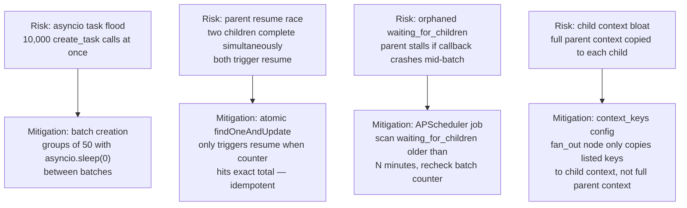

### What This Pattern Does NOT Change

- The existing `sub_workflow` node is unchanged — it remains for single, synchronous, non-HITL child calls.
- The existing HITL system in children is entirely reused — children pause, get HITL tasks, resume via public wait tokens exactly as they do today.
- The parent-child link is purely via `parent_instance_id` — there is no LangGraph subgraph nesting or checkpoint sharing.
- No changes to the public API shape — fan-out is an internal node execution detail.
