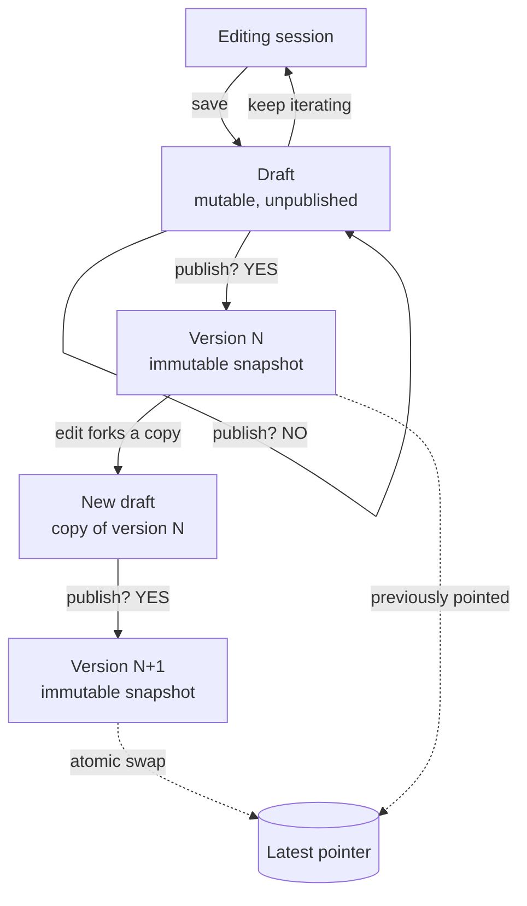

# Workflow versioning architecture

> [!summary]
> A draft/publish versioning model with copy-on-edit. Drafts are the only mutable entity; publishing produces immutable, numbered versions; a single "latest" pointer moves forward atomically on publish. In-flight executions pin to the version they started on. Rollback is roll-forward (restore old content → republish).

---

## 1. State machine



> [!important] The one rule that holds everything together
> Publish always transitions **draft → version**. Never version → version. The publish decision gate sits on the draft, not on a published version.

---

## 2. Core invariants

1. **Published versions are immutable.** Only drafts are mutable.
2. **At most one draft exists per workflow.** Editing a published version forks into it; publishing consumes it. Hitting "edit" while a draft exists redirects to the existing draft — never silently creates or overwrites one.
3. **Publish = draft → version N+1.** Never version → version.
4. **"Latest" is a pointer, not a property.** It is swapped atomically as part of the publish operation, and it only ever moves forward (latest = highest version number, always).
5. **Executions pin their version at start.** New executions resolve the latest pointer once, at trigger time. In-flight executions never see a definition change.
6. **A version referenced by any execution cannot be deleted or pruned.**
7. **Rollback is roll-forward.** Restoring V1 copies its content into the draft slot; publishing yields V3 with V1's behavior. History stays strictly linear.

---

## 3. Entities

| Entity | Mutability | Key fields | Notes |
|---|---|---|---|
| **Workflow** | metadata only | `id`, `name`, `latest_version_id`, `draft_id (nullable)` | Owns the latest pointer and the single draft slot |
| **Draft** | mutable | `id`, `workflow_id`, `content`, `forked_from_version_id (nullable)`, `updated_at` | 0 or 1 per workflow; `forked_from` is null for a never-published workflow |
| **Version** | immutable | `id`, `workflow_id`, `number`, `content (snapshot)`, `published_at` | Created only by publish; never updated or reused |
| **Execution** | append-only | `id`, `workflow_id`, `version_id`, `status`, ... | `version_id` written once at start; engine loads definition by `version_id` only |

> [!warning] Data-layer detail
> In the UI the draft card may appear to "become" the published card, but at the data layer publish must **create a new version record and clear the draft**. If draft and version share an identity, immutability gets murky.

---

## 4. Lifecycle flows

### 4.1 First publish
1. User creates workflow → editing session → **save** → draft created (`forked_from = null`).
2. User iterates (multiple save cycles on the same draft).
3. **Publish** → validate → create `Version 1` (snapshot of draft content) → set `latest_version_id = V1` → clear draft. *(Steps performed atomically.)*

### 4.2 Editing a published workflow
1. User opens latest version → hits **edit**.
2. If a draft already exists → redirect into it. Otherwise → fork: new draft with `content = copy(VN)`, `forked_from = VN`.
3. Iterate freely. Draft persists indefinitely if never published (the "publish? → NO" branch — the draft simply stays editable).
4. **Publish** → create `Version N+1` → swap latest pointer → clear draft.

### 4.3 Execution
1. Trigger fires → resolve `latest_version_id` **once** → create execution with that `version_id`.
2. Engine loads the definition **by `version_id`** for every step. No code path may resolve "latest" mid-run — if any does, the pin is fake.
3. Publishing a new version affects only executions that start afterward.

### 4.4 Rollback (roll-forward)
1. V2 is broken in production. User opens version history, selects V1, hits **Restore**.
2. System copies V1's content into the draft slot (`forked_from = V1`).
3. User publishes → **V3** carries V1's behavior. Latest never moves backward; history stays linear.

---

## 5. Publish operation (atomic)

```
publish(workflow):
  draft = workflow.draft            # must exist
  validate(draft.content)           # publish CAN fail — broken refs, schema errors
  version = create_version(
      number  = workflow.max_version_number + 1,
      content = snapshot(draft.content))
  workflow.latest_version_id = version.id   # atomic swap
  workflow.draft_id = null                  # draft consumed
  # all of the above in one transaction
```

---

## 6. Inversion analysis — designed-against failure modes

*Method: instead of "how should versioning work?", ask "what would guarantee failure?" and design each one out.*

| Failure to make impossible | Mechanism that prevents it |
|---|---|
| Lose the user's work | Persistent draft; optimistic save check (`updated_at` compare) prevents two-tab self-clobbering |
| Break runs already in progress | Immutable versions + execution-level version pinning |
| Ambiguous "latest" (two claimants / half-completed publish) | Latest is a single pointer swapped inside the publish transaction |
| Impossible rollback | Versions never mutated or deleted while referenced; restore = copy-into-draft + republish |
| Publish garbage | Validation gate inside publish; publish is allowed to fail |
| Version history becomes a tangle | One-draft-max invariant ⇒ strictly linear history, no merges |

---

## 7. Decision log

| # | Question | Decision | Rationale |
|---|---|---|---|
| 1 | In-flight executions on publish? | **Pin to starting version; only new runs get latest** | Mid-run definition swaps put executions in undefined states; matches n8n / Temporal / Step Functions practice |
| 2 | Multiple drafts per workflow? | **No — one or none** | Guarantees linear history; eliminates merge conflicts entirely |
| 3 | Publish? → NO | **Draft stays editable forever** | Cheap; harmless under one-draft invariant; show a "draft based on VN" badge in UI |
| 4 | Concurrent editors | **Single-user product** | Accepted; still add the `updated_at` save check as two-tab insurance |
| 5 | Rollback strategy | **Roll-forward (republish old content)** | Keeps `latest = highest number` invariant; repointing suits branching version trees, which this design deliberately avoids |

---

## 8. Open questions

- [ ] **Validation gate** — exactly what must pass before publish can succeed (schema, dangling node references, credential checks)?
- [ ] **Workflow deletion** — what happens to pinned, still-running executions when the parent workflow is deleted? (Soft-delete recommended.)
- [ ] **Draft revision history** — does the draft itself need undo / autosave snapshots, or is single-state sufficient?
- [ ] **Version retention** — keep all versions forever, or prune unreferenced ones past N?
- [ ] **Restore UX** — confirm whether "Restore VN" auto-publishes or lands in the draft for review first (spec currently assumes review-first).

---

*Related: [[Version controlling.canvas]]*
