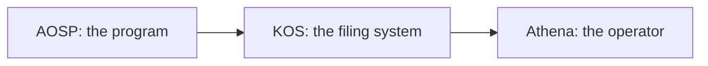
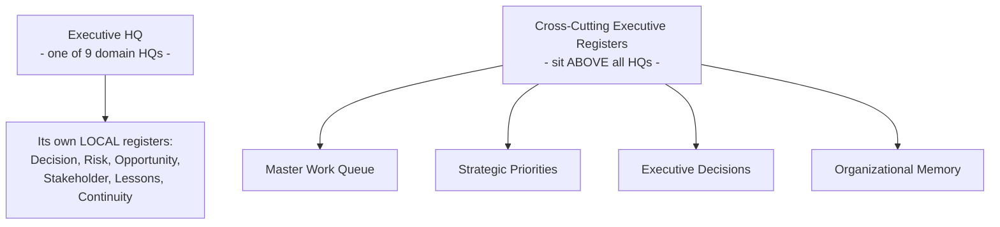
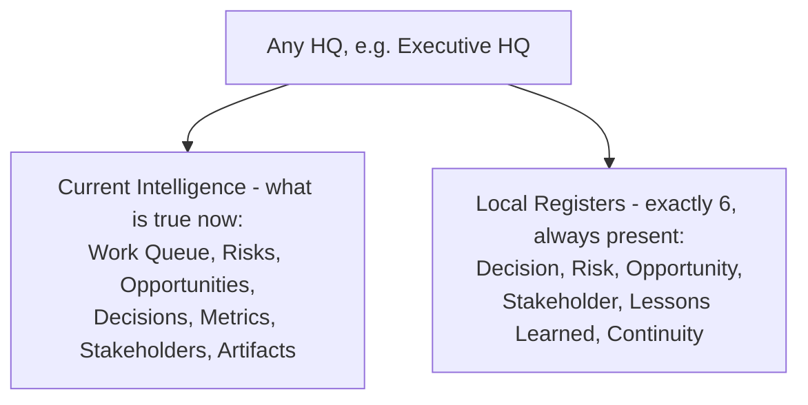
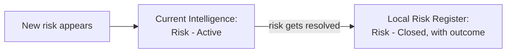
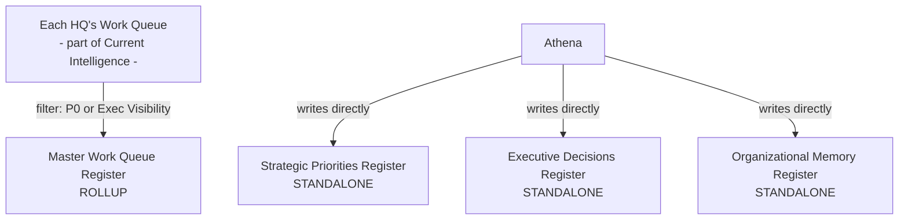
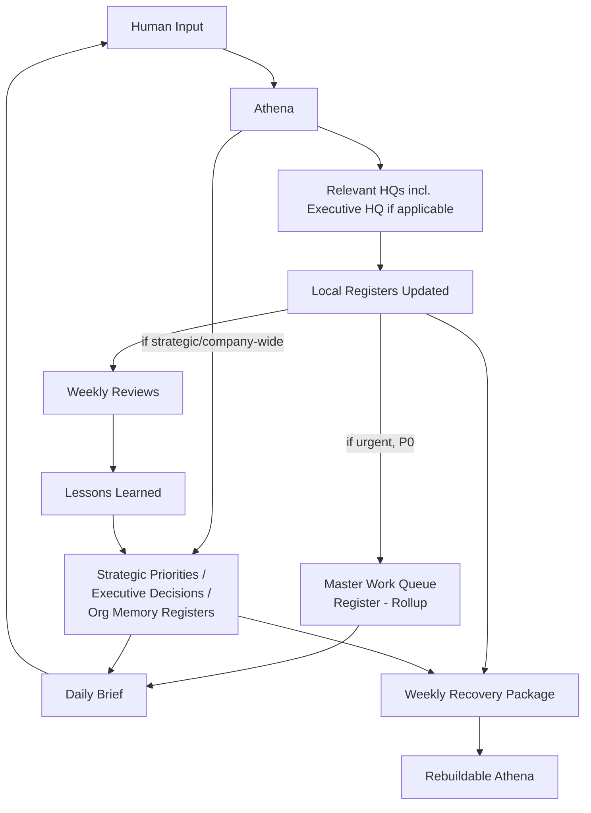
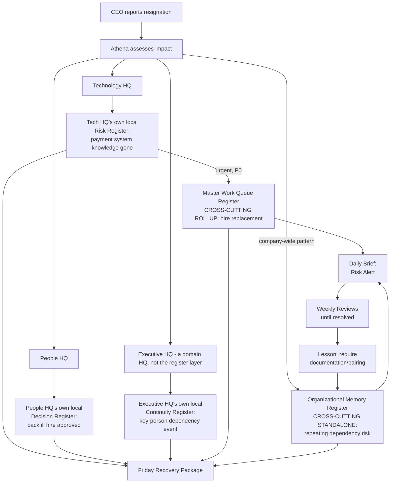
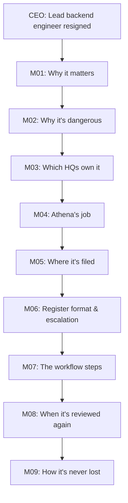

# AOSP / KOS / Athena — Consolidated Reference

*A brief, complete summary of everything discussed and agreed.*

---

## PART 1 — Overall Understanding & Definitions

### The Core Idea
Keehoo is building an organizational intelligence system so that knowledge, decisions, and context don't live only in people's heads — they survive people leaving, teams changing, and even the AI itself being rebuilt.

### The Three Big Terms

| Term | What it is | Simple analogy |
|---|---|---|
| **AOSP** | The overall program — Athena Operating System Program | The blueprint for the whole system |
| **KOS** | Keehoo Operating System — the operating framework (HQs + Registers) | The actual filing cabinets |
| **Athena** | The Chief of Staff / intelligence layer that runs within KOS | The person who does the filing |

### Other Key Definitions

| Term | Definition |
|---|---|
| **HQ (Headquarters)** | A labeled container for one domain of knowledge (Product, Revenue, People, Executive, etc.). Not a department — a "memory keeper" for that topic. |
| **Register** | A running list of history/memory. Two kinds exist — **Local** (inside one HQ) and **Cross-Cutting** (above all HQs). See the disambiguation box below. |
| **Recovery Package** | A weekly full backup of everything (Definition + all HQs + Registers). |
| **Delta Package** | A daily log of only what changed since the last backup. |

### ⚠️ Important Disambiguation — "Executive" Is Used Two Different Ways

This is a common point of confusion, so it's called out explicitly, up front:

| Term | What it actually is | Registers it has |
|---|---|---|
| **Executive HQ** | One of the **9 domain HQs** — just like Product HQ or Revenue HQ, except its domain is company-wide strategic direction. It has its own **local** registers, same structure as every other HQ. | Its own local: Decision, Risk, Opportunity, Stakeholder, Lessons Learned, Continuity |
| **Executive Registers** (a.k.a. Cross-Cutting Registers) | Four **separate, company-wide registers** that sit **above all HQs** — not owned by Executive HQ, not owned by any single HQ. Fed by/visible to every HQ. | Master Work Queue · Strategic Priorities · Executive Decisions · Organizational Memory |

**Rule of thumb used throughout this document:** whenever "Executive HQ" is meant, it's written in full as *"Executive HQ"*. Whenever the 4 company-wide registers are meant, they're called *"Cross-Cutting Registers"* — never just "Executive Registers" alone, to avoid the collision.

### Who Gives Input
**Only a human.** There is no automated data feed (no CRM, email, or Slack integration in this design). Someone tells Athena a fact, in plain conversation, and Athena decides what to do with it.

---

## PART 2 — Complete Architecture

*(Following the actual chronology of how one piece of information flows through the system.)*

### 2.1 The Nine HQs
Executive · Product · Revenue · People · Technology · Operations · Governance · Work Queue · Athena HQ (coordinates the rest)

Every HQ — including Executive HQ — has the **same internal structure**: Current Intelligence + Local Registers. No HQ is structurally special, except Athena HQ (which coordinates the others rather than owning a business domain).

### 2.2 Step 1 — What Every HQ Contains

| Current Intelligence (what's active now) | Local Registers (historical memory — exactly 6) |
|---|---|
| Work Queue | Decision Register |
| Risks (active) | Risk Register |
| Opportunities (active) | Opportunity Register |
| Metrics / KPIs | Stakeholder Register |
| Stakeholder Intelligence | Lessons Learned Register |
| Active Artifacts | Continuity Register |

### 2.3 Step 2 — What "Current Intelligence" Actually Means

**Current Intelligence answers: "What is true right now?"**
**Local Registers answer: "What happened before, and what did we learn?"**

Think of it like a doctor's file: Current Intelligence = today's vitals and active symptoms; Registers = the full medical history.

| Component | What it tracks | Example |
|---|---|---|
| Work Queue | Open work, active initiatives | "Hire backend replacement — in progress" |
| Risks | Active/emerging risks | "Payment system knowledge gap — still open" |
| Opportunities | Live growth/strategic opportunities | "New enterprise client interested" |
| Decisions | Open/pending decisions | "Outsource the hire or promote internally?" |
| Metrics/KPIs | Current performance numbers | "Deployment frequency this month" |
| Stakeholder Intelligence | Who matters now, current sentiment | "CTO candidate — 2nd round interview" |
| Active Artifacts | Documents/initiatives in active use | "Draft job description" |

**The lifecycle — how something moves from Current Intelligence into a Local Register:**

**Is this a duplicate, or just a view?** Neither — it's a **lifecycle transition**. The same risk exists in only **one place at a time**: while open, it lives in Current Intelligence only; once resolved, it moves into the Local Register and drops out of Current Intelligence. This is different from the Cross-Cutting rollup case below, where the local and company-wide copies *do* coexist as a live filtered mirror.

| Relationship | Type | Do both copies exist at once? |
|---|---|---|
| Current Intelligence → Local Register | Lifecycle transition (archival) | No — it moves, doesn't duplicate |
| Local Work Queue → Master Work Queue Register | Live rollup/view | Yes — same active item, filtered visibility |

*(Note: the lifecycle model is a reasonable inference from M05's wording, not stated with 100% explicit precision in the source text — worth periodic reconciliation via P16 HQ Consistency Review.)*

### 2.4 Step 3 — The Four Cross-Cutting Registers (Not "Inside" Any HQ)

Only **one** of the four is a rollup of HQ data. The other three are standalone — written directly by Athena because their content doesn't originate in any single HQ (including Executive HQ) to begin with.

| Register | Type | Why |
|---|---|---|
| **Master Work Queue Register** | 🔄 Rollup (filtered view) | Same data as each HQ's Work Queue (part of Current Intelligence), filtered by `P0` / `Executive Visibility = Yes` — no duplication |
| **Strategic Priorities Register** | 🏛️ Standalone | Priorities span multiple HQs by nature — written directly by Athena/leadership |
| **Executive Decisions Register** | 🏛️ Standalone | Decisions made at CEO/executive level don't belong to one HQ |
| **Organizational Memory Register** | 🏛️ Standalone | Captures cross-cutting lessons that don't fit any single HQ |

**Reminder:** none of these four live inside Executive HQ. They sit above *all* HQs, Executive HQ included.

### 2.5 Step 4 — Athena's Role
Athena sits **above** all HQs and the Cross-Cutting Registers. She doesn't store memory herself — she reads input, decides HQ impact, writes register entries, escalates what matters, runs weekly reviews, and triggers backups.

> **Constitutional rule:** *HQ Intelligence = System of Record. Athena is not the system.* Everything must be written down — because Athena (the AI instance) can be lost; the HQs/Registers cannot.

### 2.6 Step 5 — The Full Flow, End to End

### 2.7 Step 6 — Recovery Principle
> **Athena Definition + HQ Intelligence + Delta Packages = Recoverable Athena**

If Athena is ever wiped, a new instance loads the Definition (M01–M09), the latest Recovery Package, and any Delta Packages since — and knows everything, with no human re-explaining anything.

---

## PART 3 — The Example

### Scenario
> CEO tells Athena: *"Our lead backend engineer resigned today. He was the only one who understood our payment system."*

### Walking Through It

| Step                                 | What Happens                                                                                                                                                                                                                                  |
| ------------------------------------ | --------------------------------------------------------------------------------------------------------------------------------------------------------------------------------------------------------------------------------------------- |
| 1. Input                             | CEO reports the resignation — plain conversation, no form                                                                                                                                                                                     |
| 2. HQ Impact                         | Athena identifies 3 affected HQs: Technology, People, **Executive** (the domain HQ)                                                                                                                                                           |
| 3. Current Intelligence updated      | Technology HQ's **Work Queue** gets a new active item: "Hire backend replacement"                                                                                                                                                             |
| 4. Local Registers updated           | Technology HQ's own local **Risk Register**; People HQ's own local **Decision + Stakeholder Register**; **Executive HQ's own local Continuity Register** (not a cross-cutting register — just Executive HQ's local one, same as any other HQ) |
| 5. Escalation to Cross-Cutting layer | **Master Work Queue Register** (rollup, from the active Work Queue item) gets the urgent hiring task; **Organizational Memory Register** (standalone) flags the repeating pattern — neither of these lives inside Executive HQ                |
| 6. Daily Brief                       | CEO sees only: "Risk Alert — payment system knowledge gap, hiring in progress"                                                                                                                                                                |
| 7. Weekly Rhythm                     | Tracked until the replacement is hired and knowledge transferred                                                                                                                                                                              |
| 8. Resolution                        | Once the hire is made, the Work Queue item closes (leaves Current Intelligence) and the Risk Register entry is marked "Closed"                                                                                                                |
| 9. Learning                          | Lesson preserved in Lessons Learned Register: "Require documentation/pairing for all critical systems"                                                                                                                                        |
| 10. Recovery                         | Friday's backup captures the whole story — if Athena were rebuilt tomorrow, she'd know it instantly                                                                                                                                           |

### Why This Example Covers the Whole System
Human input → Athena's judgment → multiple HQs (including Executive HQ as just one domain among nine) → local registers → both types of Cross-Cutting registers (rollup + standalone) → filtered executive visibility → ongoing review → organizational learning → guaranteed recoverability.

---

## PART 4 — M01–M09 Walked Through One Example

Using the same engineer-resignation example, here's exactly what each foundational document contributes:

| Doc | Role in this event |
|---|---|
| **M01 — Vision** | Explains *why this matters*: this is the "leadership/key-person becomes a knowledge repository" problem the whole program exists to prevent |
| **M02 — Continuity Strategy** | Explains *why it's dangerous*: "knowledge trapped in individuals" is a named continuity risk — this resignation is a direct trigger |
| **M03 — HQ Vision** | Explains *why we split it by domain*: Technology, People, and Executive HQs each get explicit ownership instead of one big pile |
| **M04 — Constitution** | Defines *Athena's job*: must assess, synthesize, and write it down — "HQ Intelligence = System of Record, Athena is not the system" |
| **M05 — HQ Architecture** | Defines *exactly where it's filed*: active hiring task → Current Intelligence; risk history → Local Risk Register |
| **M06 — Register Framework** | Defines *register format and escalation rules*: required fields (Risk ID, Severity, Owner), and the check for Master Work Queue escalation |
| **M07 — Operating Model** | Defines *the step-by-step workflow*: Assess → Consult Expertise → Synthesize → Update HQ/Registers → Recommend |
| **M08 — Operational Rhythm** | Defines *when it's revisited*: appears in tomorrow's Daily Brief, tracked in Weekly Reviews until resolved |
| **M09 — Persistence & Recovery** | Defines *how it's never lost*: captured in Friday's Recovery Package, recoverable even if Athena is rebuilt from scratch |

---

## Summary

**A person says something → Athena decides what it means and where it belongs → it's written into the right HQ's local registers (Executive HQ's own local registers, if that's the affected domain) → if serious, it's rolled up (Work Queue) or written directly (Priorities/Decisions/Memory) into the separate Cross-Cutting layer → leadership sees only what matters → it's reviewed weekly until resolved → the lesson is kept forever → and none of it depends on any one person, or any one Athena instance, remembering it.**

---
*Consolidated from AOSP project documents (M01–M09, DEC-001–006, P01–P33) and full conversation history. Open directly in Obsidian — all diagrams render natively in Reading/Live Preview mode.*
