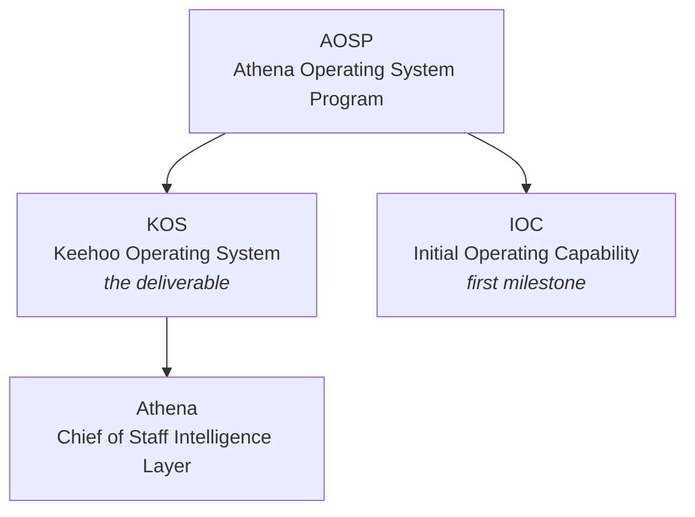

# Athena Operating System Program (AOSP)

> **Program North Star:** Persistent Executive Intelligence System

This folder is the markdown source of truth for AOSP artifacts, converted from the original `.docx` files (kept alongside, unchanged).

## Naming Convention (per AOSP-DEC-001)

These terms are **not** interchangeable:

| Term       | Role                                                             |
| ---------- | ---------------------------------------------------------------- |
| **AOSP**   | The Program (overarching initiative)                             |
| **KOS**    | The Operating System (primary program deliverable)               |
| **Athena** | Chief of Staff Intelligence Layer (operates within KOS)          |
| **IOC**    | Initial Operating Capability (first major operational milestone) |

> **Note:** Artifacts authored before DEC-001 (2026-06-22) may carry a `KOS-` prefix internally (e.g. M01 titles itself "KOS-M01"). Canonical IDs are `AOSP-Mxx`; historical prefixes are noted in each file's front matter.

## Milestones

### Phase 1 — Foundation 🟢 Complete

| ID  | Deliverable                | Markdown                                                                           |
| --- | -------------------------- | ---------------------------------------------------------------------------------- |
| M01 | Vision Definition          | [modules/AOSP-M01-vision-definition.md](modules/AOSP-M01-vision-definition.md)     |
| M02 | Continuity Strategy        | [modules/AOSP-M02-continuity-strategy.md](modules/AOSP-M02-continuity-strategy.md) |
| M03 | HQ Vision                  | [modules/AOSP-M03-hq-vision.md](modules/AOSP-M03-hq-vision.md)                     |
| M04 | Athena Constitution (v2.0) | [modules/AOSP-M04-athena-constitution.md](modules/AOSP-M04-athena-constitution.md) |
| M05 | HQ Architecture (v2.0)     | [modules/AOSP-M05-hq-architecture.md](modules/AOSP-M05-hq-architecture.md)         |
| M06 | Register Framework         | [modules/AOSP-M06-register-framework.md](modules/AOSP-M06-register-framework.md)   |

### Phase 2 — IOC 🟢 Approved

| ID | Deliverable | Markdown |
|---|---|---|
| M07 | Athena Operating Model | [modules/AOSP-M07-athena-operating-model.md](modules/AOSP-M07-athena-operating-model.md) |
| M08 | Operational Rhythm | [modules/AOSP-M08-operational-rhythm.md](modules/AOSP-M08-operational-rhythm.md) |
| M09 | Persistence & Recovery Architecture | [modules/AOSP-M09-persistence-recovery-architecture.md](modules/AOSP-M09-persistence-recovery-architecture.md) |
| M10 | IOC Certification | _not yet authored_ |

## Approved Decisions

| ID | Decision | Markdown |
|---|---|---|
| DEC-001 | Program Naming and Structural Definition | [decisions/AOSP-DEC-001-program-naming.md](decisions/AOSP-DEC-001-program-naming.md) |
| DEC-002 | Checkpoint, Artifact and Persistence Framework | [decisions/AOSP-DEC-002-checkpoint-artifact-persistence.md](decisions/AOSP-DEC-002-checkpoint-artifact-persistence.md) |
| DEC-003 | Athena Advisory & Intelligence Processing Framework | [decisions/AOSP-DEC-003-advisory-intelligence-processing.md](decisions/AOSP-DEC-003-advisory-intelligence-processing.md) |
| DEC-004 | Athena Transparency Standard | [decisions/AOSP-DEC-004-transparency-standard.md](decisions/AOSP-DEC-004-transparency-standard.md) |
| DEC-005 | Chief of Staff Holistic Responsibility Principle | [decisions/AOSP-DEC-005-holistic-responsibility.md](decisions/AOSP-DEC-005-holistic-responsibility.md) |
| DEC-006 | Self-Contained Recovery Package Principle | [decisions/AOSP-DEC-006-self-contained-recovery-package.md](decisions/AOSP-DEC-006-self-contained-recovery-package.md) |
| DEC-007 🔵 | Consistency Reconciliation (Draft — approval pending) | [decisions/AOSP-DEC-007-consistency-reconciliation.md](decisions/AOSP-DEC-007-consistency-reconciliation.md) |

## Prompt Library

33 prompts (P01–P33) covering: creation/bootstrap/recovery (P01–P04), daily rhythm (P05–P08), reviews (P09–P13), HQ management (P14–P18), packages & validation (P19–P21), governance (P22–P24), improvement (P25–P29), and IOC (P30–P33).

→ **[Full catalog with lifecycle map](prompts/README.md)**

## Open Items 🔴

1. **KOS-DEC-001 — IOC Definition and Program Direction** is referenced by DEC-001 as a Program Anchor Artifact but is missing from the repository — locate or formally supersede.
2. **M07 title** — DEC-001's roadmap says "Operations Manual"; the artifact is "Athena Operating Model" — confirm on next DEC-001 revision.
3. **DEC-007 approval** — cross-artifact amendments (advisor supersession, M01–M09 scope, status splits, HQ current/target split, DEC-005 table fix) are applied in this markdown corpus and await CEO approval; source `.docx` files are unchanged.

## Artifact Status Legend

| Symbol | Meaning |
|---|---|
| 🟢 | Approved |
| 🟡 | Discussion In Progress |
| 🔵 | Proposed |
| 🟣 | Future Consideration |
| 🔴 | Open |
| ⚫ | Deprecated / Superseded |
