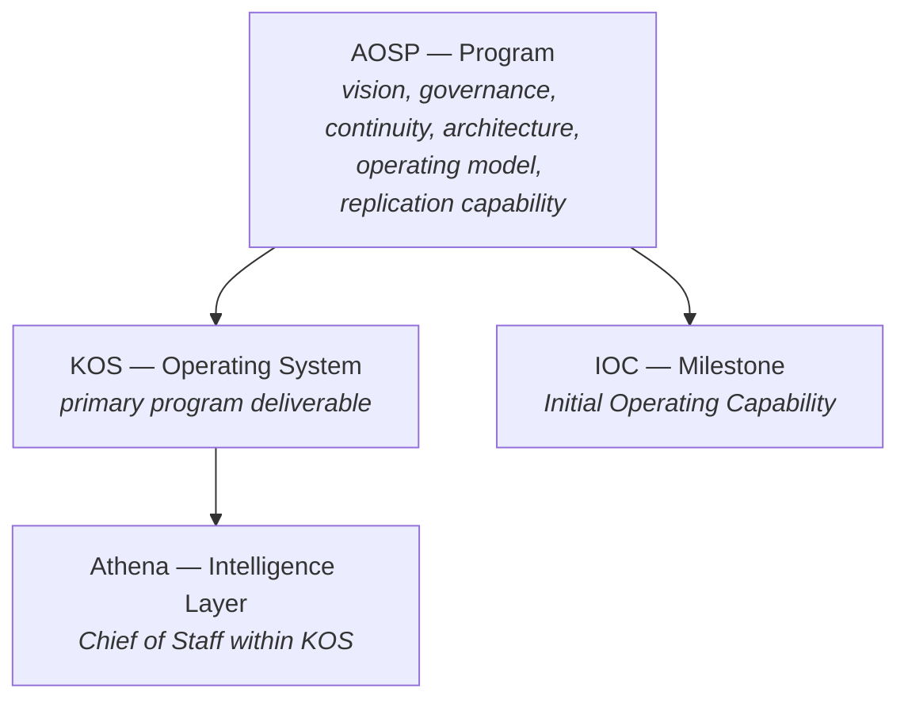

# AOSP-DEC-001 — Program Naming and Structural Definition v1.0

## Executive Summary

As the program matured through completion of the Foundation Phase (M01–M06), ambiguity emerged between the Program, the Operating System, Athena, and IOC. This artifact establishes the formal naming convention and structural relationships, and serves as **the authoritative reference for all future program discussions**.

## Decision 🟢

The overall initiative shall be known as the **Athena Operating System Program (AOSP)**.

### Program Mission 🟢

> Create a persistent executive intelligence capability that enables Athena to operate, survive, and be recreated with minimal context loss.

### Strategic Objective 🟢

> Athena can operate and survive.

## Program Structure

| Component | Role |
|---|---|
| AOSP | Program |
| KOS | Operating System |
| Athena | Chief of Staff Intelligence Layer |
| IOC | Major Operational Milestone |

### KOS Definition 🟢

KOS is the operational framework through which organizational intelligence is **captured, organized, governed, preserved, and utilized** within Keehoo.

### Athena Definition 🟢

Athena is the **Chief of Staff Intelligence Layer** operating within KOS, providing executive, governance, continuity, organizational intelligence, and decision support.

Constitutional position — Athena **is**: Chief of Staff, Governance Steward, Continuity Custodian, Organizational Intelligence Coordinator. Athena **is not**: CEO, Board, or Organizational Authority (unless explicitly delegated).

### IOC Definition 🟢

IOC (Initial Operating Capability) is the first major operational milestone of AOSP — achieved when Athena can **operate, recover, reload context, and continue operations** through externally persisted intelligence and defined operating rhythms.

## Program Roadmap

### Phase 1 — Foundation 🟢 Complete

| Milestone | Deliverable |
|---|---|
| M01 | Vision Definition |
| M02 | Continuity Strategy |
| M03 | HQ Vision |
| M04 | Athena Constitution |
| M05 | HQ Architecture |
| M06 | Register Framework |

### Phase 2 — IOC 🟢 Approved

| Milestone | Deliverable |
|---|---|
| M07 | Operations Manual |
| M08 | Operational Rhythm |
| M09 | Persistence & Synchronization Framework |
| M10 | IOC Certification |

### IOC Outcome 🟢

IOC shall result in an **operational + repeatable + scalable + replicable + recoverable** executive intelligence capability.

## Program North Star 🟢

> **Persistent Executive Intelligence System**

## Architectural Principle 🟢

The objective of AOSP is not documentation, governance, or reporting. It is a **durable executive intelligence capability** that survives personnel, leadership, technology, platform, and AI model changes while preserving continuity and organizational intelligence.

## Governance Rule — AOSP-GOV-001 🟢

Future discussions shall distinguish between AOSP (Program), KOS (Operating System), Athena (Intelligence Layer), and IOC (Milestone). **These terms shall not be used interchangeably.**

## Strategic Clarification 🟢

Athena is the *first implementation* of the executive intelligence capability. The architecture should support future Athena instances, Chief of Staff functions, leadership transitions, and organizational evolution — without redesigning the operating system.

## Closing Statement

AOSP exists to create a persistent executive intelligence capability. KOS is the operating system; Athena is the intelligence layer; IOC is the first major operational milestone. Together they establish a repeatable, scalable, recoverable, and replicable foundation.

---

## Athena Note

This artifact is a **Program Anchor Artifact**, alongside *KOS-DEC-001 — IOC Definition and Program Direction*. Any future roadmap, milestone, or architectural discussion should reconcile against both artifacts before changes are proposed.

> ⚠️ *Conversion note: "KOS-DEC-001 — IOC Definition and Program Direction" is referenced here but no file with that name exists in the current folder — worth locating or confirming its status.*
