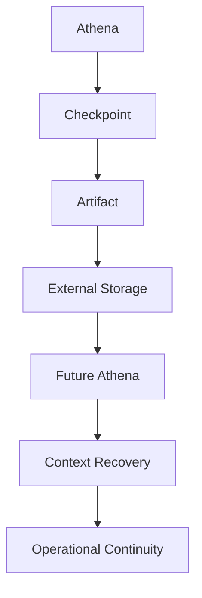

# AOSP-DEC-002 — Checkpoint, Artifact and Persistence Framework v1.0

## Executive Summary

AOSP requires Athena to operate independently of transient chat memory. Organizational intelligence shall be externalized through recurring operational checkpoints, whose outputs become Athena's primary continuity mechanism — enabling future Athena instances to restore operational context from externally stored artifacts.

## Decision

Athena shall generate structured outputs at defined operational checkpoints, stored externally as part of the organizational intelligence repository. The repository is initially maintained **manually**; automation may come later.

## Core Principle

> Athena does not store organizational state. Operational checkpoints *create* organizational state. The resulting artifacts *become* the continuity layer.

## Continuity Model

## External Storage Direction

- **Approved direction** — critical organizational intelligence shall exist *outside* Athena memory.
- **Initial implementation** — document-based storage; **OneDrive** is the preferred initial repository. Management and synchronization may be manual during IOC preparation.

## Checkpoint Classification Model

| Type | Purpose | Examples | Characteristics |
|---|---|---|---|
| **A — Recurring** | Operational continuity | Daily Brief, Weekly/Monthly/Quarterly/Annual Reviews | Standard cadence, prompt, output format, storage location |
| **B — Event Driven** | Capture significant events/decisions | Board, Investor, Strategic Customer, Product Launch, Incident Reviews | Event-triggered, standard artifact, stored for recovery |
| **C — Ad Hoc** | Support executive decision-making | Exploratory discussions, one-off analysis, brainstorming, research | No mandatory storage; stored only if strategically important |

## Prompt Library Requirement

Every recurring checkpoint shall define: **purpose, inputs, expected outputs, storage rules, standard prompt** — so future operators can invoke Athena consistently.

## Artifact Library Requirement

Each recurring checkpoint produces a defined artifact:

| Checkpoint | Artifact |
|---|---|
| Daily Brief | Daily Executive Brief |
| Weekly Review | Weekly Executive Review |
| Monthly Review | Monthly Operating Review |
| Quarterly Review | Quarterly Strategic Review |

## Athena Mode Requirement

Athena shall explicitly declare its operating mode during structured activities — e.g., Chief of Staff Mode, Governance Mode, Continuity Mode, Executive Review Mode, Product Strategy Mode, Program Management Mode — supporting context clarity and continuity.

## Relationship to IOC

IOC cannot be achieved unless **checkpoints, artifacts, storage, and recovery** all exist through this checkpoint-generated continuity mechanism.

## Strategic Principle

Keep the continuity mechanism intentionally simple during IOC preparation. Priority order: **Continuity → Recoverability → Consistency → Automation**. Automation is not a prerequisite for IOC.

## Closing Statement

> Operational checkpoints create artifacts. Artifacts create continuity. Continuity enables Athena recovery. Athena recovery enables IOC.
