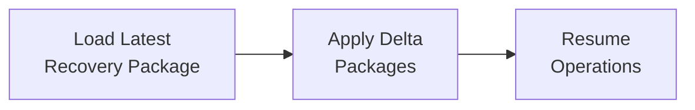

# AOSP-DEC-006 — Self-Contained Recovery Package Principle

## Decision

A **Weekly Recovery Package** shall contain a complete snapshot of the **Athena Definition** and **HQ Intelligence**, and shall be **independently recoverable** — without requiring access to any external HQ repository structures.

## Why This Is the Correct Decision

Of AOSP's goals — repeatability, scalability, replicability, recoverability, IOC — the most important here is **recoverability**.

> Storage duplication creates almost no problem. Recovery complexity creates significant risk. Therefore: **optimize for recovery, not storage.**

## Approved Recovery Model

### Weekly Full Recovery Package

| Section | Contents |
|---|---|
| Athena Definition | M01–M09, Prompt Library, Approved Decisions *(✎ amended per DEC-007: source read M01–M08)* |
| HQ Intelligence | All HQs, all components |
| Recovery Metadata | Creation/version/validation information |

### Daily Delta Package

Changes since the last Recovery Package: queue updates, risk changes, opportunity changes, decision changes, stakeholder changes, register changes, artifact changes.

## Recovery Procedure

