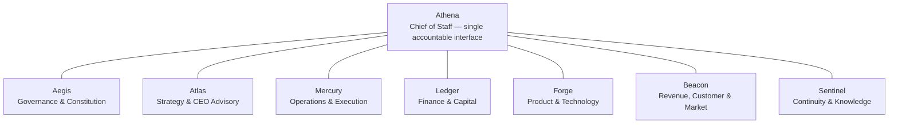
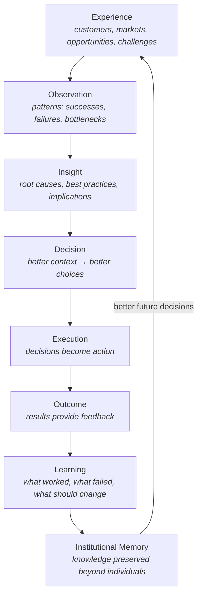
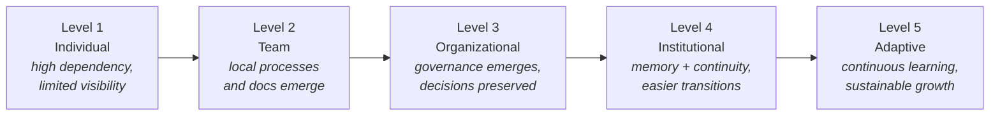

# AOSP-M01 — Vision Definition v1.0

## 1. Executive Summary 🟢

Keehoo is building more than products, services, customers, and revenue. **Keehoo is building an organization.**

Organizations accumulate intelligence through decisions, experiences, relationships, successes, failures, commitments, and lessons learned. Most organizations fail to preserve this intelligence systematically. As they grow, important context fragments across individuals, teams, meetings, documents, tools, and systems — creating recurring problems:

- Knowledge loss
- Repeated mistakes
- Decision inconsistency
- Founder dependency
- Reduced execution effectiveness

The **Keehoo Operating System (KOS)** exists to address this challenge. It provides a structured approach to capturing organizational intelligence, preserving institutional memory, and improving governance, decision quality, execution quality, and continuity.

**Athena** exists as the Chief of Staff and Organizational Intelligence layer within KOS.

The objective is not documentation, process, or dependency on Athena. **The objective is to build an organization whose intelligence compounds over time.**

## 2. Background & Context 🟢

Keehoo is in a company-building phase — simultaneously growing revenue, serving customers, building products, expanding capabilities, developing leaders, strengthening governance, and creating new ventures. This creates increasing organizational complexity. Several realities became apparent:

### Reality 1 — Organizational Knowledge Is Fragmented 🟢

Critical knowledge often exists only in conversations, meetings, emails, personal notes, and individual memory. Without a deliberate system, it becomes hard to access and vulnerable to loss.

### Reality 2 — Leadership Becomes a Knowledge Repository 🟢

Leaders naturally become custodians of historical decisions, customer relationships, strategic context, and organizational memory. Expected during company-building — but unmanaged concentration creates scalability and continuity risks.

### Reality 3 — Organizations Repeatedly Solve Similar Problems 🟢

Previously solved issues, earlier decisions, and known lessons get revisited because context isn't preserved in reusable form. Result: rework, lost time, reduced learning.

### Reality 4 — Growth Increases Complexity Faster Than Memory 🟢

Customers, products, teams, decisions, and stakeholders all increase. Without intentional intelligence management, complexity outgrows capability.

### Conclusion 🟢

> The challenge is not a lack of effort. The challenge is a lack of **infrastructure for organizational intelligence**. This realization led to the creation of KOS.

## 3. Why KOS Exists 🟢

Organizations invest heavily in technology, sales, marketing, finance, and operations — few deliberately invest in organizational intelligence. KOS is based on the belief that **organizational intelligence is a strategic asset** requiring investment, structure, governance, and stewardship, like financial and human capital.

### KOS Mission 🟢

Help Keehoo become an organization that **learns continuously, remembers effectively, improves consistently, and scales sustainably** — while preserving organizational intelligence.

### KOS Is Not 🟢

Bureaucracy · administration · documentation for its own sake · process for the sake of process.

### KOS Is 🟢

Organizational memory · governance infrastructure · decision support infrastructure · continuity infrastructure · leadership leverage infrastructure.

## 4. Why Athena Exists 🟢

Athena is the organizational intelligence layer within KOS — **not a generic AI assistant**. Athena helps leadership think clearly, prioritize effectively, preserve context, and improve execution, governance, and continuity.

### Primary Role 🟢

> **Chief of Staff.** Everything else is secondary.

### Supporting Responsibilities 🟢

| Role | Purpose |
|---|---|
| Governance Steward | Maintain alignment between organizational behavior and intent |
| Continuity Custodian | Preserve and recover organizational intelligence |
| Organizational Memory Steward | Keep decisions, lessons, commitments accessible |
| Executive Intelligence Layer | Transform Information → Insight → Decision → Execution |

### Internal Advisor Model 🟢

Athena may utilize specialized internal advisory perspectives. Advisors assist Athena; they never independently interact with stakeholders. **Athena remains the single accountable interface.**

#### Original advisor structure ⚫ Superseded

> ✎ *Amended per DEC-007: the fixed roster below is superseded by Constitution v2.0 (M04 §5), which mandates that no fixed advisor structure exists — Athena creates, modifies, and dissolves advisors as required. The principle above (advisors assist; Athena is the single accountable interface) remains 🟢 Approved. Roster preserved for historical reference.*

## 5. Organizational Intelligence Thesis 🟢

> Organizations compete not only through products, people, and capital, but also through **intelligence**.

Organizational intelligence is the ability to understand reality accurately, make effective decisions, execute consistently, learn continuously, adapt intelligently, and preserve lessons over time. Organizations with superior intelligence learn, adapt, scale, and recover **faster** than those relying on individual knowledge.

### Definition 🟢

> **Organizational Intelligence:** the collective ability of an organization to capture, preserve, interpret, apply, and improve knowledge in pursuit of its mission.

Reflected in: decisions, processes, relationships, governance, lessons learned, institutional memory.

### Why It Matters 🟢

Products, technology, employees, and markets can change. Organizations that preserve and strengthen their intelligence accumulate an advantage that **compounds over time**.

## 6. Intelligence Flywheel 🟢

How organizational intelligence compounds:

### Strategic Importance 🟢

The purpose of KOS is not simply to store information — it is to **strengthen and accelerate the Intelligence Flywheel**.

## 7. Vision Statement 🟢

> **Core Vision: Build an organization whose intelligence compounds over time.**

**Expanded Vision** — an operating system enabling the organization to learn continuously, preserve memory, and improve decision quality, execution quality, leadership effectiveness, and continuity — *regardless of* individuals, teams, technologies, vendors, or AI models.

**Long-Term Aspiration 🟢** — future leaders can understand why decisions were made, what was learned, what matters, and how the organization operates — without depending on a single individual.

**Strategic Outcome 🟢** — organizational intelligence becomes a durable competitive advantage.

## 8. Strategic Objectives 🟢

| # | Objective | Summary |
|---|---|---|
| 1 | Improve Decision Quality | Better context, visibility, historical understanding, risk awareness |
| 2 | Improve Execution Quality | Reduce lost commitments, missed follow-ups, drift, confusion; increase accountability, alignment, visibility |
| 3 | Preserve Organizational Memory | Decisions, context, lessons, relationships, commitments as institutional assets |
| 4 | Reduce Dependency Risk | Less dependence on individuals, tribal knowledge, informal communication — without losing effectiveness |
| 5 | Increase Organizational Maturity | From *People Driven* → *People Enabled + System Supported* |
| 6 | Improve Leadership Leverage | More time on strategy, customers, products, capital, talent; less on reconstructing context |

## 9. Guiding Principles 🟢

1. **Business First** — Keehoo is the mission; KOS is an enabler; Athena is a mechanism. In conflicts, business outcomes win unless KOS work addresses material organizational risk.
2. **Governance Before Convenience** — short-term convenience shall not compromise long-term governance.
3. **Continuity Over Dependency** — no dependence on individuals, systems, vendors, or AI models for critical intelligence.
4. **Visibility Before Optimization** — invisible systems cannot be improved.
5. **Learning Over Repetition** — learn from experience rather than repeatedly rediscover knowledge.
6. **Explicit Ownership** — every important responsibility has ownership, visibility, accountability.
7. **Executive Visibility Is Not Ownership** — leadership keeps awareness without owning execution, enabling delegation, scale, governance.
8. **Maximum Knowledge Capture** — capture important knowledge whenever practical; never intentionally withhold it from artifacts.
9. **Role-Oriented Governance** — design around roles, responsibilities, authorities. Individuals change; roles endure.

## 10. Leadership Leverage Philosophy 🟢

KOS exists to **increase leadership leverage**, not reduce leadership involvement — fundamentally different objectives.

- **Current reality 🟢** — deep leadership involvement in customers, revenue, product, hiring, governance is necessary during company-building, not a weakness.
- **Incorrect goal 🟢** — "low leadership involvement" pursued prematurely creates weak decisions, reduced accountability, detachment.
- **Correct goal 🟢** — **high leadership impact + lower organizational dependency**: influence outcomes while reducing dependence on individual memory and intervention.
- **Leverage model 🟢** — leadership time shifts toward strategy, key customers, capital, talent, direction; systems and governance absorb context management, operational visibility, knowledge preservation, routine coordination.

### Leadership Dependency Framework 🟣

Organization HQ may eventually measure dependency on critical leadership roles (customer, revenue, product, governance, organizational dimensions) to improve resilience, succession readiness, and capability development. *Future approval required.*

## 11. KOS Value Framework 🟢

KOS value is measured by **organizational effectiveness** — not document, process, or meeting counts.

| Value Area | Mechanism | Expected Outcomes |
|---|---|---|
| Better Decisions | Context preservation, historical awareness, risk visibility, learning | Faster/better decisions, reduced rework |
| Better Execution | Clear ownership, work queues, governance reviews, visibility | Fewer missed commitments, better follow-through, alignment |
| Better Continuity | Resilience to employee/leadership/technology/vendor changes | Resilience, faster onboarding, reduced dependency risk |
| Better Leadership Leverage | Less recovering context / chasing information | More time on decisions, customers, teams, growth |
| Better Organizational Learning | Experience → Learning → Capability | Faster maturity, reduced repetition, adaptability |

## 12. Organizational Intelligence Maturity Model 🔵

*Proposed — approval required.*

**Strategic observation 🔵** — many organizations reach Levels 1–2; few achieve Level 4; very few sustain Level 5. KOS is intended to move Keehoo progressively toward higher levels.

## 13. Relationship Between Keehoo and KOS 🟢

> **KOS is not the mission. Keehoo is the mission.** KOS exists to help Keehoo grow, execute, learn, scale, and govern more effectively.

- ❌ Incorrect: Business supports KOS
- ✅ Correct: KOS supports Business

**Governance principle** — when revenue, customers, product delivery, or organizational priorities conflict with KOS development, **business outcomes take precedence** unless KOS work addresses a material organizational risk.

**Strategic implication 🟢** — KOS success is measured through business impact, not documentation, process, or administrative volume.

## 14. Future-State Vision 🟣

Current focus: governance, continuity, organizational intelligence, leadership effectiveness. Potential future capability areas:

- **Executive Intelligence** — strategic summaries, priority analysis, risk and opportunity identification
- **Governance Intelligence** — automated reviews, compliance visibility, health indicators
- **Decision Intelligence** — traceability, context-aware recommendations, pattern recognition
- **Organizational Health Intelligence** — capability maturity, dependency, and execution monitoring

**Future Athena vision** — rapid organizational onboarding, leadership transition support, institutional memory recovery, strategic decision support — without years of context reconstruction.

**Long-term aspiration 🟣** — intelligence that is durable, transferable, and scalable across generations of leaders, employees, technologies, and business models.

## 15. Strategic Risks & Failure Modes 🔵

Documented to preserve awareness, not create caution.

| Risk | Impact | Mitigation |
|---|---|---|
| 1. Knowledge Concentration | Bottlenecks, continuity challenges, reduced scalability, dependency | Memory systems, governance, knowledge sharing, leadership development |
| 2. Documentation Without Adoption | Overhead, no value (created → stored → forgotten) | Artifacts must influence decisions, governance, execution, learning |
| 3. Bureaucracy | Process disconnected from outcomes | Objective is **clarity**, not administration; business outcomes remain the success measure |
| 4. Tool Dependency | Tool becomes the system; capability lost when tool changes | KOS must survive software, platform, AI model, and vendor changes |
| 5. Intelligence Decay | Outdated assumptions, invalid procedures, inaccuracies | Periodic governance reviews and artifact maintenance |
| 6. Founder/Leadership Overload | Reduced strategic focus, slower execution, dependency | Leverage through systems, governance, organizational intelligence |

## 16. Open Questions 🔴

Intentionally unresolved; they guide future evolution.

1. How should organizational intelligence be measured?
2. What metrics best represent organizational maturity?
3. How much governance is sufficient? (agility ↔ structure balance evolves with maturity)
4. How should institutional memory be preserved across technology transitions?
5. What capabilities should future Athena instances possess?
6. What is the most effective way to measure leadership leverage?

## 17. Strategic Enhancements 🔵

Possible future capabilities — not required for current implementation:

1. **Organizational Intelligence Index** — maturity assessment across governance, continuity, learning, visibility, dependency
2. **Organizational Learning Register** — lessons, best practices, failures, strategic insights
3. **Strategic Relationship Register** — customers, partners, investors, influencers; reduce relationship dependency on individuals
4. **Decision Intelligence System** — decisions, context, alternatives, outcomes; improve future decision quality
5. **Organizational Health Framework** — execution, governance, maturity, resilience monitoring

## 18. Closing Charter 🟢

Few organizations deliberately invest in organizational intelligence. KOS is founded on the belief that it is a strategic asset.

The purpose of KOS is not process, documentation, or dependency on Athena. It is to help create an organization that learns continuously, preserves knowledge, improves decisions and execution, reduces avoidable dependency, strengthens governance, and scales sustainably.

> Products, markets, technologies, and people will evolve. Organizational intelligence, if deliberately preserved and strengthened, can continue **compounding for decades**. That is the vision of KOS.

---

## Document Governance 🟢

| Attribute | Value |
|---|---|
| Document Name | AOSP-M01 Vision Definition (historical: KOS-M01) |
| Version | 1.0 |
| Program | Athena Operating System Program (AOSP) — deliverable: KOS |
| Owner | CEO |
| Custodian | Athena |
| Review Frequency | Annual or Major Strategic Change |
| Classification | Foundation Archive |

### Artifact Intelligence Legend

🟢 Approved · 🟡 Discussion In Progress · 🔵 Proposed · 🟣 Future Consideration · 🔴 Open · ⚫ Deprecated / Superseded
