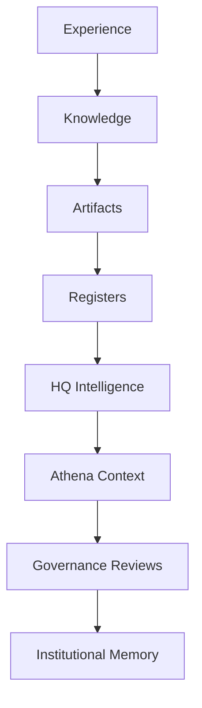
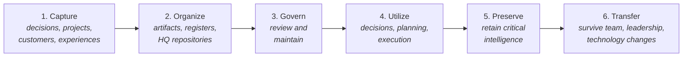
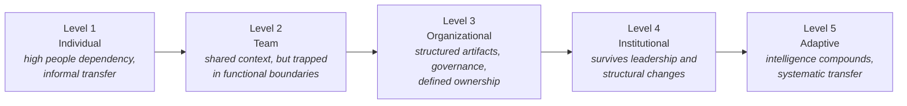

# AOSP-M02 — Continuity Strategy v1.0

> ✎ *Amended per DEC-007: the source header read "🟢 In Development" — a contradictory pairing. Following M01's two-axis pattern, this is resolved as document status 🟢 Approved (all sections carry individual approval statuses) + artifact status 🔄 Consolidation in Progress.*

## 1. Executive Summary 🟢

Organizations spend significant effort acquiring knowledge; very few spend equivalent effort preserving it. As organizations grow, critical intelligence distributes across people, teams, documents, systems, processes, and relationships. Without deliberate continuity mechanisms, organizational intelligence degrades — causing repeated mistakes, slower decisions, leadership dependency, operational disruption, and loss of institutional memory.

The Continuity Strategy ensures critical organizational intelligence survives beyond individuals, roles, teams, technologies, and AI platforms.

> The objective is not simply preservation. The objective is **continuity of organizational capability**.

## 2. Purpose of Continuity 🟢

Continuity ensures intelligence remains available when circumstances change: employee exits, leadership transitions, restructuring, product evolution, technology migration, AI model changes, growth. The organization should keep functioning effectively through significant change.

### Definition 🟢

> **Continuity:** the ability of an organization to preserve, recover, transfer, and utilize critical organizational intelligence across time and change.

### Strategic Objective 🟢

Decisions remain understandable · context remains recoverable · relationships remain visible · knowledge remains accessible · governance remains durable.

## 3. Why Continuity Matters 🟢

The visible loss of context is often small; the invisible loss is substantial.

- **Example losses 🟢** — decisions revisited repeatedly, customers re-explaining context, new leaders rediscovering old lessons, teams repeating mistakes, projects losing historical rationale.
- **Hidden cost 🟢** — reduced execution effectiveness, slower onboarding, increased dependency, reduced learning velocity. These costs **compound** over time.

## 4. Continuity Philosophy 🟢

1. **Intelligence Is a Strategic Asset** — treat knowledge as seriously as financial assets, customer relationships, IP.
2. **Preservation Is Not Enough** — continuity requires accessibility, context, governance, maintenance — not just storage.
3. **Context Matters More Than Data** — organizations rarely lose raw information; they lose meaning, rationale, relationships, decision context. KOS prioritizes context.
4. **Continuity Must Survive Technology** — software, vendor, platform, and AI model changes. Technology is an implementation layer; continuity is an organizational capability.
5. **Continuity Must Be Operational** — supporting daily execution, not existing solely for archival purposes.

## 5. What Must Survive 🟢

| Category | Includes |
|---|---|
| 1. Strategic Intelligence | Vision, mission, strategic direction, major priorities |
| 2. Governance Intelligence | Policies, principles, decision rights, escalation paths |
| 3. Organizational Intelligence | Structure, responsibilities, reporting relationships, operating rhythms |
| 4. Product Intelligence | Product decisions, architecture rationale, roadmaps, lessons learned |
| 5. Customer Intelligence | Customer history, relationship context, strategic stakeholders, commitments |
| 6. Execution Intelligence | Work queues, commitments, risks, opportunities, dependencies |

## 6. Continuity Architecture 🟢

Continuity is not achieved through documents alone but through an integrated architecture:

**Architectural objective 🟢** — intelligence remains discoverable, understandable, recoverable, transferable, and actionable across time.

## 7. HQ-Based Continuity Model 🟢

Core design decision: continuity is **not centralized** into a single repository — it is **distributed across organizational domains** via HQs.

**Why HQs exist 🟢** — HQs are custodians of domain intelligence, providing context preservation, visibility, governance, and continuity for specific areas.

### Continuity Ownership Structure 🟢

> ✎ *Note per DEC-007: this 11-HQ table is the **target model**. The current-state implementation (M09 §5) operates 6 HQs: Executive, Product, Revenue, People, Technology, Operations. HQs are added as domains mature.*

| HQ | Continuity Responsibility |
|---|---|
| Executive HQ | Strategic context |
| Revenue HQ | Revenue intelligence |
| Customer Success HQ | Customer intelligence |
| Marketing HQ | Market intelligence |
| Product HQ | Product intelligence |
| Finance HQ | Financial intelligence |
| Capital HQ | Capital intelligence |
| Organization HQ | People & capability intelligence |
| Governance HQ | Governance intelligence |
| Work Queue HQ | Execution intelligence |
| Athena HQ | Meta-intelligence & continuity coordination |

**Strategic principle 🟢** — no single person should become the sole custodian of organizational intelligence. HQs distribute continuity ownership.

## 8. Athena Continuity Model 🟢

Athena is the **coordinator** of organizational intelligence — not its owner.

**Responsibilities 🟢** — preserve context, connect information, surface risks, recover historical understanding, support leadership transitions.

### Athena Is Not the System 🟢

> Organization ≠ Athena, and Continuity ≠ Athena. Athena *supports* continuity; Athena is not continuity itself.

**Strategic reason 🟢** — future continuity must survive different AI models, providers, and technologies. **Continuity belongs to the organization, not to a tool.**

## 9. Organizational Memory Lifecycle 🔵

*Proposed.*

**Strategic principle 🔵** — knowledge that is captured but never utilized does not become organizational intelligence.

## 10. Recovery Principles 🟢

Continuity is tested when recovery is required. Scenarios: leadership transition, key employee departure, product/customer ownership change, technology or AI platform migration.

1. **Context Before Detail** — recover intent, rationale, history before detailed information.
2. **Decisions Before Documents** — *why* decisions were made matters more than recovering every document.
3. **Relationships Before Transactions** — customer and stakeholder relationships often carry more value than transactional records.
4. **Recover Capability, Not Just Information** — the objective is not "recover files"; it is **recover organizational capability**.

### Recovery Success Test 🟢

> Continuity succeeds when a new leader can rapidly understand **what matters, why it matters, what happened, what is pending, and what requires attention** — without depending on a single individual.

## 11. Continuity Risks 🔵

1. Knowledge trapped in individuals
2. Knowledge trapped in tools
3. Knowledge trapped in unmaintained documents
4. Loss of relationship intelligence
5. Loss of decision rationale
6. Continuity becoming administrative rather than operational

## 12. Continuity Maturity Model 🔵

*Proposed — approval required. Purpose is resilience, not compliance.*

**Strategic observation 🔵** — many organizations achieve Levels 1–2; few achieve Level 4; very few sustain Level 5. This strategy aims to move Keehoo progressively toward Levels 4 and 5.

## 13. Continuity Governance Framework 🟢

Without governance, continuity gradually deteriorates. **Objective:** critical intelligence remains current, accessible, relevant, recoverable.

### Governance Responsibilities

| Owner | Owns continuity of |
|---|---|
| Executive HQ | Vision, strategic direction, executive priorities |
| Governance HQ | Policies, governance decisions, escalation frameworks, organizational standards |
| Work Queue HQ | Commitments, open items, risks, opportunities, dependencies |
| Departmental HQs | Domain-specific intelligence, historical context, operational knowledge |
| Athena HQ | Coordinates continuity reviews and continuity health assessments |

### Review Cadence 🔵

| Review Type | Frequency |
|---|---|
| Executive Continuity Review | Quarterly |
| HQ Continuity Review | Quarterly |
| Artifact Review | Annual |
| Major Strategic Review | Event Driven |
| Leadership Transition Review | Event Driven |

## 14. Future-State Continuity Vision 🟣

Current focus: *preserving* intelligence. Future focus: *enabling* intelligence.

1. **Continuity Health Dashboard** — visibility into dependency risks, knowledge concentration, governance and continuity maturity
2. **Leadership Transition Readiness** — rapid onboarding of new executives, department leaders, product leaders
3. **Organizational Memory Search** — rapid discovery of decisions, context, rationale, historical lessons
4. **Multi-Generation Athena Continuity** — future Athena instances inherit organizational memory, governance context, strategic context without years of conversation reconstruction

## 15. Open Questions 🔴

1. How should continuity maturity be measured?
2. Which intelligence categories require the highest continuity protection?
3. What is the optimal balance between continuity and agility?
4. How should continuity be maintained during rapid growth?
5. What continuity capabilities should future Athena instances possess?

## 16. Strategic Enhancements 🔵

1. **Continuity Score** — health measurement across recoverability, accessibility, ownership, maintenance, transferability
2. **Knowledge Concentration Monitoring** — identify intelligence overly dependent on individuals
3. **Relationship Continuity Framework** — customer, partner, investor, strategic stakeholder relationships
4. **Transition Playbooks** — standardized support for leadership, product, and department ownership changes
5. **Continuity Risk Register** — dedicated tracking of continuity-related risks

## 17. Closing Charter 🟢

Organizations focus on acquiring knowledge; few focus on preserving it; fewer still ensure it remains useful across time and change.

> The purpose of continuity is not archival preservation. The purpose of continuity is **operational resilience**.

Intelligence must survive personnel changes, leadership transitions, technology transitions, and organizational evolution — while remaining relevant, accessible, and actionable. Continuity transforms organizational intelligence from a temporary advantage into a **durable asset**.

---

## Document Governance 🟢

| Attribute | Value |
|---|---|
| Document Name | AOSP-M02 Continuity Strategy (historical: KOS-M02) |
| Version | 1.0 |
| Program | Athena Operating System Program (AOSP) — deliverable: KOS |
| Owner | CEO |
| Custodian | Athena |
| Review Frequency | Annual or Major Organizational Change |
| Classification | Foundation Archive |

### Artifact Intelligence Legend

🟢 Approved · 🟡 Discussion In Progress · 🔵 Proposed · 🟣 Future Consideration · 🔴 Open · ⚫ Deprecated / Superseded
