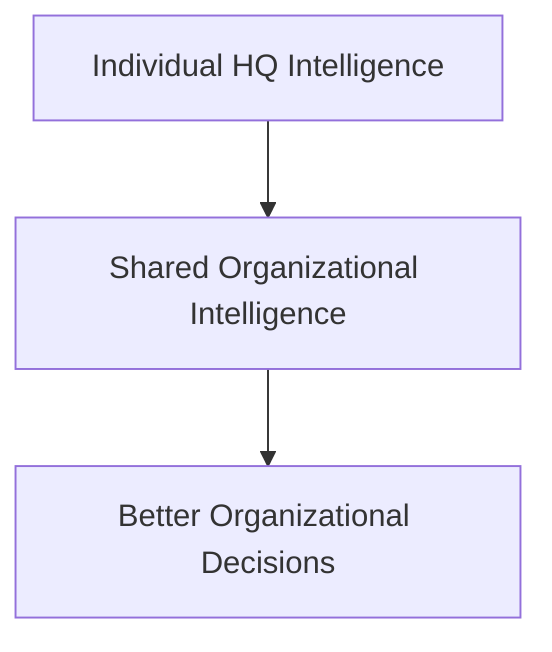
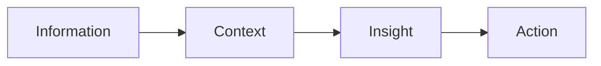
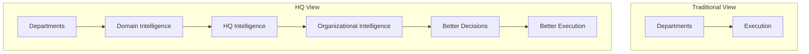
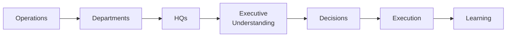
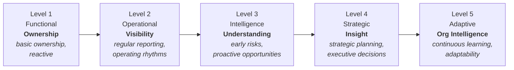

# AOSP-M03 — HQ Vision v1.0

## 1. Executive Summary 🟢

Most organizations are structured around departments, which are optimized for execution. But execution alone does not guarantee organizational intelligence, governance, continuity, or strategic alignment. As organizations grow, information fragments across departments, teams, systems, and individuals.

The **HQ Model** solves this: HQs provide explicit ownership of organizational intelligence, acting as custodians of context, governance, continuity, priorities, and performance visibility for their domains.

> The purpose of HQs is not to create another management layer. The purpose is to create **organizational clarity**.

## 2. Why HQs Exist 🟢

Every important domain accumulates intelligence — revenue accumulates customer and pipeline intelligence, finance accumulates financial intelligence, product accumulates product intelligence, governance accumulates governance intelligence. In most organizations this intelligence fragments. **HQs ensure critical intelligence has an explicit custodian.**

- **Core principle 🟢** — every critical domain should have ownership, visibility, continuity, governance.
- **Without HQs 🟢** — fragmented context, decisions lose rationale, dependencies increase, governance weakens, continuity suffers.
- **Traditional structures 🟢** — departments focus on *execution*; HQs focus on *intelligence + governance + continuity*. **Both are required.**

## 3. HQ Philosophy 🟢

HQs are not departments, teams, or organizational hierarchy. **HQs are organizational intelligence constructs.**

- **HQs do 🟢** — domain visibility, intelligence, governance, continuity, prioritization.
- **HQs do not 🟢** — increase bureaucracy, add approvals, create reporting overhead.

## 4. Relationship Between Departments and HQs 🟢

| | Departments | HQs |
|---|---|---|
| Purpose | **Execute** | **Understand · Govern · Preserve · Improve** |
| Examples | Sales, Engineering, Marketing, Finance teams | Revenue HQ, Product HQ, Governance HQ… |
| Revenue example | Generates pipeline, closes deals, manages customers | Maintains revenue intelligence and visibility, tracks risks/opportunities, supports strategic decisions |

> **Strategic observation 🟢** — departments create *activity*; HQs create *understanding*. Organizations require both.

## 5. HQ Design Principles 🟢

1. **Domain Ownership** — every critical domain has a clear custodian.
2. **Visibility Before Optimization** — you cannot improve what you cannot see.
3. **Intelligence Before Reporting** — the objective is understanding; reporting is a by-product.
4. **Continuity By Design** — every HQ contributes to organizational continuity.
5. **Governance By Design** — every HQ contributes to organizational governance.
6. **Executive Visibility Without Ownership** — leadership retains visibility while delegating execution.

## 6. The HQ Intelligence Model 🟢

Each HQ manages five categories of intelligence:

| Category       | Covers                                      |
| -------------- | ------------------------------------------- |
| 1. Operational | Current status and performance              |
| 2. Strategic   | Direction, priorities, opportunities        |
| 3. Governance  | Policies, decisions, standards              |
| 4. Continuity  | Historical context and institutional memory |
| 5. Future      | Emerging opportunities, risks, scenarios    |

## 7. Relationship Between HQs 🟢

HQs form a **connected intelligence network** — no HQ operates in isolation.

Organizational problems rarely belong to a single domain:

| Challenge | HQs Involved |
|---|---|
| Revenue Growth | Revenue, Marketing, Product, Finance |
| Customer Retention | Customer Success, Product, Revenue |
| Product Investment | Product, Finance, Capital |
| Organizational Scaling | Organization, Governance, Executive |
| Strategic Planning | Executive, Revenue, Product, Finance |

> **Strategic observation 🟢** — the value of the HQ model increases as HQs become more connected. The organization should behave as an integrated intelligence system, not isolated functions.

## 8. Executive HQ Philosophy 🟢

Executive HQ provides **strategic coherence** — the highest organizational intelligence layer, with visibility across strategy, priorities, risks, opportunities, and organizational health.

- **Is not 🟢** — task manager, decision approver, operational bottleneck.
- **Is 🟢** — responsible for strategic direction, executive visibility, organizational alignment, leadership effectiveness.

> **Strategic principle 🟢** — executive attention is a scarce organizational resource. Executive HQ ensures it is focused on what matters most.

## 9. Athena HQ Philosophy 🟢

Athena HQ is unique: it owns no business domain. It exists to **support the effectiveness of all HQs**, coordinating context, continuity, governance, and intelligence flow.

**Responsibilities 🟢** — context preservation, organizational memory support, executive support, governance support, risk visibility, opportunity visibility.

> **Important principle 🟢** — Athena supports intelligence. Athena does not replace leadership, ownership, or accountability.

## 10. Governance Through HQs 🟢

Governance is **embedded into how HQs function**, not a separate disconnected activity. Every HQ contributes to visibility, accountability, continuity, risk management, and decision quality.

**Objectives 🟢** — important matters visible, ownership clear, decisions traceable, risks understood, opportunities recognized.

> **Philosophy 🟢** — the purpose of governance is not control. The purpose is organizational effectiveness.

## 11. Organizational Intelligence Network 🟢

### Intelligence Flow Model 🟢

**Strategic outcome 🟢** — the organization sees earlier, learns faster, coordinates better, scales more effectively.

## 12. Why HQs Matter 🟢

| Challenge | HQ Answer |
|---|---|
| Fragmented information | Structured visibility |
| Leadership dependency | Distributed organizational intelligence |
| Weak continuity | Preserved domain context |
| Poor cross-functional alignment | Shared organizational understanding |
| Limited strategic visibility | Intelligence elevated from operations to leadership |

## 13. HQ Maturity Model 🔵

*Proposed — approval required. Purpose is understanding how intelligence matures, not assessment for its own sake.*

**Strategic observation 🔵** — most organizations operate between Levels 1–2. KOS aims to progressively move HQs toward Levels 4 and 5.

## 14. Future-State HQ Vision 🟣

1. **Intelligence Dashboards** — risks, opportunities, dependencies, strategic priorities across HQs
2. **Cross-HQ Intelligence** — automatic identification of interdependencies, emerging patterns, bottlenecks
3. **Predictive Governance** — surface escalations, dependency risks, and strategic concerns before they become material
4. **Organizational Health Visibility** — execution, governance, continuity, capability health
5. **Decision Intelligence** — structured visibility into major decisions, context, outcomes, lessons learned

## 15. Open Questions 🔴

1. What is the optimal maturity path for HQ evolution?
2. How should HQ effectiveness be measured?
3. How much governance responsibility should each HQ own?
4. What intelligence categories should receive the highest priority?
5. What role should future AI capabilities play within HQ operations?

## 16. Strategic Enhancements 🔵

1. **HQ Performance Framework** — effectiveness across visibility, governance, continuity, decision support, strategic contribution
2. **HQ Intelligence Registers** — dedicated repositories per HQ for context, decisions, continuity
3. **Cross-HQ Review Framework** — structured review of risks, opportunities, dependencies across HQs
4. **Organizational Intelligence Dashboard** — unified executive view of priorities, risks, opportunities, health
5. **HQ Capability Assessment** — periodic evaluation of HQ maturity and effectiveness

## 17. Closing Charter 🟢

Execution is necessary, but execution alone does not create organizational intelligence. The HQ model exists because **intelligence, continuity, governance, and visibility all require ownership**.

The objective is not another management layer — it is a stronger organization: one that understands itself better, learns faster, coordinates better, governs more effectively, preserves intelligence, and scales sustainably.

> The HQ model is the structural foundation through which KOS operationalizes organizational intelligence.

---

## Document Governance 🟢

| Attribute | Value |
|---|---|
| Document Name | AOSP-M03 HQ Vision (historical: KOS-M03) |
| Version | 1.0 |
| Program | Athena Operating System Program (AOSP) — deliverable: KOS |
| Owner | CEO |
| Custodian | Athena |
| Review Frequency | Annual or Major Organizational Change |
| Classification | Foundation Archive |

### Artifact Intelligence Legend

🟢 Approved · 🟡 Discussion In Progress · 🔵 Proposed · 🟣 Future Consideration · 🔴 Open · ⚫ Deprecated / Superseded
