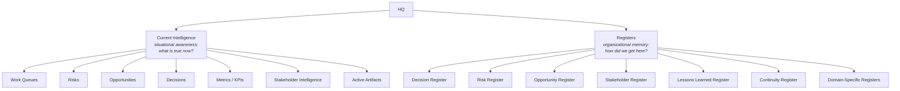
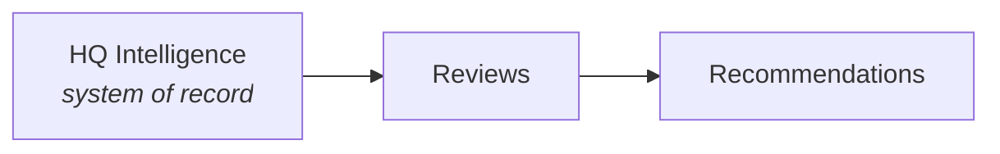

# AOSP-M05 — HQ Architecture v2.0

> Post-DEC-001 artifact. Note: owner is **Athena** here, whereas M01–M03 list Owner: CEO / Custodian: Athena.

## 1. Purpose

The HQ Architecture defines how organizational intelligence is **structured, maintained, accessed, persisted, and recovered**. HQs are the primary containers of organizational intelligence within Athena.

Foundation for: intelligence management, operational reviews, executive visibility, organizational memory, continuity, recovery, IOC validation.

## 2. HQ Definition

> **HQ = the primary container of organizational intelligence for a domain.**

An HQ represents an *intelligence domain* — not necessarily a department, organizational unit, or reporting structure. An HQ may represent a function, program, strategic initiative, business domain, or organizational area.

## 3. HQ Objectives

Every HQ shall maintain current and historical intelligence, preserve continuity, support decision-making, support reviews and reporting, support recovery and IOC validation, and enable organizational learning.

## 4. HQ Structure

Every HQ follows a common structure:

## 5. Current Intelligence

The active operational view of a domain. It answers: *What is true now? What requires attention? What is changing?*

| Component | Tracks |
|---|---|
| Work Queues | Open work, active initiatives, pending actions, dependencies, execution status |
| Risks | Active/emerging risks, severity, ownership, mitigation |
| Opportunities | Growth, strategic, operational, innovation opportunities |
| Decisions | Open, pending, approved decisions; decision dependencies |
| Metrics / KPIs | Current performance, trends, targets, variances |
| Stakeholder Intelligence | Key stakeholders, influence, relationships, expectations, sentiment, dependencies |
| Active Artifacts | Active documents, initiatives, working artifacts, current references |

## 6. Registers

Registers are Athena's **structured organizational memory** — preserving history, context, outcomes, lessons, continuity. They answer: *How did we get here? What have we learned? What happened previously?*

## 7. Standard Registers

| Register | Captures |
|---|---|
| Decision | Decisions, rationale, outcomes, superseded decisions |
| Risk | Historical/closed risks, outcomes, patterns |
| Opportunity | Historical/pursued/missed opportunities, outcomes |
| Stakeholder | Stakeholder history, relationship evolution, intelligence changes |
| Lessons Learned | Successes, failures, insights, recommendations, institutional learning |
| Continuity | Major milestones, critical transitions, recovery events |
| Domain-Specific | As needed: Product, Architecture, Customer, Investor, Compliance registers, etc. |

## 8. Structural Consistency Principle

> **Current Intelligence + Registers = Complete HQ Intelligence.** All HQs follow the same architecture. Content may vary; structure remains consistent.

## 9. Intelligence Ownership Principle

Athena is responsible for HQ **health, integrity, continuity, consistency**, continuously assessing completeness, currency, consistency, and recoverability.

## 10. Relationship to Operational Rhythm

Reviews operate *on* HQ Intelligence; they never become the system of record.

❌ Not: Reviews → HQ Intelligence.

## 11. Relationship to Recovery

> **Athena Definition + HQ Intelligence + Delta Packages = Recoverable Athena**

Recovery packages shall contain complete HQ Intelligence snapshots.

## 12. Relationship to IOC

IOC is successful only if Athena can reconstruct **Current Intelligence, historical intelligence (Registers), and organizational context** from recovery artifacts.

---

## M05 Core Principle

> HQs are the authoritative containers of organizational intelligence. Current Intelligence provides situational awareness. Registers provide organizational memory. Together they enable continuity, learning, recovery, and decision support.
