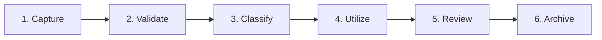
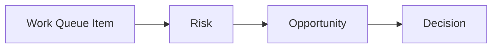
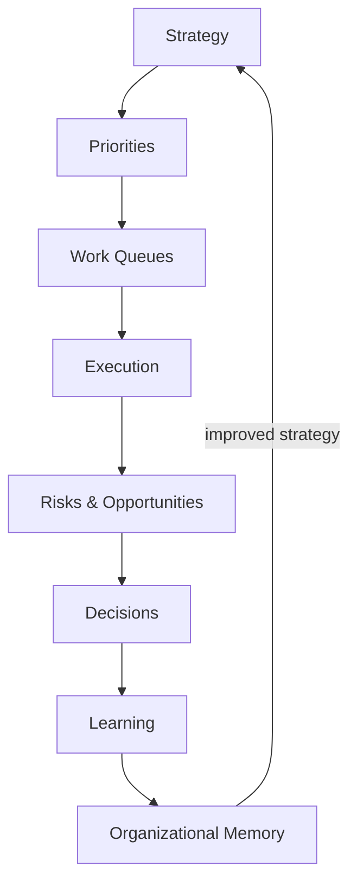

# AOSP-M06 — Register Framework v1.0

> ⚠️ *Conversion note: this is the only module whose source **filename** still uses the pre-DEC-001 `KOS-` prefix.*

## 1. Executive Summary 🟢

Registers are the **operational memory structures** of KOS. HQs provide ownership; governance provides discipline; continuity provides preservation; **registers provide operational intelligence**.

> Without registers, knowledge *exists*. With registers, knowledge becomes *manageable*.

## 2. Purpose of Registers 🟢

Registers provide visibility, continuity, governance, traceability, and decision support.

- **Are not 🟢** — reports, spreadsheets, administrative records (though they may be implemented with those tools).
- **Are 🟢** — living intelligence systems, organizational memory systems, governance systems, decision-support systems.

## 3. Register Philosophy 🟢

1. **Single Source of Truth** — one primary register per critical intelligence category.
2. **Ownership Before Population** — a register must have ownership before scale.
3. **Visibility Before Perfection** — an imperfect visible register beats a perfect invisible one.
4. **Continuity Before Automation** — registers should function before automation is introduced.
5. **Business Value First** — registers improve outcomes, not create administrative activity.

## 4. Register Classification Model 🟢

| Class | Purpose | Examples |
|---|---|---|
| **A — Executive** | Executive visibility | Master Work Queue, Risk, Opportunity, Strategic Priorities, Executive Decisions |
| **B — Governance** | Governance & accountability | Governance Decisions, Policy, Escalation, Exception |
| **C — Continuity** | Institutional memory | Organizational Memory, Lessons Learned, Relationship Intelligence, Decision Context |
| **D — Domain** | HQ-specific intelligence | Pipeline, Product Portfolio, Cash Flow, Investor |

## 5. Register Design Standard 🟢

| Tier | Fields |
|---|---|
| **Mandatory** | Register ID, Register Name, HQ Owner, Record ID, Title, Status, Created Date, Last Updated, Owner (or TBD), Description |
| **Recommended** (optional) | Priority, Executive Visibility, Dependencies, Notes, Attachments |
| **Continuity** (recommended) | Context, Decision History, Lessons Learned, Related Records |

## 6. Register Lifecycle 🟢

**Lifecycle principle 🟢** — information that is never used should not become a permanent register burden.

## 7. Register Health Model 🔵

Evaluate each register on: **Completeness** (critical info present?), **Accuracy** (current?), **Ownership** (accountability clear?), **Utilization** (actively used?), **Continuity** (can future leaders understand it?).

## 8. Register Governance Principles 🟢

Every register: has a custodian, supports decision-making, is reviewed periodically, minimizes duplication, supports continuity.

## 9. Initial Register Landscape 🟢

Phase 1 focuses on five P0 registers — providing ~80% of executive visibility with minimal overhead:

Master Work Queue · Risk · Opportunity · Strategic Priorities · Executive Decisions.

## 10. Master Work Queue Register (MWQR) 🟢

Primary execution visibility mechanism: a consolidated view of commitments, priorities, dependencies, progress, ownership, and execution health across all HQs. Answers: *what must be done, who owns it, why it matters, what is blocked, what is at risk.*

**Fields** — Queue ID, HQ, Work Item, Owner, Executive Visibility (Y/N), Priority, Status, Completion %, Target Date, Dependencies, Last Updated, Notes (audit trail).

| Priority | Meaning |
|---|---|
| P0 | Critical — immediate attention |
| P1 | Important — direct impact on objectives |
| P2 | Planned — useful, not immediately critical |
| P3 | Future — deferred or exploratory |

| Status | Meaning |
|---|---|
| Not Started | Work not initiated |
| Active | In progress |
| Awaiting Input | Waiting on dependency |
| Blocked | Cannot proceed |
| Monitor | Observation only |
| Complete | Finished |
| Cancelled | No longer required |

**Audit trail 🟢** — every significant update captures Date / Update / By (e.g., `2026-06-22 | Requirements shared with team | CEO`).

**Executive view** — CEO normally sees P0, strategic P1, blocked, and escalated items — not every operational task.

## 11. Risk Register 🟢

Visibility into threats to organizational objectives; enables proactive risk management.

> **Risk:** an event or condition that may negatively impact organizational objectives.

**Fields** — Risk ID, HQ, Title, Description, Severity, Probability, Owner, Status (Open/Mitigated/Closed), Mitigation Plan (required), Last Updated.

**Severity** — Critical (material threat) / High / Medium / Low. **Probability** — High / Medium / Low.

**Risk scoring 🔵** — future: `Risk Score = Severity × Probability`.

**Executive rule 🟢** — all Critical and High risks must be visible to Executive HQ.

*Example risks:* Salary Funding Pressure (Finance), Product Delivery Delay (Product), Customer Churn Risk (Customer Success), Founder Bandwidth Constraint (Organization).

## 12. Opportunity Register 🟢

Structured attention for value creation — not informal conversations.

> **Opportunity:** a situation that may create strategic, operational, financial, product, customer, or organizational value.

**Fields** — Opportunity ID, HQ, Title, Description, Potential Impact, Owner, Status, Next Action (required), Last Updated.

**Impact** — Transformational (changes trajectory) / Strategic / Operational / Incremental.

**Status** — Identified → Evaluating → Approved → Active → Realized (or Closed).

**Executive rule** — Executive HQ maintains visibility into Transformational and Strategic opportunities.

*Example opportunities:* DigiDevalaya Ecosystem Expansion (Product), SMB/Freelancer Platform (Product), Shirdi Expansion (Customer Success), Investor Network Development (Capital).

## 13. Register Cross-Linking Principle 🟢

Registers don't operate independently — a work item may spawn a risk, an opportunity, a decision:

Objective: **context preservation across registers**.

## 14. Executive Visibility Model 🟢

Leadership sees: Work Queue (P0, escalated, blocked) · Risks (Critical, High) · Opportunities (Strategic, Transformational).

> The objective is **visibility**, not information overload.

## 15. Strategic Priorities Register (SPR) 🟢

Keeps organizational focus aligned with strategic intent.

> **Strategic priority:** an initiative, objective, or outcome that materially contributes to organizational success.

**Fields** — Priority ID, Title, Description, Strategic Outcome, Executive Sponsor, HQ Owner, Priority Level, Status, Success Criteria (required), Risks, Last Updated.

**Levels** — L1 Enterprise Critical / L2 Strategic / L3 Operational.
**Status** — Defined → Approved → Active → Achieved (or At Risk / Retired).

*Examples:* DigiDevalaya Growth (L1), Revenue Growth (L1), KOS Rollout (L2), Department Reporting Framework (L2).

## 16. Executive Decisions Register 🟢

Preserves decision rationale, historical context, organizational learning.

> **Decision:** a formal determination that influences organizational direction, priorities, investments, governance, products, customers, or operations.

**Fields** — Decision ID, Date, Title, Context, Decision, Alternatives Considered, Expected Outcome (required), Decision Authority, Related Risks/Opportunities, Status (Active/Superseded), Last Updated.

**Preservation principle 🟢** — future leaders should understand *what* was decided, *why*, what *alternatives* existed, what *outcome* was expected.

*Examples:* Create KOS Program, Adopt HQ Model, Establish Athena Constitution, Launch DigiDevalaya Ecosystem Strategy.

## 17. Organizational Memory Register 🔵

*Proposed — approval required.* Preserves institutional memory that fits nowhere else: major lessons, significant events, historical context, transformation initiatives, stakeholder insights.

**Fields** — Memory ID, Event/Insight, Context, Organizational Impact, Lessons Learned, Related HQs, Last Updated.

## 18. Register Governance Model 🟢

| Role | Responsibility |
|---|---|
| Register Custodian | Maintains register integrity |
| Register Contributor | Adds and updates records |
| Register Consumer | Uses information for decisions |

> A register without ownership eventually becomes obsolete.

## 19. Register Operating Rhythm 🟢

| Cadence | Registers Reviewed |
|---|---|
| Weekly | Work Queue, Risk, Opportunity |
| Monthly | Strategic Priorities, Executive Decisions |
| Quarterly | Organizational Memory, Governance registers |
| Annual | Register architecture, relevance, effectiveness |

## 20. KOS Dashboard Model 🟢

The Executive Dashboard **summarizes** registers, never reproduces them. Components: Strategic Priorities, Executive Work Queue (P0 + strategic), Executive Risks (Critical/High), Executive Opportunities (Strategic/Transformational), Organizational Health (HQ indicators), Decisions Requiring Attention.

> The dashboard answers: **What matters? What changed? What requires attention?**

## 21. KOS Operating Cycle 🟢

## 22. Closing Charter 🟢

Registers transform organizational intelligence into an **operational capability**. Without them: fragmented visibility, weak continuity, inconsistent governance. With them: structured intelligence, traceable decisions, visible risks, actionable opportunities, durable learning.

> The Register Framework is the operational engine of KOS — converting vision, continuity, governance, and architecture into day-to-day management capability. It completes the foundational operating model.

---

## Document Governance 🟢

| Attribute | Value |
|---|---|
| Document Name | AOSP-M06 Register Framework (historical: KOS-M06) |
| Version | 1.0 |
| Program | Athena Operating System Program (AOSP) — deliverable: KOS |
| Owner | CEO |
| Custodian | Athena |
| Review Frequency | Annual or Major Governance Change |
| Classification | Foundation Archive |

### M06 Completion Assessment

| Area | Status |
|---|---|
| Register Architecture | 🟢 Complete |
| Executive Registers | 🟢 Complete |
| Governance Model | 🟢 Complete |
| Operating Rhythm | 🟢 Complete |
| Dashboard Model | 🟢 Complete |
| KOS Operational Layer | 🟢 Complete |
