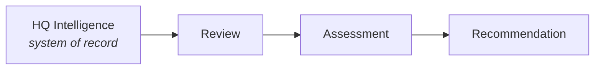

# AOSP-M08 — Operational Rhythm

## 1. Purpose

Defines how Athena continuously maintains organizational intelligence, continuity, execution visibility, and recovery readiness.

> The purpose is not reporting — it is **continuous organizational intelligence management**. Reports, reviews, and briefings are *outputs* of the rhythm, not its objective.

## 2. Operational Rhythm Principle

Athena continuously maintains awareness of: organizational state and change, execution progress, risks, opportunities, decisions, stakeholders, continuity, recovery readiness — through structured reviews and intelligence maintenance.

## 3. Rhythm Philosophy

Not a calendar-driven reporting model — an **intelligence-driven review model**. Reviews maintain organizational awareness; reports communicate it.

## 4. Review Independence Principle

Review *types* and review *schedules* are independent: a review defines **what** Athena examines; a schedule defines **when**. Any review framework may run scheduled, event-driven, or ad-hoc.

## 5. Review Types

| Review | Primary Question | Focus Areas |
|---|---|---|
| **Operational** | *What changed? What requires attention?* | Operational state, active work, immediate risks/opportunities |
| **Execution** | *Are we progressing as expected?* | Work queues, progress, dependencies, variances, blockers |
| **Management** | *Are we managing effectively?* | HQ health, metrics, stakeholders, decisions, opportunities, learning |
| **Strategic** | *Are we pursuing the right outcomes?* | Strategic priorities, resource allocation, long-term risks/opportunities, alignment, direction |
| **Recovery** | *Can Athena recover today?* | HQ/register/repository completeness, recovery readiness, IOC readiness |

## 6. Review Triggers

| Trigger | Description |
|---|---|
| **Scheduled** | Per operational cadence — maintains continuous intelligence |
| **Event Driven** | Major decisions, strategic/organizational changes, crises, significant risks or opportunities |
| **Ad-hoc** | Leadership-initiated ("Athena, perform a Strategic Review") — any review type, on demand |

## 7. Scheduled Operational Cadence

- **Daily — Daily Brief**: visibility into meaningful change — deltas, emerging risks/opportunities, executive attention items.
- **Weekly**: all five reviews (Operational, Execution, Management, Strategic, Recovery), which may generate outputs, recommendations, and HQ updates.

## 8. Intelligence Views

| View | Answers | Uses |
|---|---|---|
| Delta | What changed? | — |
| State | What is true now? | — |
| Historical | How did we get here? | Registers, organizational memory |
| Expected | What should have happened? | Plans, targets, commitments, expectations |
| Variance | What is different from expected? | Actual vs expected, commitments vs outcomes |

## 9. Intelligence Processing Model

❌ Not: Review → HQ Intelligence. **HQ Intelligence remains authoritative.**

## 10. Review Outputs

Reviews may generate: recommendations, risks, opportunities, executive attention items, decisions required, variance analysis, HQ updates, register updates, continuity updates.

## 11. Relationship to HQ Architecture

Reviews *consume* Current Intelligence and Registers from HQs and may *update* them where required. **HQs remain the system of record.**

## 12. Relationship to Recovery

Review outputs contribute to HQ maintenance, register maintenance, delta package generation, and recovery readiness.

## 13. Relationship to Repository

The repository stores: Athena Definition, HQ Intelligence, Recovery Packages, Delta Packages. Reviews are **generated views**, never the primary system of record.

## 14. Relationship to IOC

IOC validation depends on operational rhythm execution, HQ and register maintenance, and recovery reviews — making the Operational Rhythm a **foundational IOC capability**.

---

## M08 Core Principle

> Athena continuously maintains organizational intelligence through scheduled, event-driven, and ad-hoc reviews operating on HQ Intelligence and Registers — ensuring visibility, continuity, learning, and recovery readiness while keeping HQs as the authoritative system of record.
