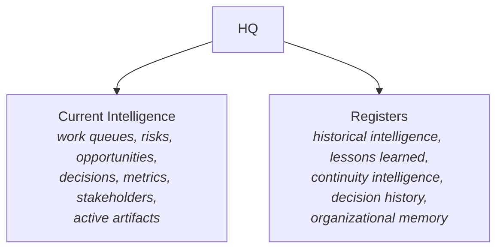
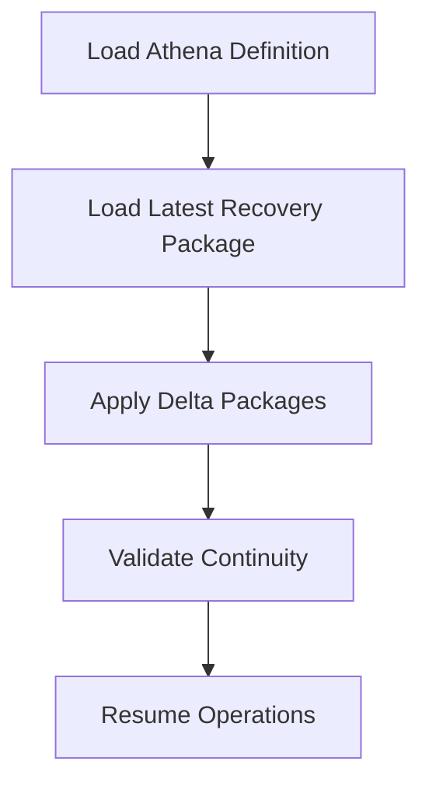

# AOSP-M09 — Persistence & Recovery Architecture

## 1. Purpose

Defines how Athena **preserves, reconstructs, and validates** organizational intelligence — ensuring Athena remains recoverable, repeatable, replicable, and continuous, independent of individual conversations, sessions, or memory.

## 2. Recovery Philosophy

> Recovery is not the restoration of files. **Recovery is the restoration of Athena.**

The objective: reconstruct organizational intelligence, context, continuity, organizational memory, and operating state with sufficient fidelity to resume operations.

## 3. Recovery Principle

> **Athena Definition + HQ Intelligence + Delta Packages = Recoverable Athena**

The foundational recovery equation of AOSP.

## 4. Repository Architecture

| Layer | Defines | Contains |
|---|---|---|
| **Athena Definition** | *What Athena Is* | M01–M09, Prompt Library, Approved Decisions *(✎ amended per DEC-007: source read M01–M08)* |
| **HQ Intelligence** | *What Athena Knows* | All HQs — Current Intelligence, Registers, associated artifacts |

## 5. Repository Structure

```
/AOSP
    /Athena Definition
        M01 Vision
        M02 Continuity Philosophy
        M03 HQ Vision
        M04 Constitution
        M05 HQ Architecture
        M06 Register Framework
        M07 Operating Model
        M08 Operational Rhythm
        M09 Persistence & Recovery Architecture   <- ✎ added per DEC-007
        /Prompt Library
        /Approved Decisions
    /HQ Intelligence
        /Executive HQ
        /Product HQ
        /Revenue HQ
        /People HQ
        /Technology HQ
        /Operations HQ
    /Delta Packages
    /Recovery Packages
    /IOC
```

> ✎ *Resolved per DEC-007: this 6-HQ list is the **current-state** implementation (M09 is a "Current State" artifact). M02 §7's 11-HQ table is the **target model**. HQs are added as domains mature; both lists are correct for their scope. M05 §2 supports this: an HQ is an intelligence domain, not a fixed org unit.*

## 6. HQ Persistence Model

Each HQ follows the approved M05 architecture:



## 7. Recovery Packages

**Purpose** — a complete, self-contained recovery snapshot.

> **Principle (DEC-006)** — Recovery Packages shall be *independently recoverable*. Recovery shall not require access to external repository structures.

**Contents:** Athena Definition snapshot (M01–M09, Prompt Library, Approved Decisions) + HQ Intelligence snapshot (all HQs: Current Intelligence, Registers, artifacts) + recovery metadata (creation date, package version, recovery and validation information).

## 8. Recovery Package Frequency

**Weekly Full Recovery Package** — complete recoverable snapshot of Athena Definition + HQ Intelligence as of creation time.

## 9. Delta Packages

Capture **only changes** since the last Recovery Package — to work queues, risks, opportunities, decisions, metrics, stakeholders, registers, artifacts. Generated as part of operational rhythm, typically **daily**.

## 10. Recovery Procedure



**Objective** — recover sufficient intelligence and continuity to resume Chief of Staff responsibilities.

## 11. Recovery Readiness

Continuously maintained; assessed through recovery reviews, HQ health reviews, repository validation, IOC validation.

## 12. Recovery Responsibility

Athena is responsible for recovery readiness, visibility, risks, and gaps — surfaced through operational reviews.

## 13. Repository Governance

Athena ensures repository **completeness, consistency, recoverability, integrity**.

## 14. Relationship to Operational Rhythm

The rhythm (M08) maintains HQ Intelligence, Registers, recovery readiness, and Delta Packages — **recovery is part of normal operation**.

## 15. Relationship to Prompt Library

The Prompt Library is part of the Athena Definition. Prompts define creation, operation, reviews, governance, recovery, and IOC.

## 16. Relationship to IOC

> IOC validates: *can Athena be reconstructed from Athena Definition, HQ Intelligence, and Delta Packages?*

Recovery architecture exists to support IOC; IOC exists to validate recovery architecture.

## 17. Success Criteria

Recovery succeeds when a new Athena instance can load the Athena Definition, reconstruct HQ Intelligence, restore organizational memory and continuity, and **produce materially equivalent reviews, recommendations, and assessments — without reliance on prior conversation history**.

---

## M09 Core Principle

> Athena preserves recoverability through a repository architecture of Athena Definition, HQ Intelligence, Recovery Packages, and Delta Packages — enabling complete reconstruction of organizational intelligence, continuity, and operational capability independent of conversations or memory.
