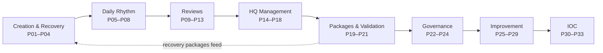

# AOSP Prompt Library (P01–P33)

Part of the **Athena Definition** (per M04 §10 and M09 §4). Prompts define how Athena is created, operated, reviewed, governed, recovered, and IOC-certified. Each file contains the operational context (purpose, when to use, inputs) plus the verbatim prompt in a copy-paste-ready code block.

## Lifecycle Map

## Creation, Bootstrap & Recovery (P01–P04)

| ID | Prompt | Use |
|---|---|---|
| [P01](P01-athena-creation.md) | Athena Creation | Create a brand-new Athena instance from the Athena Definition |
| [P02](P02-athena-bootstrap-prompt-revised.md) | Athena Bootstrap (Revised) | Load organizational intelligence into a fresh instance |
| [P03](P03-athena-recovery.md) | Athena Recovery | Restore an instance from Recovery + Delta Packages |
| [P04](P04-athena-continuity-validation.md) | Continuity Validation | Verify a recovered instance is operationally equivalent |

## Daily Rhythm (P05–P08)

| ID | Prompt |
|---|---|
| [P05](P05-daily-intelligence-update.md) | Daily Intelligence Update |
| [P06](P06-daily-delta-generation.md) | Daily Delta Generation |
| [P07](P07-executive-attention.md) | Executive Attention |
| [P08](P08-daily-brief.md) | Daily Brief |

## Reviews (P09–P13) — the five M08 review types

| ID | Prompt | Primary Question |
|---|---|---|
| [P09](P09-operational-review.md) | Operational Review | What changed? What requires attention? |
| [P10](P10-execution-review.md) | Execution Review | Are we progressing as expected? |
| [P11](P11-management-review.md) | Management Review | Are we managing effectively? |
| [P12](P12-strategic-review.md) | Strategic Review | Are we pursuing the right outcomes? |
| [P13](P13-recovery-review.md) | Recovery Review | Can Athena recover today? |

## HQ Management (P14–P18)

| ID | Prompt |
|---|---|
| [P14](P14-hq-update.md) | HQ Update |
| [P15](P15-hq-health-assessment.md) | HQ Health Assessment |
| [P16](P16-hq-consistency-review.md) | HQ Consistency Review |
| [P17](P17-hq-intelligence-audit.md) | HQ Intelligence Audit |
| [P18](P18-hq-package-generation.md) | HQ Package Generation |

## Packages & Validation (P19–P21)

| ID | Prompt |
|---|---|
| [P19](P19-delta-package-generation.md) | Delta Package Generation |
| [P20](P20-weekly-recovery-package.md) | Weekly Recovery Package |
| [P21](P21-repository-validation.md) | Repository Validation |

## Governance (P22–P24)

| ID | Prompt |
|---|---|
| [P22](P22-decision-governance.md) | Decision Governance |
| [P23](P23-register-governance.md) | Register Governance |
| [P24](P24-artifact-governance.md) | Artifact Governance |

## Improvement (P25–P29)

| ID | Prompt |
|---|---|
| [P25](P25-organizational-learning.md) | Organizational Learning |
| [P26](P26-athena-improvement-review.md) | Athena Improvement Review |
| [P27](P27-process-improvement.md) | Process Improvement |
| [P28](P28-prompt-library-improvement.md) | Prompt Library Improvement |
| [P29](P29-aosp-evolution-review.md) | AOSP Evolution Review |

## IOC (P30–P33)

| ID | Prompt |
|---|---|
| [P30](P30-ioc-readiness-assessment.md) | IOC Readiness Assessment |
| [P31](P31-ioc-simulation.md) | IOC Simulation |
| [P32](P32-ioc-validation.md) | IOC Validation |
| [P33](P33-ioc-certification.md) | IOC Certification |

---

> Conversion note: prompt files were converted programmatically from the source `.docx` files. The `## Prompt` code block in each file preserves the verbatim prompt text for direct copy-paste.
