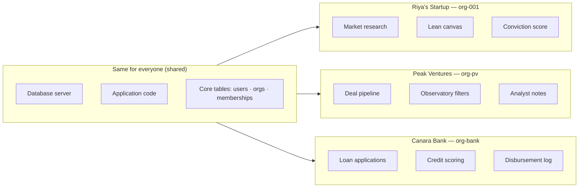

# 01 — What is Multi-Tenancy?

> Plain English. No jargon. Read this before anything else.

---

## The apartment building analogy

Imagine FounderOS is an apartment building.

Every **tenant** (family) lives in their own flat. They have their own door, their own key, their own furniture. The family in Flat 301 cannot walk into Flat 302 — even though both flats are in the same building, share the same electricity supply, and use the same lift.

That is multi-tenancy.

- The **building** = FounderOS database
- Each **flat** = one organization (a startup, a VC firm, a bank)
- The **key** = `org_id` — the unique ID of that organization
- The **family members** = users who are members of that org
- The **furniture** = data (market research, deal pipeline, loan applications)

No tenant can see another tenant's furniture. Ever.

---

## Why does this matter?

FounderOS has six different types of users on the same platform:

- Riya (founder) is building her EdTech startup
- Vikram (investor) is sourcing deals at Peak Ventures
- Prashant (banker) is finding loan-ready startups at Canara Bank
- Meera (govt officer) is matching startups to TIDE 2.0 grants
- Deepak (mentor) is advising founders on GTM strategy
- Students are browsing startup journeys to learn

They all live in the same building. But Vikram must never see Riya's private market research. Riya must never see Vikram's deal notes. Prashant must never see Karan's investment thesis.

Multi-tenancy is the architecture that makes this guarantee possible — automatically, on every single database query.

---

## The one rule

Everything in this document set flows from one rule:

> **Every piece of data is stamped with a tenant ID.  
> Every query automatically filters by that tenant ID.  
> No query ever returns data from a different tenant.**

In FounderOS, the tenant ID is almost always `org_id` — the ID of the organization that owns the data. The one exception is mentors, who use `user_id` directly (explained in `personas/06-mentor.md`).

---

## What changes between tenants, and what doesn't

The infrastructure is shared. The data is not.

---

## The two questions every engineer must ask

Before writing any database query on FounderOS, ask:

1. **Who owns this data?** → That gives you the `org_id` (or `user_id` for mentors)
2. **Does the current user belong to that org?** → Check the `memberships` table

If both answers are yes — proceed. If either is no — return 403.

That's it. That's the entire security model.

---

*Next: [02 — The Tenant Model](./02-tenant-model.md)*
