# 03 — Core Schema

> Every table, every relationship, every important column explained.

---

## The full entity relationship diagram

```mermaid
erDiagram
    USERS {
        uuid id PK
        string email
        string password_hash
        enum active_persona "founder|investor|mentor|student"
        timestamp created_at
    }

    ORGANIZATIONS {
        uuid id PK
        string name
        enum org_type "startup|vc_firm|individual_investor|bank|govt"
        timestamp created_at
    }

    MEMBERSHIPS {
        uuid id PK
        uuid user_id FK
        uuid org_id FK
        enum role "owner|admin|member"
        timestamp joined_at
    }

    INVITES {
        uuid id PK
        uuid org_id FK
        string invited_email
        enum role
        string token
        uuid invited_by FK
        enum status "pending|accepted|declined|expired"
        timestamp expires_at
    }

    SUBSCRIPTIONS {
        uuid id PK
        uuid org_id FK
        enum plan_tier "free|starter|pro|enterprise"
        enum billing_cycle "monthly|annual"
        enum status "active|cancelled|past_due"
        timestamp expires_at
    }

    STARTUPS {
        uuid id PK
        uuid org_id FK
        string name
        string tagline
        enum stage "idea|mvp|growth|scale"
        string sector
        string state
        string dpiit_number
        string gstin
        boolean is_discoverable
        integer conviction_score
        integer mrr
        timestamp created_at
    }

    STARTUP_MILESTONES {
        uuid id PK
        uuid startup_id FK
        uuid org_id FK
        string title
        text description
        boolean is_public
        timestamp achieved_at
    }

    AGENT_RUNS {
        uuid id PK
        uuid user_id FK
        uuid org_id FK
        enum agent_type "market_research|conviction_scorer|pitch_generator|financial_projections|lean_canvas|gtm|tam_sam_som"
        enum status "pending|running|completed|failed"
        jsonb input_payload
        jsonb output_payload
        timestamp created_at
    }

    INVESTOR_PROFILES {
        uuid id PK
        uuid org_id FK
        boolean is_visible_to_founders
        text thesis
        text[] sectors
        text[] stage_preference
        integer cheque_min
        integer cheque_max
    }

    DEAL_PIPELINE {
        uuid id PK
        uuid org_id FK
        uuid startup_id FK
        uuid assigned_to FK
        enum stage "watchlist|contacted|dd|term_sheet|closed|passed"
        text notes
        uuid connection_request_id FK
        timestamp created_at
    }

    MENTOR_PROFILES {
        uuid id PK
        uuid user_id FK
        boolean is_visible_to_founders
        text[] domains
        integer experience_years
        integer session_rate
        text[] availability
        text bio
    }

    MENTOR_SESSIONS {
        uuid id PK
        uuid mentor_user_id FK
        uuid founder_org_id FK
        uuid startup_id FK
        timestamp scheduled_at
        integer duration_mins
        integer gross_amount
        integer platform_fee
        integer mentor_payout
        enum status "confirmed|completed|cancelled"
        enum payout_status "pending|paid"
    }

    MENTOR_REVIEWS {
        uuid id PK
        uuid session_id FK
        uuid reviewer_org_id FK
        uuid reviewed_user_id FK
        integer rating
        text comment
        timestamp created_at
    }

    CONNECTION_REQUESTS {
        uuid id PK
        uuid from_org_id FK
        uuid to_org_id FK
        uuid startup_id FK
        uuid investor_profile_id FK
        text message
        enum request_type "investor_interest|loan_application|scheme_application"
        enum status "pending|accepted|declined"
        text decline_reason
        timestamp responded_at
    }

    BANK_PROFILES {
        uuid id PK
        uuid org_id FK
        boolean is_visible_to_founders
        text[] loan_types
        integer min_mrr
        boolean requires_gstin
        boolean cgtmse_partner
        string interest_rate_range
    }

    SCHEME_PROFILES {
        uuid id PK
        uuid org_id FK
        boolean is_visible_to_founders
        string scheme_name
        text[] sectors
        integer max_grant_amount
        boolean requires_dpiit_number
        date application_deadline
    }

    LOAN_APPLICATIONS {
        uuid id PK
        uuid org_id FK
        uuid startup_id FK
        uuid connection_request_id FK
        integer loan_amount
        boolean cgtmse_eligible
        enum stage "under_review|approved|disbursed|rejected"
        uuid assigned_officer FK
        text notes
    }

    SCHEME_APPLICATIONS {
        uuid id PK
        uuid org_id FK
        uuid startup_id FK
        uuid scheme_profile_id FK
        uuid connection_request_id FK
        integer grant_amount
        enum status "applied|shortlisted|approved|rejected"
        uuid assigned_officer FK
    }

    USERS ||--o{ MEMBERSHIPS : "belongs to"
    ORGANIZATIONS ||--o{ MEMBERSHIPS : "has members"
    ORGANIZATIONS ||--o| STARTUPS : "owns"
    ORGANIZATIONS ||--o{ AGENT_RUNS : "scoped to"
    USERS ||--o{ AGENT_RUNS : "triggers"
    STARTUPS ||--o{ STARTUP_MILESTONES : "has"
    ORGANIZATIONS ||--o| SUBSCRIPTIONS : "has"
    ORGANIZATIONS ||--o{ INVITES : "sends"
    ORGANIZATIONS ||--o| INVESTOR_PROFILES : "has"
    ORGANIZATIONS ||--o{ DEAL_PIPELINE : "owns"
    STARTUPS ||--o{ DEAL_PIPELINE : "tracked by"
    USERS ||--o| MENTOR_PROFILES : "has"
    USERS ||--o{ MENTOR_SESSIONS : "mentors in"
    ORGANIZATIONS ||--o{ MENTOR_SESSIONS : "books via"
    MENTOR_SESSIONS ||--o| MENTOR_REVIEWS : "has"
    ORGANIZATIONS ||--o{ CONNECTION_REQUESTS : "sends"
    ORGANIZATIONS ||--o{ CONNECTION_REQUESTS : "receives"
    ORGANIZATIONS ||--o| BANK_PROFILES : "has"
    ORGANIZATIONS ||--o| SCHEME_PROFILES : "has"
    ORGANIZATIONS ||--o{ LOAN_APPLICATIONS : "owns"
    ORGANIZATIONS ||--o{ SCHEME_APPLICATIONS : "owns"
```

---

## Table-by-table reference

### Core tables (never change)

**`users`** — One row per human. The identity layer.
- `active_persona` — which mode they are currently in. Changes when they switch persona.
- Never stores org-level data. It's a passport, not a property deed.

**`organizations`** — One row per tenant.
- `org_type` — controls which features unlock in the UI.
- The tenant boundary. All domain data hangs off `org_id`.

**`memberships`** — The join between people and orgs.
- `role` — `owner` can do everything including delete the org. `admin` can manage members. `member` can use features.
- One user can have multiple rows here (multiple orgs). One org can have multiple rows (multiple members).

**`invites`** — A pending promise before a membership is created.
- `token` — the magic link sent by email. Encodes `org_id` and intended `role`.
- `status` moves: `pending` → `accepted` or `declined` or `expired`.
- An invite is redeemed the same way whether the invitee has an account or not.

**`subscriptions`** — Billing state per org.
- Scoped to `org_id` — the firm pays, not the individual.
- `plan_tier` gates feature access. `enterprise` for banks and govt (contract-based).

---

### Founder tables

**`startups`** — The central startup record.
- `is_discoverable` — the single flag that controls Observatory visibility. One column flip opens the startup to investors, banks, and government simultaneously.
- `conviction_score` — AI-generated 0–100 score. Lives on the startup, not on any individual user.
- `gstin` and `dpiit_number` — stored here for bank and govt filtering.
- `mrr` — current monthly recurring revenue. Used by bank loan filters.
- **POC equivalent:** `startup_ideas` table. The key migration change is adding `org_id` (replaces `session_id` as the tenant key) and promoting agent output columns (`research_report`, `lean_canvas_output`, etc.) into `planning_data` rows.

**`startup_milestones`** — Progress events in the startup's journey.
- `is_public` — controls whether this milestone appears in the Observatory.
- Has both `startup_id` and `org_id` for efficient querying either way.

**`planning_data` / `agent_runs`** — Every AI agent execution. In the POC this table is called `planning_data` and that name is kept going forward — it maps directly to the `agent_runs` concept.
- `org_id` — who owns the output (the startup).
- `user_id` — who triggered the run (the individual member).
- `panel` — the agent type: `market_research`, `lean_canvas`, `conviction_scorer`, `gtm`, `financial_projections`, `market_sizing`.
- Both IDs are always present. Never overwrite a run — every execution is a new row. This gives a full history.
- `output_data` is JSONB — flexible enough for any agent's output format. Large outputs also stored in MinIO via `minio_key`.
- `user_selections` JSONB — tracks the founder's manual edits and choices on top of the AI output.
- **POC note:** The original `planning_data` had a unique constraint on `(idea_id, panel)` — one run per panel type. This constraint is dropped in the multi-tenant design to allow multiple runs per panel (Riya's run + Arjun's re-run both preserved).

---

### Cross-tenant interaction tables

**`connection_requests`** — The handshake between two orgs.
- `from_org_id` → `to_org_id` — always org-to-org, never person-to-person.
- `request_type` — `investor_interest`, `loan_application`, or `scheme_application`.
- Email addresses are never stored here. They are fetched from `users` only after `status = accepted`.
- This is the only controlled surface where two tenants can interact.

**`mentor_sessions`** — The one place where both tenancy models meet.
- `mentor_user_id` — user-scoped (mentor is an individual).
- `founder_org_id` — org-scoped (the startup booked the session).
- `platform_fee` is calculated and locked at booking time (15–20% of `gross_amount`).

---

## The tenant key rule

| Table | Tenant key | Reason |
|---|---|---|
| `startups` (POC: `startup_ideas`) | `org_id` | Startup belongs to the org, not the founder |
| `planning_data` (POC name retained) | `org_id` + `user_id` | Owned by org, triggered by user |
| `startup_milestones` | `org_id` | Startup's history, not an individual's |
| `idea_documents` | `org_id` | Files belong to the startup org |
| `tasks` | `org_id` | Tasks belong to the startup org |
| `deal_pipeline` | `org_id` | Firm's pipeline, not an analyst's |
| `investor_profiles` | `org_id` | Firm's public face, not a person's |
| `loan_applications` | `org_id` | Bank's portfolio, not an officer's |
| `scheme_applications` | `org_id` | Govt body's records, not an official's |
| `mentor_profiles` | `user_id` | Personal expertise — the one exception |
| `mentor_sessions` | both | Bridge between two tenancy models |
| `mentor_reviews` | `user_id` | Review goes on the mentor person |
| `govt_schemes` | none | Shared reference cache — not tenant data |
| `pulse_articles` | none | Shared reference cache — not tenant data |

---

*Previous: [02 — Tenant Model](./02-tenant-model.md)*  
*Next: [Personas →](./personas/01-founder.md)*
