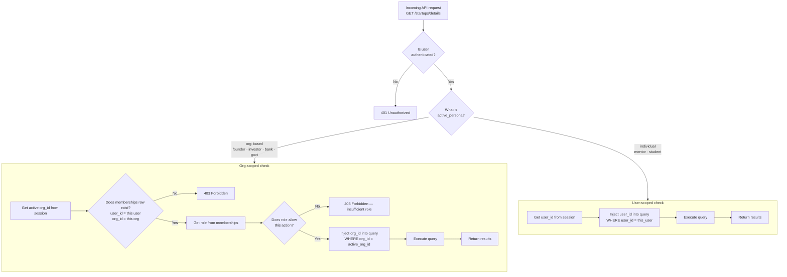

# 06 — Security Model

> The one check that makes the entire platform safe.

---

## The fundamental guarantee

No query on FounderOS should ever return data from a different tenant. This guarantee is enforced by one check, applied automatically on every authenticated request.



---

## The middleware in pseudocode

Every API handler is wrapped by this middleware before executing:

```python
def tenant_middleware(request, handler):
    user = get_user_from_session(request)
    if not user:
        raise HTTP401()

    if user.active_persona in ORG_BASED_PERSONAS:
        org_id = get_active_org_id(request, user)
        membership = db.query(
            "SELECT role FROM memberships WHERE user_id = %s AND org_id = %s",
            user.id, org_id
        )
        if not membership:
            raise HTTP403("Not a member of this organization")

        request.tenant_id = org_id
        request.tenant_type = "org"
        request.role = membership.role

    elif user.active_persona in USER_BASED_PERSONAS:
        request.tenant_id = user.id
        request.tenant_type = "user"
        request.role = "owner"  # always full access to own data

    return handler(request)
```

Every query in every handler then uses `request.tenant_id` — never a raw ID from the URL or request body.

---

## The golden rule for writing queries

```python
# WRONG — trusts the client to send the right org_id
def get_startup(startup_id, org_id_from_request):
    return db.query("SELECT * FROM startups WHERE id = %s AND org_id = %s",
                    startup_id, org_id_from_request)

# RIGHT — uses the tenant_id injected by middleware
def get_startup(startup_id, request):
    return db.query("SELECT * FROM startups WHERE id = %s AND org_id = %s",
                    startup_id, request.tenant_id)
```

The client never gets to decide which tenant's data they're reading. The middleware decides.

---

## What protects each table

| Table | Protected by |
|---|---|
| `startups` | `WHERE org_id = request.tenant_id` |
| `agent_runs` | `WHERE org_id = request.tenant_id` |
| `startup_milestones` | `WHERE org_id = request.tenant_id` |
| `deal_pipeline` | `WHERE org_id = request.tenant_id` |
| `loan_applications` | `WHERE org_id = request.tenant_id` |
| `scheme_applications` | `WHERE org_id = request.tenant_id` |
| `mentor_profiles` | `WHERE user_id = request.tenant_id` |
| `mentor_sessions` | `WHERE mentor_user_id = request.tenant_id` OR `WHERE founder_org_id = request.tenant_id` (depends on persona) |
| `connection_requests` | `WHERE from_org_id = request.tenant_id` OR `WHERE to_org_id = request.tenant_id` |

---

## The Observatory exception — intentional cross-tenant read

The Startup Observatory is the one place where cross-tenant data is intentionally exposed. This is controlled by a hard whitelist of visible fields:

```python
OBSERVATORY_PUBLIC_FIELDS = [
    "startups.id",
    "startups.name",
    "startups.tagline",
    "startups.sector",
    "startups.stage",
    "startups.state",
    "startups.conviction_score",
    "startups.mrr",          # only if founder has set it public
]

def get_observatory(filters, request):
    # Note: NO tenant_id filter here — this is intentionally cross-tenant
    return db.query(
        f"SELECT {', '.join(OBSERVATORY_PUBLIC_FIELDS)} "
        "FROM startups "
        "WHERE is_discoverable = true "
        "AND ... filters ...",
    )
    # Private tables (agent_runs, lean_canvas etc) are NEVER joined here
```

The whitelist is the protection. Only explicitly allowed fields are returned. Private tables are never touched.

---

*Back to [Index](../index.md) · Next: [Decisions Log](./07-decisions-log.md)*
