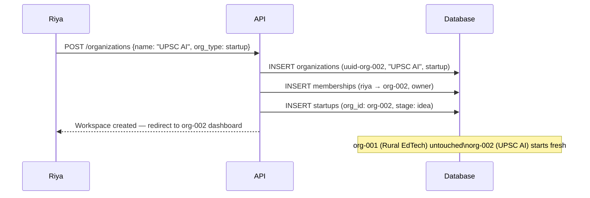
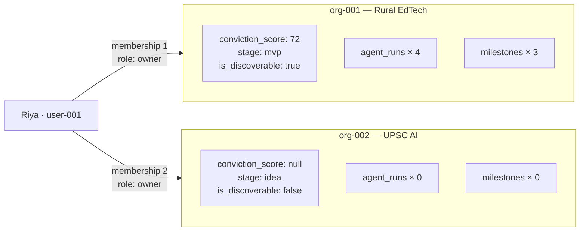

# Flow 03 — Second Idea (Multiple Workspaces)

> One founder, two startups, zero data contamination.

---

## Creating a second startup



---

## Workspace isolation



Switching workspaces changes the active `org_id` in the session. Every subsequent query uses the new `org_id`. The two startups never share data.

---

## Arjun and the second startup

Arjun is a co-founder of Rural EdTech (org-001). He has zero access to UPSC AI (org-002).

```
-- Arjun tries to access UPSC AI
SELECT role FROM memberships
WHERE user_id = 'uuid-arjun'
AND org_id = 'uuid-org-002';

-- Result: 0 rows
-- API response: 403 Forbidden
```

Arjun does not know UPSC AI exists. The API never reveals it to him.

---

*Back to [Index](../index.md) · Next: [Two-Way Discovery](./04-two-way-discovery.md)*
