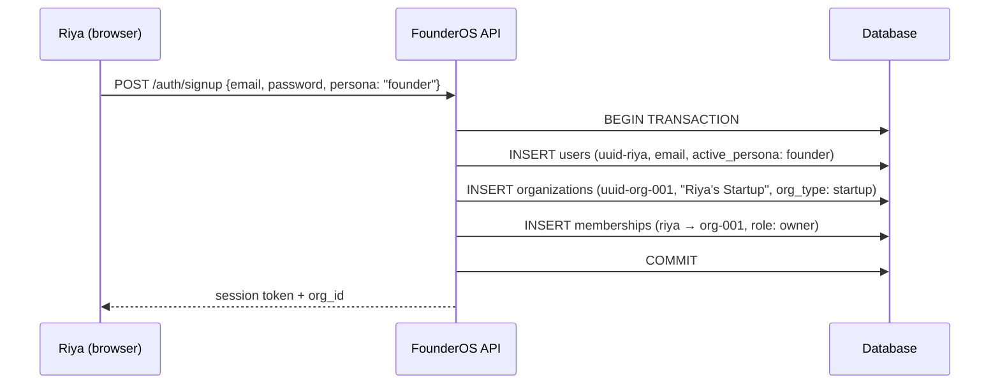
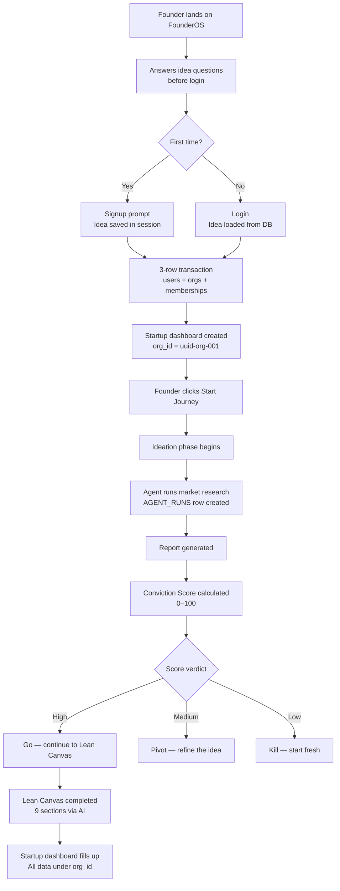
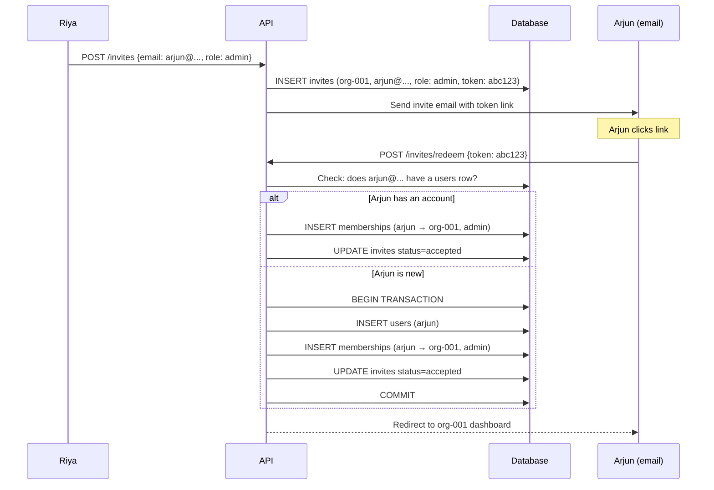
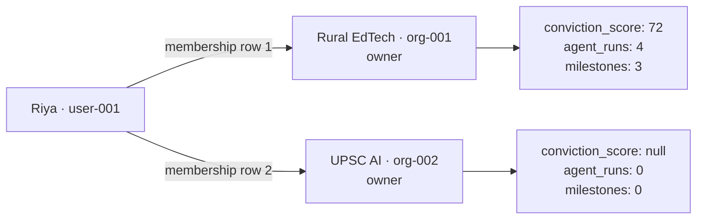

# Persona 01 — Founder

> The primary persona. Everything else on the platform exists to serve or observe the founder's journey.

---

## Who is this?

An entrepreneur building a startup. Could be solo or have a team. The startup — not the individual — is the tenant.

**Real example used in this documentation:** Riya, a teacher from Pune building an offline-first EdTech app for rural Maharashtra.

---

## Signup creates three rows simultaneously



All three inserts happen in one transaction. If any step fails, all three roll back. No ghost accounts, no orphaned orgs.

---

## The ideation journey



---

## Key data decisions

### planning_data always has two IDs

```
org_id  = who OWNS the output  (the startup)
user_id = who TRIGGERED the run (the individual member)
```

This table is called `planning_data` in the codebase — it is the direct equivalent of the `agent_runs` concept. One row per agent execution, never overwritten.

If Riya runs market research and Arjun runs it again two weeks later — two rows, same `org_id`, different `user_id`. Neither is deleted. The startup sees a chronological history of all runs, labelled by who triggered them.

| Column | What it holds |
|---|---|
| `panel` | The agent type: `market_research`, `lean_canvas`, `conviction_scorer`, `gtm`, `financial_projections`, `market_sizing` |
| `output_data` | JSONB — the AI agent's full output |
| `user_selections` | JSONB — the founder's edits and choices on top of the AI output |
| `minio_key` | Object storage key for large outputs (PDFs, slide decks) |
| `org_id` | Tenant key — the startup org that owns this run |
| `user_id` | Who pressed the button — audit trail, not ownership |

### is_discoverable controls all external visibility

One boolean on the `startups` table. When `false` (default), the startup is invisible to investors, banks, and government. When `true`, it appears in the Observatory for all three audiences simultaneously. No separate opt-in per audience.

### conviction_score lives on the startup, not the user

If Riya leaves and Arjun continues, the score travels with the startup. It is an assessment of the idea, not the person.

---

## Multi-user flow

When a second founder joins:



The invite redemption path is identical whether Arjun has an account or not. The only difference is whether a `users` row is created first.

---

## Role permissions

| Action | owner | admin | member |
|---|---|---|---|
| View all startup data | ✓ | ✓ | ✓ |
| Run AI agents | ✓ | ✓ | ✓ |
| Invite members | ✓ | ✓ | ✗ |
| Flip is_discoverable | ✓ | ✗ | ✗ |
| Delete the startup | ✓ | ✗ | ✗ |
| Remove members | ✓ | ✓ | ✗ |

---

## Multiple startups (second idea)

One user, multiple orgs:



Switching workspaces changes the active `org_id` in the session. All queries instantly reflect the new org. Data never bleeds between orgs.

---

*Back to [Index](../index.md) · Next: [Investor — VC](./02-investor-vc.md)*
