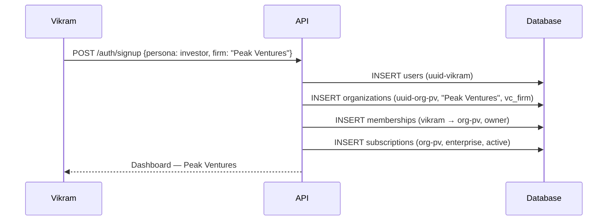
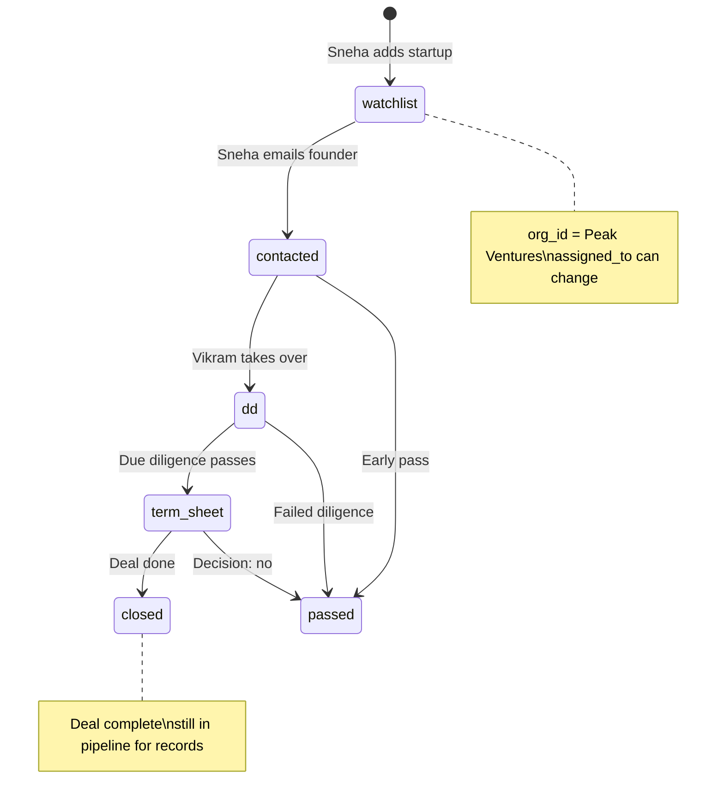
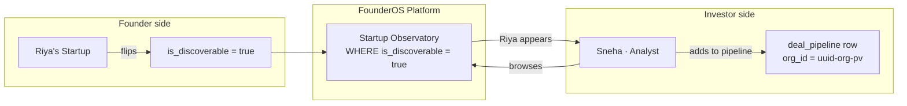
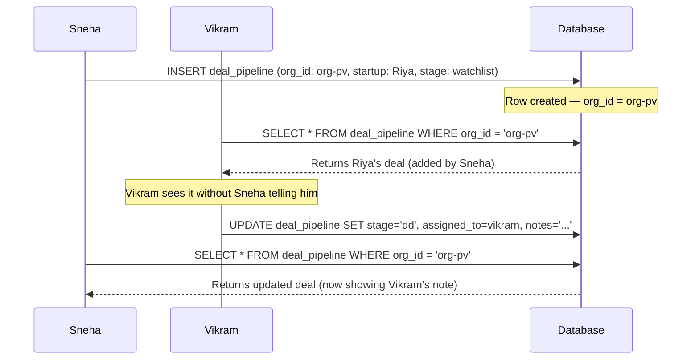
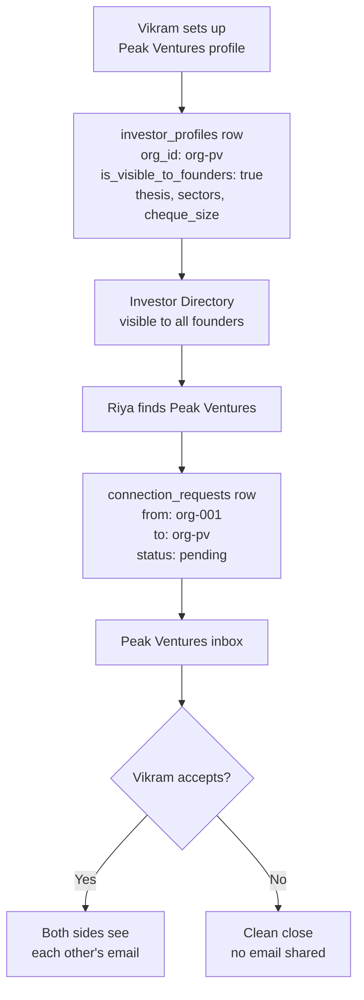

# Persona 02 — Investor (VC Firm)

> A multi-person investment firm. The firm owns the pipeline, not any individual analyst.

---

## Who is this?

A venture capital firm with multiple team members — partners, principals, analysts. The firm is the tenant. Every deal added by any team member belongs to the firm.

**Real example:** Peak Ventures. Vikram (Principal) and Sneha (Analyst) are both members. The deal pipeline belongs to Peak Ventures, not to either person.

---

## Signup

Same three-row transaction as a founder, with `org_type = 'vc_firm'`:

---

## The deal pipeline

The pipeline belongs to the firm (`org_id = uuid-org-pv`). `assigned_to` tracks which analyst is currently working the deal — but this is not ownership, it is assignment.

### Key field distinction

| Field | Meaning | Can change? |
|---|---|---|
| `org_id` | Who owns this deal | Never |
| `assigned_to` | Who is working it now | Anytime |

If Sneha leaves Peak Ventures, Vikram reassigns her deals in one UPDATE per row. The org retains all pipeline history.

---

## Two-sided discovery

### What investors can see vs cannot see

| Visible in Observatory | Hidden always |
|---|---|
| Startup name, sector, stage | Private market research (agent_runs) |
| Conviction score | Lean canvas notes |
| Public milestones | Financial projections |
| MRR (if public) | Private team notes |

---

## Shared pipeline — both Vikram and Sneha see the same data

Same `org_id` → same results for both. This is the firm-level pipeline working correctly.

---

## Investor Directory (reverse discovery)

Founders can also find and reach out to investors. Firms opt in via `investor_profiles`:

---

*Back to [Index](../index.md) · Next: [Solo Investor](./03-investor-solo.md)*
