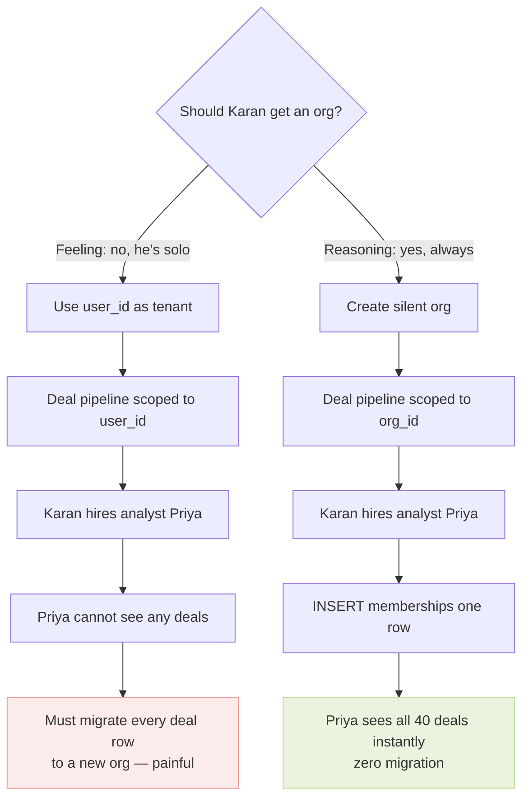
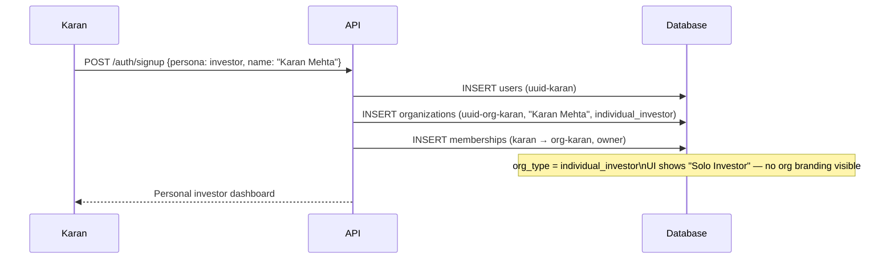
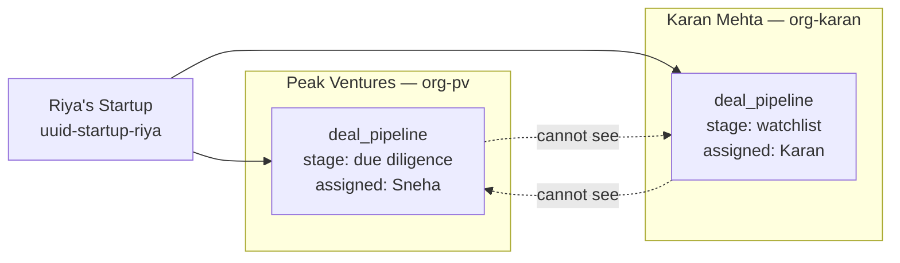

# Persona 03 — Solo Angel Investor

> One person investing their own money. The silent org rule in action.

---

## Who is this?

An individual investor — no firm, no team. Just their own capital and judgment.

**Real example:** Karan Mehta, serial entrepreneur turned angel investor.

---

## The silent org rule

The temptation is to skip creating an org for a solo investor and just use their `user_id` as the tenant. This is wrong.



**Rule:** Every persona that could ever have a team member gets an org — even if they start solo.

---

## Signup



The org exists in the database. Karan's UI never shows the word "organization" — his dashboard just says his name. The org is silent.

---

## Same pipeline, different org_type

Two investors can track the same startup simultaneously. Their pipeline rows are completely isolated:



Same `startup_id` in both rows. Completely different `org_id`. Neither investor knows the other is tracking Riya.

---

## When Karan grows

Adding an analyst is one INSERT — because the org already exists:

```
INSERT INTO memberships
  (user_id, org_id, role)
VALUES
  (uuid-priya, uuid-org-karan, 'member');
```

Priya immediately sees all 40 deals Karan has been tracking. Zero data migration. This is the entire payoff of the silent org rule.

---

*Back to [Index](../index.md) · Next: [Bank](./04-bank.md)*
