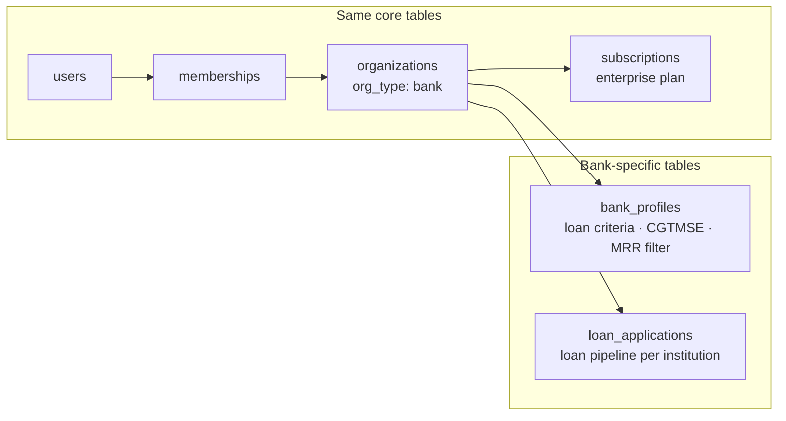
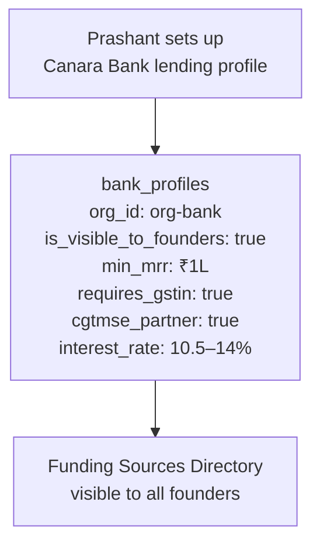
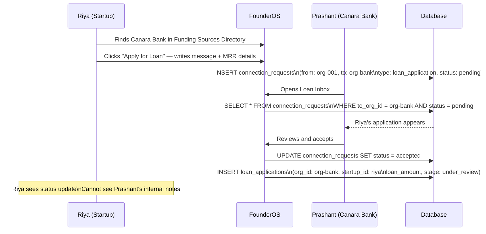
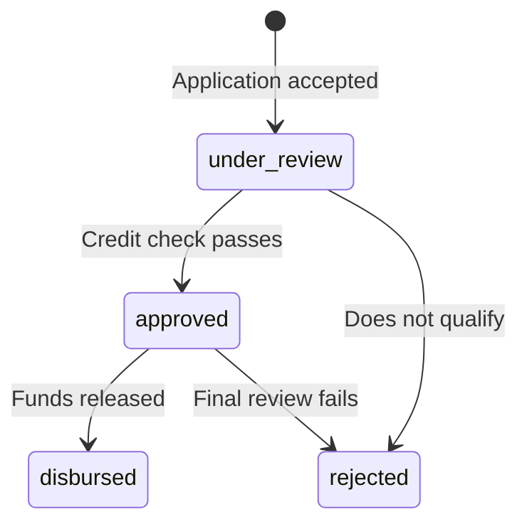

# Persona 04 — Bank / Lending Institution

> Finds loan-ready startups using real financial signals. CGTMSE-native.

---

## Who is this?

An MSME lending desk at a bank or NBFC. Multiple loan officers sharing a loan pipeline. The institution is the tenant.

**Real example:** Prashant, Loan Officer at Canara Bank's MSME desk.

---

## What's the same as VC

Everything at the org level is identical — same signup flow, same invite flow, same membership model. `org_type = 'bank'` is the only difference in the core tables.



---

## Bank profile — the lending criteria made discoverable



---

## How banks discover startups

Banks use the same Observatory as investors, with different filters:

```
-- Investor filter
SELECT * FROM startups
WHERE is_discoverable = true
AND sector = 'edtech'
AND conviction_score >= 65

-- Bank filter
SELECT * FROM startups
WHERE is_discoverable = true
AND mrr >= 100000
AND gstin IS NOT NULL
AND dpiit_number IS NOT NULL
```

Same `is_discoverable` flag. Same `startups` table. Different WHERE clause. Riya flips one toggle and becomes visible to investors, banks, and government all at once.

---

## Loan application flow



---

## Loan pipeline stages



---

## Privacy wall

| Riya can see | Riya cannot see |
|---|---|
| Her application status | Prashant's credit scoring notes |
| Whether she was approved | Other startups' applications |
| Disbursement amount | Internal bank risk ratings |
| Bank's contact (after acceptance) | Loan officer's personal email before acceptance |

---

*Back to [Index](../index.md) · Next: [Government](./05-government.md)*
