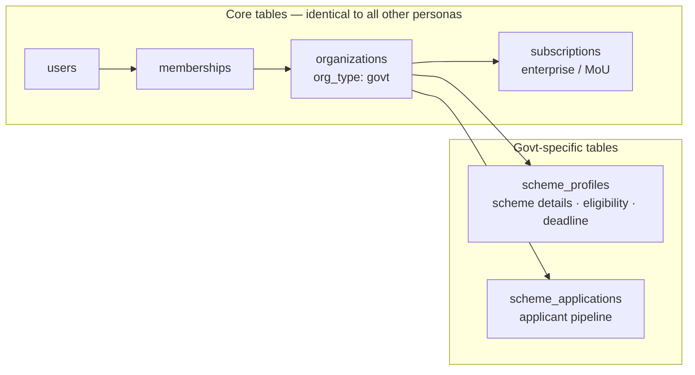
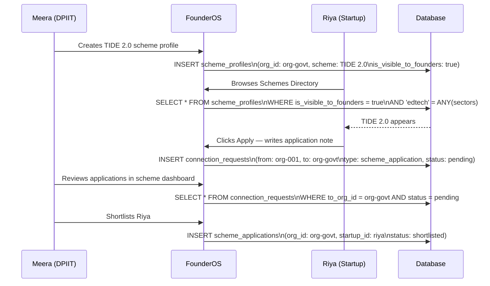
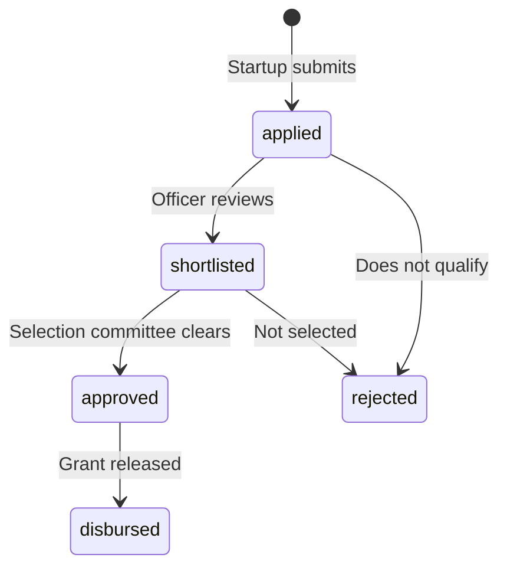

# Persona 05 — Government Body

> Matches startups to grant schemes. Live ecosystem dashboard for policy decisions.

---

## Who is this?

A government body — central or state — managing startup grant schemes. Examples: DPIIT (Startup India), MeitY (TIDE 2.0), state innovation cells.

**Real example:** Meera, Scheme Manager at DPIIT Karnataka, managing TIDE 2.0 applications.

---

## Same structure, different purpose



One key difference from other personas: the `subscriptions` row for govt bodies has `billing_cycle = null` — the contract is handled via an MoU outside the platform. The `status` is simply set to `active` by the FounderOS team after signing.

---

## Scheme profile

Each scheme the government offers becomes a discoverable profile:

| Field | Example |
|---|---|
| `scheme_name` | TIDE 2.0 |
| `sectors` | `['edtech', 'healthtech']` |
| `max_grant_amount` | ₹15,00,000 |
| `requires_dpiit_number` | true |
| `application_deadline` | 2025-03-31 |
| `is_visible_to_founders` | true |

Multiple schemes from the same government body = multiple rows in `scheme_profiles`, all with the same `org_id`.

---

## Scheme discovery and application flow



---

## Scheme application stages



---

## The ecosystem dashboard

Government bodies also get a live read-only view of the broader startup ecosystem — not just their applicants. This is a simple query across the `startups` table filtered by `is_discoverable = true` with state and sector filters. No special table needed — this is the Observatory from the government's perspective.

```
-- Karnataka govt ecosystem view
SELECT sector, stage, COUNT(*), AVG(conviction_score)
FROM startups
WHERE is_discoverable = true
AND state = 'KA'
GROUP BY sector, stage
```

This powers the "live ecosystem dashboard" feature mentioned in the pitch deck — a real-time view of Karnataka's startup health without any startup needing to do anything extra beyond flipping `is_discoverable`.

---

*Back to [Index](../index.md) · Next: [Mentor](./06-mentor.md)*
