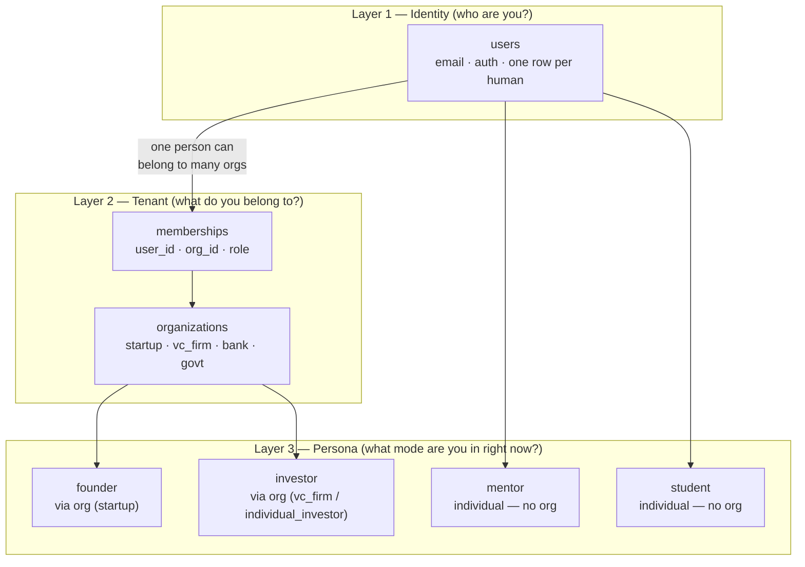
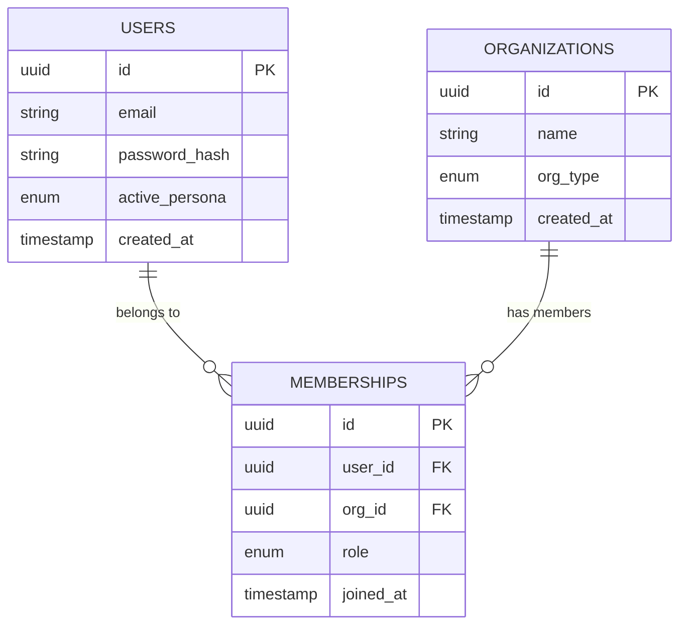
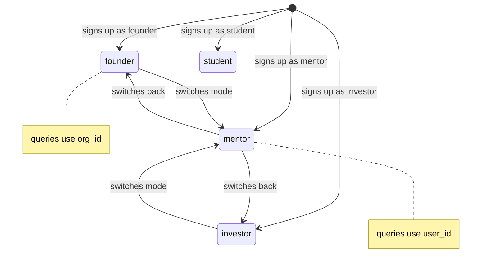
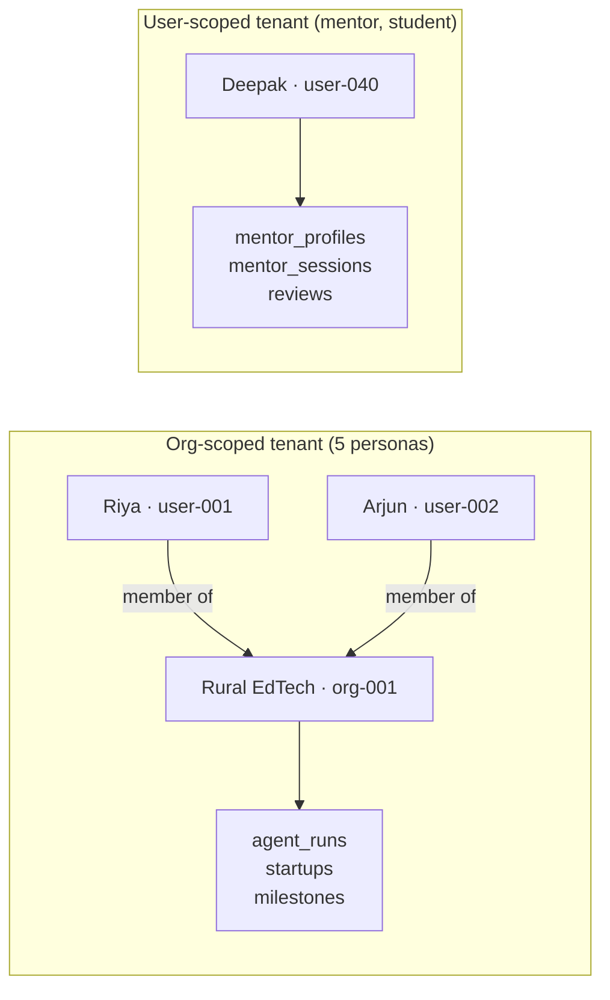

# 02 — The Tenant Model

> How identity, tenancy, and persona are three separate concepts — and why that separation matters.

---

## Three layers, not one

Most systems conflate the person and the tenant. FounderOS does not.

**Layer 1 — Identity:** One row per human. Riya is one person. She has one email, one password, one account. Always.

**Layer 2 — Tenancy:** The organization is the tenant. Riya's startup is separate from Riya herself. If Riya leaves her startup, the startup's data stays. A VC firm is the tenant, not the individual analyst.

**Layer 3 — Persona:** The mode a user is currently operating in. Riya can be a founder in the morning and switch to mentor in the evening. Her `active_persona` column determines which dashboard loads and which queries run.

---

## Why separate person from tenant?

| Question | Wrong answer | Right answer |
|---|---|---|
| Who owns the market research? | Riya | Riya's startup (org-001) |
| Who owns the deal pipeline? | Vikram | Peak Ventures (org-pv) |
| What happens if Riya leaves? | Data is lost | Startup keeps all data |
| What if Vikram's analyst leaves? | Deals are lost | Firm keeps all deals |
| Can Riya have two startups? | Needs two accounts | One account, two orgs |

---

## The membership table is the join

`memberships` is a many-to-many join table. One user can belong to many orgs. One org can have many users. The `role` column (`owner`, `admin`, `member`) controls what each person can do inside that org.

---

## The active_persona column

`active_persona` on the `users` table holds the persona the user is currently operating as. FounderOS supports sequential persona switching — one active mode at a time.

**When active_persona = org-based role** (founder, investor, bank, govt):
- All queries filter by `org_id` from the user's active membership
- Data belongs to the organization

**When active_persona = individual role** (mentor, student):
- All queries filter by `user_id` directly
- Data belongs to the person

---

## The two tenancy patterns side by side

---

## The silent org rule

> **Every persona that could ever have a team member gets an org — even if they start solo.**

This applies to solo angel investors specifically. Karan signs up alone. He gets an org anyway (`individual_investor`). His deal pipeline is scoped to that org. When he hires an analyst six months later, it is one `INSERT` into `memberships`. Zero data migration.

Mentors are the only exception — because you cannot hire someone to do your mentoring for you. Mentoring is inherently personal.

---

*Previous: [01 — What is Multi-Tenancy?](./01-what-is-multi-tenancy.md)*  
*Next: [03 — Core Schema](./03-core-schema.md)*
