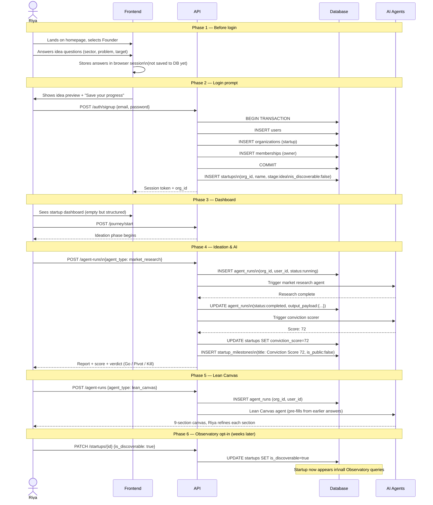
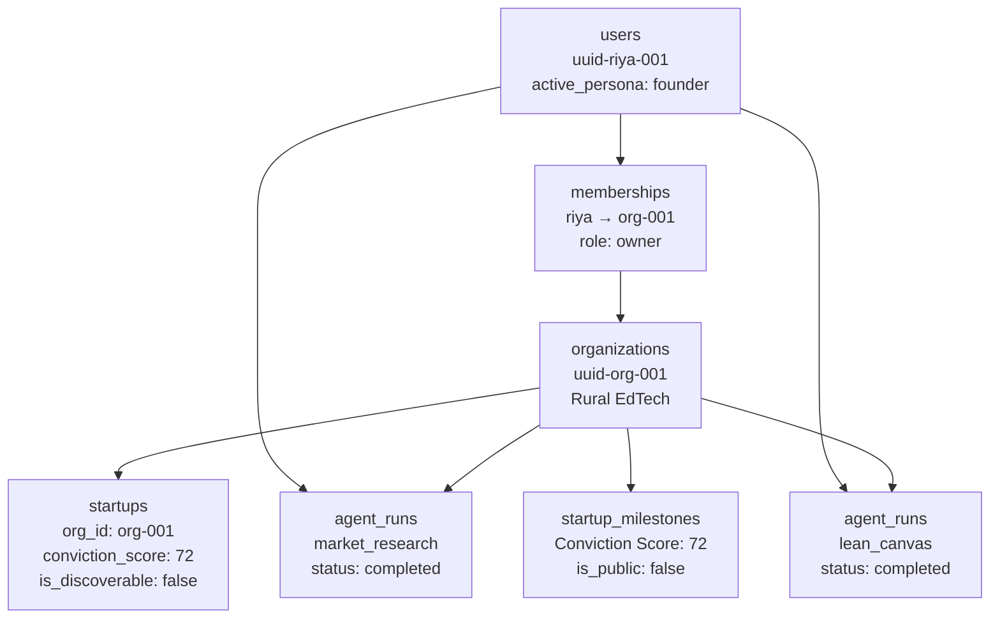

# Flow 01 — Founder Onboarding & Ideation

> Riya's complete journey from landing page to conviction score.

---

## The full flow

---

## Why capture the idea before login?

Forcing signup before idea capture loses ~60% of founders at the top of the funnel. By capturing the idea first, FounderOS gives Riya a reason to complete registration — her idea is already there waiting.

The idea data is held in browser session storage. The moment signup completes, it is flushed to the database under the new `org_id`.

---

## Data state at the end of ideation

---

*Back to [Index](../index.md) · Next: [Multi-User Invite](./02-multi-user-invite.md)*
