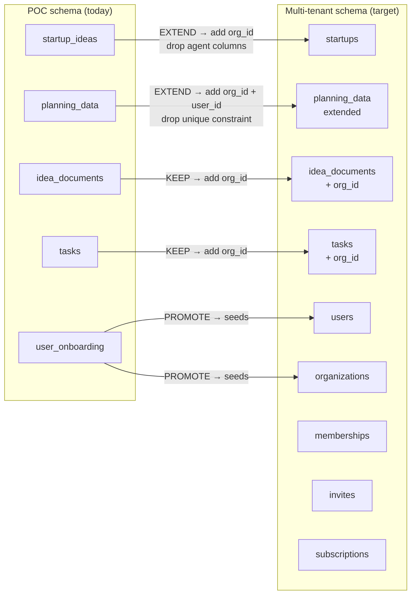
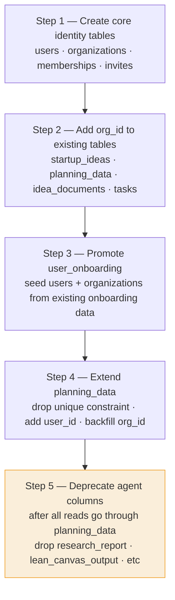

# 08 — POC to Multi-Tenant Migration

> How the current working POC schema maps to the full multi-tenant design.  
> Read this before writing any Alembic migration.

## The honest summary

The POC schema is not wrong — it is a single-user version of the right design. Most tables survive with minor additions. Two structural changes are needed. Nothing is thrown away.

```
Status legend:
  KEEP     — no structural change, add org_id column only
  EXTEND   — existing table, drop a constraint or add columns
  PROMOTE  — data moves to a new table, old table deprecated
  NEW      — does not exist yet, create from scratch
  UNTOUCHED— keep exactly as-is, no changes needed
```


## Table-by-table mapping

### PostgreSQL tables




### `startup_ideas` → `startups`

**Status: EXTEND**

The table keeps its name variant (`startup_ideas` in Alembic, `startups` conceptually). The changes:

| Change | What | Why |
|---|---|---|
| ADD | `org_id VARCHAR(36)` | Tenant key — replaces session_id as the data owner |
| ADD | `is_discoverable BOOLEAN DEFAULT false` | Observatory opt-in flag |
| ADD | `dpiit_number VARCHAR(50)` | Bank and govt filtering |
| ADD | `gstin VARCHAR(20)` | Bank loan eligibility filter |
| ADD | `mrr INTEGER` | Bank lending filter, Observatory display |
| KEEP | `session_id` | Retained for pre-signup anonymous phase |
| KEEP | `conviction_score`, `conviction_score_status` | Already correct |
| KEEP | `name`, `description`, `space`, `sector`, `location`, `stage` | Already correct |
| DEPRECATE | `research_status`, `research_report` | Move to planning_data rows |
| DEPRECATE | `lean_canvas_status`, `lean_canvas_output` | Move to planning_data rows |
| DEPRECATE | `market_sizing_status`, `market_sizing_output` | Move to planning_data rows |
| DEPRECATE | `financial_projection_status`, `financial_projection_output` | Move to planning_data rows |
| DEPRECATE | `gtm_status`, `gtm_output` | Move to planning_data rows |

**Migration order:** Add `org_id` first. Backfill from session lookup. Deprecate agent columns last — only after all reads go through `planning_data`.

```sql
-- Step 1: add org_id (nullable during transition)
ALTER TABLE startup_ideas ADD COLUMN org_id VARCHAR(36);
ALTER TABLE startup_ideas ADD COLUMN is_discoverable BOOLEAN NOT NULL DEFAULT false;
ALTER TABLE startup_ideas ADD COLUMN dpiit_number VARCHAR(50);
ALTER TABLE startup_ideas ADD COLUMN gstin VARCHAR(20);
ALTER TABLE startup_ideas ADD COLUMN mrr INTEGER;

-- Step 2: at signup, promote session idea to org idea
UPDATE startup_ideas
SET org_id = :new_org_id
WHERE session_id = :browser_session_id
AND org_id IS NULL;

-- Step 3 (later, after planning_data migration is validated):
ALTER TABLE startup_ideas DROP COLUMN research_status;
ALTER TABLE startup_ideas DROP COLUMN research_report;
-- ... repeat for all agent output columns
```


### `planning_data` — keep name, extend columns

**Status: EXTEND**

This is the best-designed table in the POC. `(idea_id, panel)` one-row-per-panel-type was right for a single user. For multi-user it becomes one-row-per-run — the unique constraint is dropped.

| Change | What | Why |
|---|---|---|
| ADD | `org_id VARCHAR(36)` | Tenant key |
| ADD | `user_id VARCHAR(36)` | Who triggered this run — audit trail |
| DROP | `UNIQUE (idea_id, panel)` | Allow multiple runs per panel type |
| KEEP | `panel` | Agent type identifier — already correct |
| KEEP | `output_data JSONB` | Agent output — already correct |
| KEEP | `user_selections JSONB` | Founder edits — already correct |
| KEEP | `minio_key` | Large output storage — already correct |
| KEEP | `status`, `error` | Run lifecycle tracking — already correct |

**The `panel` values map to agent types:**

| `panel` value | Agent |
|---|---|
| `market_research` | Market Research Agent |
| `conviction_scorer` | Conviction Scorer |
| `lean_canvas` | Lean Canvas Agent |
| `market_sizing` | TAM/SAM/SOM Agent |
| `financial_projections` | Financial Projections Agent |
| `gtm` | GTM Strategy Agent |

```sql
-- Drop unique constraint
ALTER TABLE planning_data DROP CONSTRAINT uq_planning_idea_panel;

-- Add tenant and audit columns
ALTER TABLE planning_data ADD COLUMN org_id VARCHAR(36);
ALTER TABLE planning_data ADD COLUMN user_id VARCHAR(36);

-- Backfill org_id from the parent startup_ideas row
UPDATE planning_data pd
SET org_id = si.org_id
FROM startup_ideas si
WHERE pd.idea_id = si.id
AND si.org_id IS NOT NULL;
```


### `idea_documents` — add org_id

**Status: KEEP + extend**

No structural change. Just add `org_id` for tenant scoping so document queries can filter without joining through `startup_ideas`.

```sql
ALTER TABLE idea_documents ADD COLUMN org_id VARCHAR(36);

UPDATE idea_documents id
SET org_id = si.org_id
FROM startup_ideas si
WHERE id.idea_id = si.id;

CREATE INDEX idx_idea_documents_org_id ON idea_documents(org_id);
```


### `tasks` — add org_id

**Status: KEEP + extend**

Same as `idea_documents`. Tasks belong to the startup org, not to any individual.

```sql
ALTER TABLE tasks ADD COLUMN org_id VARCHAR(36);

UPDATE tasks t
SET org_id = si.org_id
FROM startup_ideas si
WHERE t.idea_id = si.id;

CREATE INDEX idx_tasks_org_id ON tasks(org_id);
```


### `user_onboarding` — promote into users + org seeding

**Status: PROMOTE**

`user_onboarding` captures a one-time snapshot of who the user is and what they want. In the full design, this data seeds:
- `users` table — `user_id`, `role` → `active_persona`
- `organizations` table — org name derived from answers
- `startups` table — `space`, `location`, `tech_background`, `current_stage` from `answers` JSONB

The `user_onboarding` table can be retained as a historical log of the original answers, but it should no longer be the authoritative source for role or persona. Those live on `users.active_persona`.

| `user_onboarding` field | Migrates to |
|---|---|
| `user_id` | `users.id` |
| `role` | `users.active_persona` |
| `answers.space` | `startups.sector` |
| `answers.location` | `startups.location` |
| `answers.tech_background` | `startups.tech_background` |
| `answers.current_stage` | `startups.stage` |
| `view_mode` | UI state — keep on `user_onboarding` or move to `users` |
| `completed_at` | Keep as audit timestamp |


### New tables — create fresh

These do not exist in the POC. None of them require touching existing data.

| Table | Purpose | Add when |
|---|---|---|
| `users` | Auth + identity layer | Before any multi-user feature |
| `organizations` | Tenant boundary | Before any multi-user feature |
| `memberships` | User ↔ org join | Before any multi-user feature |
| `invites` | Pending membership promises | Before invite flow |
| `subscriptions` | Billing state per org | Before payment integration |
| `startup_milestones` | Public progress events | Before Observatory |
| `investor_profiles` | Investor directory opt-in | Before investor persona |
| `deal_pipeline` | VC deal tracking | Before investor persona |
| `connection_requests` | Cross-org handshake | Before two-way discovery |
| `bank_profiles` | Bank directory opt-in | Before bank persona |
| `loan_applications` | Loan pipeline | Before bank persona |
| `scheme_profiles` | Govt scheme directory | Before govt persona |
| `scheme_applications` | Scheme pipeline | Before govt persona |
| `mentor_profiles` | Mentor directory | Before mentor persona |
| `mentor_sessions` | Session booking | Before mentor persona |
| `mentor_reviews` | Session reviews | Before mentor persona |


### SQLite databases — untouched

**Status: UNTOUCHED**

Both cache databases stay exactly as they are. They hold shared reference data — not tenant data.

| Database | Tables | Action |
|---|---|---|
| `govt.db` | `govt_schemes`, `govt_cache_meta` | No changes. No org_id needed. |
| `pulse.db` | `pulse_articles`, `pulse_cache_meta` | No changes. No org_id needed. |

> **Rule:** Never add `org_id` to reference/cache tables. Reference data is shared across all tenants by design. Adding tenant scoping would create data duplication with no benefit.


## The 5-step migration sequence

Run these steps in order. Each step is independently deployable — the POC keeps working between steps.



> **Warning on Step 5:** Do not rush this step. Keep the agent output columns as nullable fallbacks during the transition. Only drop them after the planning_data rows are fully populated and all API reads have been updated to use planning_data exclusively.


## What the query pattern looks like before and after

### Before (POC — session scoped)

```python
# Get startup idea for current session
idea = db.query(
    "SELECT * FROM startup_ideas WHERE session_id = %s",
    request.session_id
)
```

### After (multi-tenant — org scoped)

```python
# Middleware has already set request.tenant_id = org_id
idea = db.query(
    "SELECT * FROM startup_ideas WHERE org_id = %s",
    request.tenant_id
)
```

### After — planning_data history query

```python
# Get all market research runs for this startup, newest first
runs = db.query(
    """SELECT pd.*, u.email as triggered_by
       FROM planning_data pd
       JOIN users u ON u.id = pd.user_id
       WHERE pd.org_id = %s
       AND pd.panel = 'market_research'
       ORDER BY pd.created_at DESC""",
    request.tenant_id
)
```


*Back to [[index|Index]] · See also: [[06-security-model|Security Model]] · [[07-decisions-log|Decisions Log]]*
