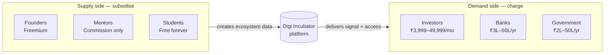
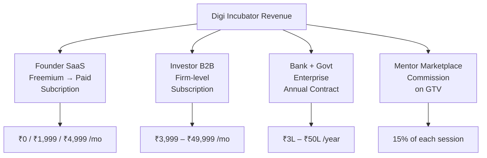
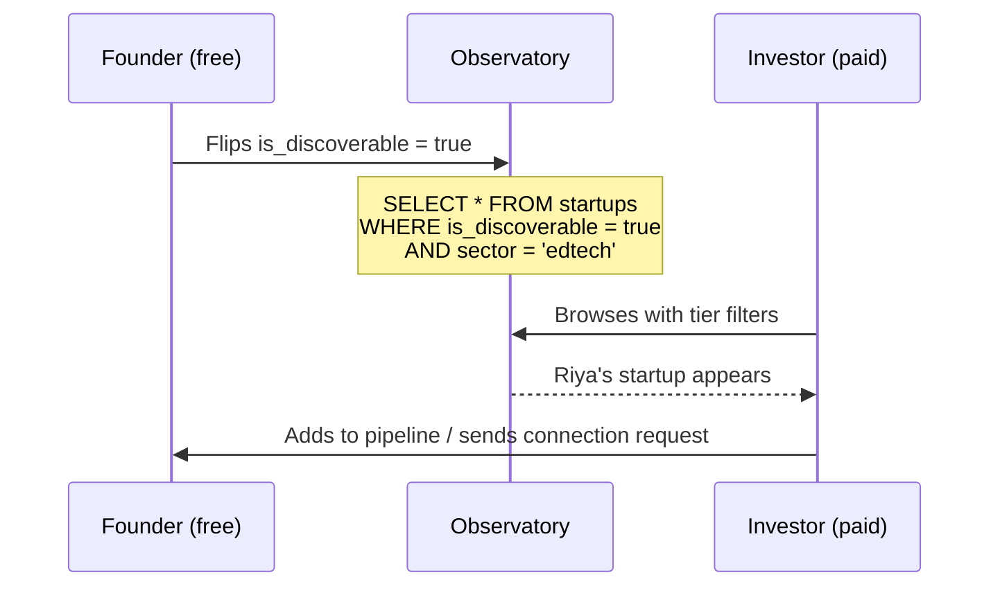
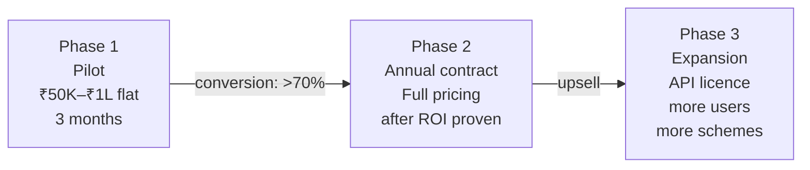
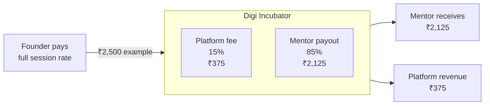
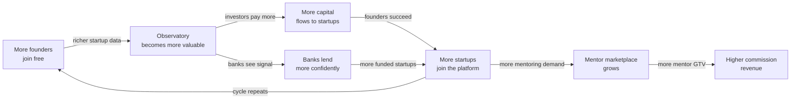
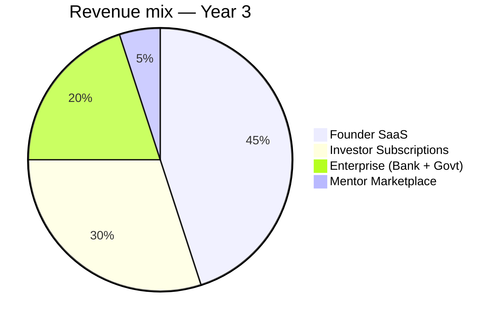

# 09 — Pricing Architecture

> How Digi Incubator charges across six personas, why each model was chosen, and how all four revenue streams compound together.


## The core principle — who pays, and why

Digi Incubator is a multi-sided platform. The fundamental pricing rule for any marketplace:

> **Subsidise the supply side. Charge the demand side.**

Founders and mentors create the raw material — startup data, traction signals, expertise — that every other persona pays to access. Charge them too much and the platform starves. Investors, banks, and government bodies consume that data with clear, measurable ROI. They can and should pay more.



---

## Willingness to pay — what each persona compares your price to

Before setting any number, understand the mental anchor each persona uses.

| Persona | Comparing price to | Their ROI per ₹1 spent |
|---|---|---|
| Founder | Hiring a consultant (₹5K–20K/session) | High — saves 40+ hours of research |
| VC firm | Missing one good deal (₹10Cr+ return) | Extreme — one deal = 10 years of subscription |
| Solo angel | Cost of manual sourcing + due diligence | High — saves 20+ hours per deal |
| Bank | Cost of one bad loan (₹25L+ write-off) | Extreme — one avoided bad loan = 2 years subscription |
| Government | Cost of manual scheme matching + admin | Medium — efficiency gain, political value |
| Mentor | Finding clients themselves (LinkedIn, referrals) | Medium — platform brings clients, takes 15% |

The investor's and bank's ROI is so extreme that your price almost cannot be too high for the value delivered. The founder's ROI is real but more modest — which is why freemium is the right entry point.


## The four revenue streams




## Stream 1 — Founder SaaS (Freemium)

### The freemium philosophy

The freemium gate is the most important product decision in the entire pricing architecture. What you lock away tells a story about what you value.

**The correct gate is agent run volume — not feature type.**

Every founder should be able to see what all features look like. The limit is how many times they can use them. This drives upgrades from active users who have already seen the value, not confused users who haven't.

### Tiers



```mermaid
flowchart LR
    subgraph Explorer["Explorer — Free"]
        E1[3 AI agent runs total]
        E2[Conviction score — 1 run]
        E3[Lean canvas — 1 run]
        E4[Observatory opt-in]
        E5[2 investor requests/mo]
        E6[500MB storage]
    end

    subgraph Builder["Builder — ₹1,999/mo ★"]
        B1[Unlimited AI agent runs]
        B2[All agents incl. GTM + financials]
        B3[Pitch deck generator]
        B4[Unlimited investor requests]
        B5[10GB storage]
        B6[Up to 3 team members]
    end

    subgraph Scale["Scale — ₹4,999/mo"]
        S1[Everything in Builder]
        S2[Unlimited team members]
        S3[White-label pitch exports]
        S4[API access]
        S5[Dedicated onboarding]
    end

    Explorer -->|upgrade trigger| Builder
    Builder -->|team grows| Scale
```

| Feature | Explorer (Free) | Builder (₹1,999/mo) | Scale (₹4,999/mo) |
|---|---|---|---|
| AI agent runs | 3 total | Unlimited | Unlimited |
| Market research | 1 run | Unlimited | Unlimited |
| Conviction score | 1 run | Unlimited | Unlimited |
| Lean canvas | 1 run | Unlimited | Unlimited |
| GTM + financial agents | Locked | Included | Included |
| Pitch deck generator | Locked | Included | Included |
| Observatory opt-in | Free | Free | Free |
| Investor connection requests | 2/month | Unlimited | Unlimited |
| Document storage | 500MB | 10GB | Unlimited |
| Team members | 1 | Up to 3 | Unlimited |
| White-label exports | — | — | Included |
| API access | — | — | Included |

### Annual pricing

| Plan | Monthly | Annual | Saving |
|---|---|---|---|
| Builder | ₹1,999/mo | ₹19,999/yr | 2 months free |
| Scale | ₹4,999/mo | ₹49,999/yr | 2 months free |

### The freemium rules — never break these

**1. The conviction score must be free on the first run.**
It is the product's best demonstration of value. A founder who never experiences it will never upgrade.

**2. Observatory opt-in must always be free.**
It is the mechanism that creates value for investors. If founders pay to appear in the Observatory, investor discovery breaks.

**3. Mentor booking must always be free for founders.**
This drives the mentor marketplace GTV, which is a separate revenue stream.

### The upgrade moment

Riya uses her free market research run. She gets a detailed report on the EdTech landscape in rural India. Two weeks later she has new data and wants to re-run. She hits the limit. At this moment she is a motivated buyer — she has seen the value, she wants more. That is the upgrade moment. This is the correct way to build freemium conversion.


## Stream 2 — Investor B2B (Subscription)

### The core decision — firm pays, not individual

The deal pipeline, the Observatory access, the portfolio analytics — all of this belongs to the firm, not to the analyst. If Sneha adds a startup to the pipeline, Vikram sees it when he logs in tomorrow. The subscription is per-firm, not per-seat.

### Tiers

| Plan | Price | Who it's for |
|---|---|---|
| Solo angel | ₹3,999/mo | Individual investors with no team |
| VC firm | ₹24,999/mo | 2–5 person investing teams |
| VC firm — large | ₹49,999/mo | 10+ analyst firms |

| Feature | Solo angel | VC firm | VC firm — large |
|---|---|---|---|
| Observatory access | Full | Full + advanced filters | Full + custom filters |
| Deal pipeline | 50 deals | Unlimited | Unlimited |
| Team members | 1 | Up to 5 | Unlimited |
| Investor profile — visible to founders | Included | Included | Included |
| Bulk sector + stage filters | — | Included | Included |
| Portfolio analytics dashboard | — | Included | Included |
| API + data export | — | — | Included |
| Dedicated account manager | — | — | Included |

### Annual pricing

| Plan | Monthly | Annual | Saving |
|---|---|---|---|
| Solo angel | ₹3,999/mo | ₹39,999/yr | 2 months free |
| VC firm | ₹24,999/mo | ₹2,49,999/yr | 2 months free |
| VC firm — large | ₹49,999/mo | ₹4,99,999/yr | 2 months free |

### The solo angel rule — silent org, not user_id

Every solo investor gets an org even though they start alone. If Karan's deal pipeline was scoped to his `user_id`, adding an analyst later would require migrating every row. With a silent org from day one, adding a team member is one `INSERT` into `memberships`. The pricing tier (`individual_investor`) distinguishes them from `vc_firm` in the UI — the underlying data structure is identical.

### Observatory access gates deal flow



The Observatory is what makes the investor subscription worth paying for. Protect it — never give investors Observatory access on a free tier.


## Stream 3 — Bank + Government (Enterprise Contracts)

### Why enterprise pricing is different

Prashant at Canara Bank cannot approve a ₹25,000/month subscription on a credit card. He needs a purchase order, a vendor registration, an invoice, and his manager's sign-off. Your pricing page just needs to say **"Contact us for enterprise pricing."** The number is determined in conversation, not on a webpage.

### Pricing ranges

**Banks and lending institutions**

| Package | Annual price |
|---|---|
| Pilot — MSME desk (3 months) | ₹50K–₹1L flat fee |
| Small bank — MSME lending access | ₹3L–₹5L/yr |
| Full MSME lending integration | ₹8L–₹15L/yr |
| API + data feed licence | ₹20L–₹50L/yr |

**Government bodies**

| Package | Annual price |
|---|---|
| Single scheme pilot MoU | ₹2L–₹5L/yr |
| State govt — full ecosystem dashboard | ₹8L–₹20L/yr |
| Central govt / DPIIT — national licence | ₹25L–₹50L/yr |

### The 3-phase enterprise sales model



Never ask a bank to sign an annual contract without a paid pilot. The pilot removes their procurement risk. Your target conversion from pilot to annual contract should be above 70% — if it is not, the product is not delivering enough value and that is a product problem, not a pricing problem.

### What banks and govt can see vs cannot see

| Visible via Observatory | Never accessible |
|---|---|
| Startup name, sector, stage | Private agent_runs and market research |
| Conviction score | Lean canvas notes |
| Public milestones | Financial projections |
| GSTIN presence (yes/no) | Individual founder contact before consent |
| MRR (if founder made public) | Other investors' deal notes |

The `connection_requests` table is the only controlled bridge. A bank contacts a startup through the platform — the startup consents — then contact details unlock. The bank's internal loan notes and credit scoring remain entirely private to their org.


## Stream 4 — Mentor Marketplace (Commission)

### Never charge mentors a subscription

| Approach | What happens |
|---|---|
| Subscription model | Mentors hesitate before earning anything — low join rate |
| Commission model | Zero barrier to join — mentors earn, Digi Incubator earns |

The commission model perfectly aligns incentives: Digi Incubator earns only when the mentor earns. This is the right structure for marketplace supply-side acquisition.

### Commission structure



| | Amount (example: ₹2,500 session) |
|---|---|
| Founder pays | ₹2,500 |
| Digi Incubator commission (15%) | ₹375 |
| Mentor receives | ₹2,125 |

### Commission calculation — locked at booking time

```
gross_amount  = session_rate × (duration_mins / 60)
platform_fee  = gross_amount × 0.15
mentor_payout = gross_amount - platform_fee
```

These values are calculated once and stored as fixed integers at booking. Refund and dispute logic reads from this fixed value — no recalculation needed. No ambiguity.

### Mentor session rate range

| Mentor type | Typical rate |
|---|---|
| Domain expert (early career) | ₹500–₹1,500/hr |
| Senior professional | ₹1,500–₹3,500/hr |
| Serial founder / ex-CXO | ₹3,500–₹10,000/hr |

### Future lever — optional premium listing

At scale (once mentors have consistent bookings), introduce an optional premium listing at ₹499/mo. This pushes a mentor's profile to the top of search results. It is never mandatory — it is a growth lever, not a gate.


## Students — free, always

Students pay nothing. They browse the Observatory in read-only mode, follow public startup journeys, and learn from real traction data.

This is not a freemium tier with a planned upgrade. This is a deliberate long-term acquisition decision.

Every student on Digi Incubator is a potential founder in 2–3 years. When they are ready to build, they already know the platform, already trust it, and will sign up on their first day of building. The cost is storage. The return is a warm acquisition pipeline that compounds year over year.


## The network flywheel — how pricing drives compounding

Each revenue stream reinforces the others. The pricing model is designed to accelerate this.



The freemium entry point for founders is deliberately generous — because every founder who joins makes the platform more valuable for everyone else. Pricing friction at the top of the funnel kills the flywheel before it starts.


## Revenue projections

| Year | Founders (paid) | VC firms | Enterprise deals | Mentor GTV | Total ARR |
|---|---|---|---|---|---|
| Year 1 | 500 × ₹2K/mo avg | 20 × ₹25K/mo | 0 | ₹5L/mo GTV | **₹46L** |
| Year 2 | 5,000 × ₹2K/mo avg | 150 × ₹25K/mo | 2 × ₹8L/yr | ₹50L/mo GTV | **₹5Cr** |
| Year 3 | 20,000 × ₹2K/mo avg | 500 × ₹25K/mo | 10 × ₹12L/yr | ₹2Cr/mo GTV | **₹25Cr** |

### Revenue mix — Year 3



### Key metrics

| Metric | Target |
|---|---|
| Founder average ARPU | ₹2,000/mo |
| VC firm average ARPU | ₹25,000/mo |
| LTV:CAC ratio | 5× by Month 18 |
| Mentor platform commission rate | 15% |
| Enterprise pilot → contract conversion | >70% |


## Pricing decisions log

### PD-01 — Freemium gate is volume, not features

**Decision:** Every founder can see all features. The limit is how many times they can use them per month.

**Why:** Gating by feature type (e.g., locking the conviction score entirely) means users never experience the product's best moments. They can't upgrade to something they've never seen. Volume gates let users experience the value and then hit a natural wall at the moment they are most motivated to pay.


### PD-02 — Observatory opt-in is always free for founders

**Decision:** `is_discoverable` toggle costs founders nothing, on any plan.

**Why:** The Observatory is the primary value driver for investor subscriptions. If founders pay to appear in it, fewer founders opt in. Fewer startups in the Observatory means less value for investors, which means lower investor conversion. Charging founders for Observatory access would damage the highest-margin revenue stream.


### PD-03 — Investor subscription is per-firm, not per-seat

**Decision:** One subscription covers the entire firm. Pricing scales by firm size and feature tier, not by headcount.

**Why:** Per-seat pricing creates incentives to limit access within a firm — partners don't give analysts accounts to save money. This reduces engagement with the platform and hurts the data quality of the deal pipeline. Per-firm pricing aligns everyone's incentives: the more team members use the platform, the more valuable it becomes.


### PD-04 — Banks always start with a paid pilot

**Decision:** No enterprise contract without a 3-month paid pilot first.

**Why:** Annual enterprise contracts fail when the buyer hasn't experienced the value. A ₹1L pilot that converts to a ₹12L annual deal is better than a ₹12L proposal that takes 18 months to close and fails at procurement. The pilot removes institutional risk. Target conversion rate: >70%.


### PD-05 — Mentors pay zero to join

**Decision:** Mentors are never charged a subscription. Digi Incubator earns only when they earn.

**Why:** Charging mentors before they have earned anything creates a high-friction join. The marketplace needs supply-side density to be useful — which means the join barrier must be as low as possible. Commission alignment means Digi Incubator has a direct incentive to drive bookings, not just sign-ups.


### PD-06 — 15% commission rate at launch

**Decision:** Start at 15%. Move to 18–20% only when the platform has meaningful pricing power.

**Why:** 15% is below what most coaching platforms charge (20–30%) but enough to build a real revenue line. Raising the rate before mentors have alternatives means they stay. Raising it too early when mentors can simply use Calendly instead drives them away.


### PD-07 — Students are free, always — not a trial

**Decision:** Student access is free and unlimited in time. No upgrade path, no time limit, no card required.

**Why:** Students are not a revenue opportunity today. They are a 2–3 year warm acquisition pipeline for the founder persona. Any pricing friction on students reduces the size of this future pipeline. The cost (storage, compute) is marginal. The long-term return compounds every year.


*Back to [[index|Index]] · See also: [[01-founder|Business Model — Persona files]]*
