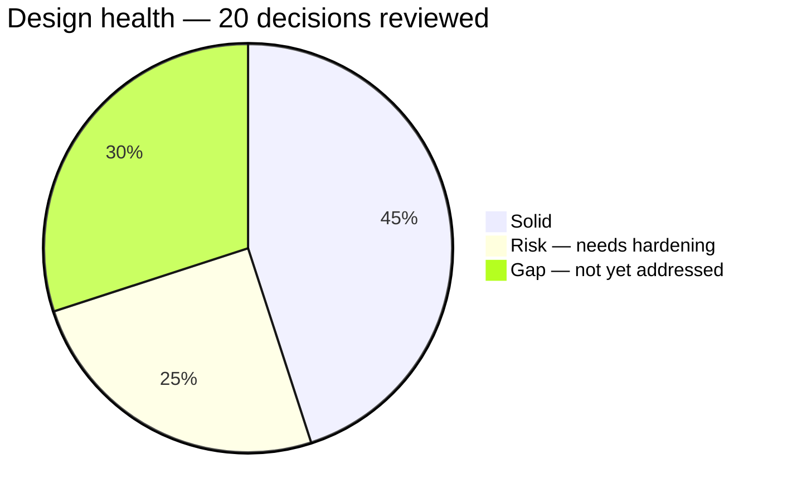
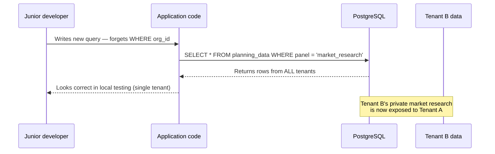
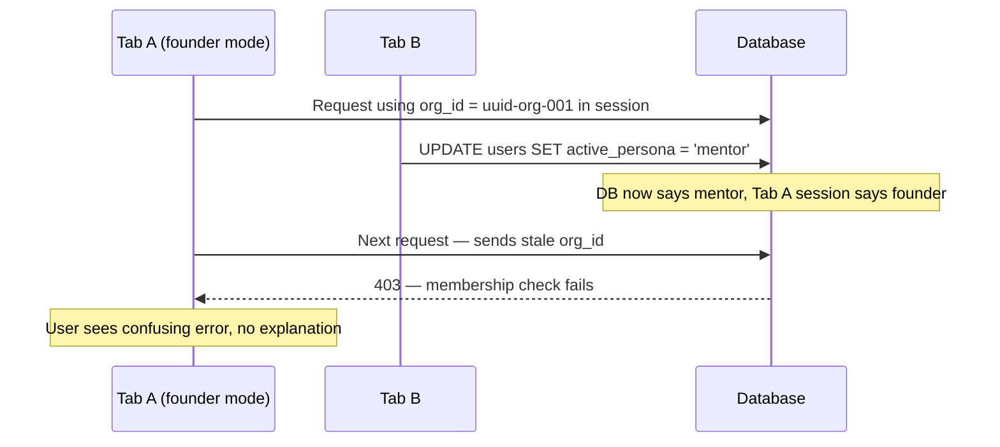
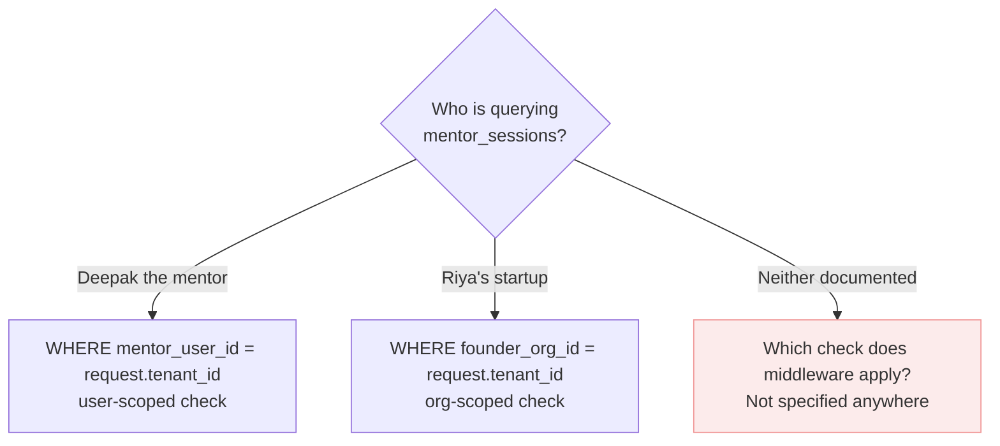
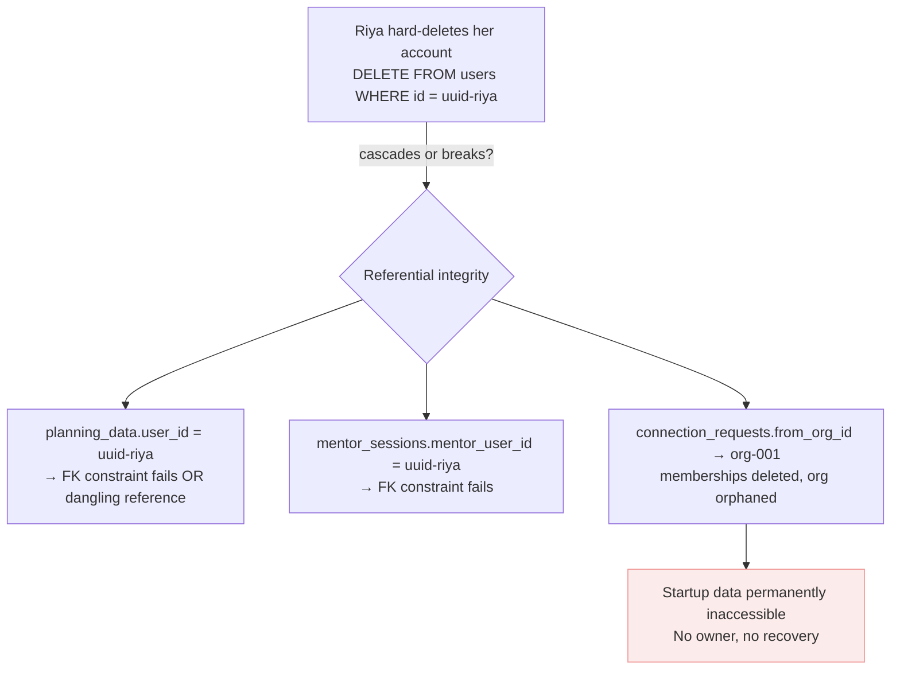
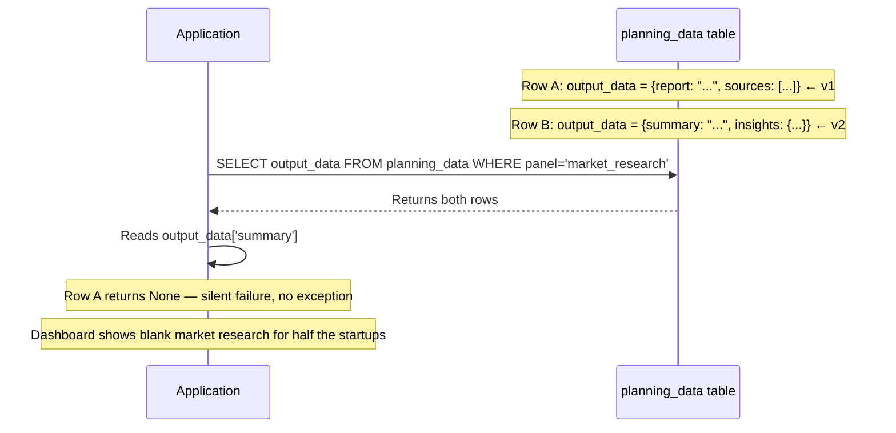

# 10 — Inversion Analysis: Multi-Tenancy

> **Method:** Instead of asking "how does the design work?", ask "what would make this design fail?" Every assumption is treated as potentially wrong until proven right. Solid decisions are confirmed. Risks are named. Gaps are flagged for action.

> **Result:** The core architecture is ~85% solid. All gaps are additive hardening — nothing in the structural design needs to be undone.


## Summary scorecard



| Status | Count | Nature |
|---|---|---|
| Solid | 9 | Core decisions are correct and hold under inversion |
| Risk | 5 | Correct concept, incomplete or fragile execution |
| Gap | 6 | Entirely unaddressed — additive work needed |


## Inversion 1 — Row-level isolation

### The assumption being tested

> "Missing a WHERE org_id = ... clause on a query is a data leak — code reviews must catch this."

### What inversion reveals

Code reviews are human. As the team grows from 2 to 10 engineers, the probability of a missing `WHERE org_id` clause reaching production approaches certainty. The design relies entirely on developer discipline — there is no system-level enforcement preventing a cross-tenant data leak.

**The failure mode:**



### The fix

PostgreSQL Row Level Security (RLS) enforces tenant isolation at the database engine level. No application query can bypass it.

```sql
-- Enable RLS on every domain table
ALTER TABLE startups        ENABLE ROW LEVEL SECURITY;
ALTER TABLE planning_data   ENABLE ROW LEVEL SECURITY;
ALTER TABLE deal_pipeline   ENABLE ROW LEVEL SECURITY;
ALTER TABLE loan_applications ENABLE ROW LEVEL SECURITY;

-- Create isolation policy (application sets current org at request start)
CREATE POLICY tenant_isolation ON startups
    USING (org_id = current_setting('app.org_id', true)::uuid);

-- Set at request start in middleware
SET LOCAL app.org_id = 'uuid-org-001';
```

### Decision required

- **Option A:** Add RLS before any real tenant data enters the system (recommended)
- **Option B:** Keep code-discipline approach, add RLS later as a hardening step

> **Verdict:** RLS is not a replacement for good query hygiene — it is the safety net under it. A platform handling investor deal notes, bank loan data, and government scheme information cannot rely on discipline alone. One cross-tenant leak is a platform-ending event.


## Inversion 2 — Observatory security

### The assumption being tested

> "The whitelist is the protection. Only explicitly allowed fields are returned. Private tables are never touched."

### What inversion reveals

`OBSERVATORY_PUBLIC_FIELDS` is a Python list. Any developer can add a `JOIN` to the Observatory query without realising the security implication. There is no database-level mechanism preventing private data from being accidentally included.

**Second gap:** `conviction_score` is in the public whitelist — but it is an AI-generated number. Investors and banks are making financial decisions based on it. There is no disclaimer, no governance policy, and no liability framework documented anywhere.

**Third gap:** No rate limiting on Observatory queries. A competitor or scraper can programmatically pull all discoverable startup data with no throttle.

### The fix

Replace the Python whitelist with a PostgreSQL view:

```sql
CREATE VIEW observatory_view AS
SELECT
    s.id,
    s.name,
    s.tagline,
    s.sector,
    s.stage,
    s.state,
    s.conviction_score,
    s.mrr,
    s.dpiit_number IS NOT NULL AS has_dpiit,
    s.gstin IS NOT NULL AS has_gstin
FROM startups s
WHERE s.is_discoverable = true
  AND s.deleted_at IS NULL;

-- Application queries this view, never the raw table
-- A developer cannot accidentally JOIN private tables through a view
```

### Decision required

- Replace `OBSERVATORY_PUBLIC_FIELDS` Python list with `observatory_view` DB view
- Define and document `conviction_score` disclaimer language for Observatory display
- Add rate limiting: suggested 100 requests/minute per `org_id` on the Observatory endpoint


## Inversion 3 — Session and persona desync

### The assumption being tested

> "`active_persona` in the database and in the browser session are always in sync."

### What inversion reveals

**Scenario A — multi-tab desync:**



**Scenario B — membership revoked mid-session:**

Riya is removed from her startup by another owner while she has an active session. Her next request gets a 403 with no graceful redirect — just a raw error. No documented recovery path exists.

**Scenario C — persona/org mismatch:**

A user manipulates the API to set `active_persona = 'investor'` while having no investor org membership. The middleware should detect this — but the validation is not explicitly documented.

### The fix

```python
def tenant_middleware(request, handler):
    user = get_user_from_session(request)

    if user.active_persona in ORG_BASED_PERSONAS:
        org_id = get_active_org_id(request, user)
        membership = db.query(
            "SELECT role FROM memberships WHERE user_id=%s AND org_id=%s AND deleted_at IS NULL",
            user.id, org_id
        )
        if not membership:
            # Graceful path — not a raw 403
            redirect_to_persona_selector(request)
            return

        # Validate persona matches org_type
        org = db.query("SELECT org_type FROM organizations WHERE id=%s", org_id)
        if not persona_matches_org_type(user.active_persona, org.org_type):
            raise HTTP403("Persona and organization type mismatch")
```

### Decision required

- Document the graceful failure paths (revoked membership, stale session, persona mismatch)
- Add session invalidation on `active_persona` change — all other tabs get redirected to persona selector


## Inversion 4 — The mentor bridge table

### The assumption being tested

> "The security middleware handles all queries correctly."

### What inversion reveals

The middleware has two modes: org-scoped and user-scoped. `mentor_sessions` needs **both simultaneously** — `mentor_user_id` (user-scoped) and `founder_org_id` (org-scoped). The middleware as documented does not show which mode applies, or how it handles both.



**Second gap:** `mentor_reviews.reviewer_org_id` — what if a student (no org) leaves a review? Students are user-scoped. `reviewer_org_id` would be `NULL`. Referential integrity breaks, or the student simply cannot leave a review — but neither outcome is documented.

### The fix

`mentor_sessions` needs its own explicit security rules documented separately from the generic middleware:

```python
def mentor_sessions_query(request):
    if request.user.active_persona == 'mentor':
        # Mentor sees their own sessions
        return db.query(
            "SELECT * FROM mentor_sessions WHERE mentor_user_id = %s",
            request.user.id
        )
    elif request.user.active_persona == 'founder':
        # Startup sees sessions they booked
        return db.query(
            "SELECT * FROM mentor_sessions WHERE founder_org_id = %s",
            request.tenant_id  # org_id
        )
```

For `mentor_reviews` — decide one of:
- Add `reviewer_user_id` as nullable alongside `reviewer_org_id` (covers students)
- Restrict reviews to paying founders only (simpler, fewer edge cases)


## Inversion 5 — The orphan problem

### The assumption being tested

> "When data is deleted, the system handles it cleanly."

### What inversion reveals

There is no `deleted_at` column on any table in the schema. Hard-deleting any row with foreign key references will cause referential integrity failures across multiple tables.



**Three orphan scenarios:**

| Scenario | What happens | Documented fix? |
|---|---|---|
| Only owner deletes account | Org exists with 0 members — permanently inaccessible | No |
| Founder archives startup | `planning_data` cascade deletes — investors' `deal_pipeline.startup_id` now dangling | No |
| User deletes account | `planning_data.user_id`, `mentor_sessions.mentor_user_id` FK failures | No |

### The fix

Add soft deletes to every entity table:

```sql
-- Add to all entity tables
ALTER TABLE users          ADD COLUMN deleted_at TIMESTAMP NULL;
ALTER TABLE organizations  ADD COLUMN deleted_at TIMESTAMP NULL;
ALTER TABLE memberships    ADD COLUMN deleted_at TIMESTAMP NULL;
ALTER TABLE startups       ADD COLUMN deleted_at TIMESTAMP NULL;

-- Every query must include:
WHERE deleted_at IS NULL

-- Owner transfer flow (prevents org orphaning)
CREATE TABLE ownership_transfers (
    id          UUID PRIMARY KEY,
    org_id      UUID NOT NULL,
    from_user   UUID NOT NULL,
    to_user     UUID NOT NULL,
    status      VARCHAR(20) DEFAULT 'pending',
    created_at  TIMESTAMP NOT NULL
);
```


## Inversion 6 — Performance at scale

### The assumption being tested

> "The query patterns are correct."

### What inversion reveals

The queries are correct. They are not indexed. At 20,000 startup orgs each with 10–50 `planning_data` rows, and 500 VC firms running Observatory queries 50 times a day — the missing indexes become production incidents.

**Critical missing indexes:**

```sql
-- 1. Dashboard: every panel load runs this query
--    Without index: full table scan on planning_data
CREATE INDEX idx_planning_data_org_panel
    ON planning_data(org_id, panel, created_at DESC);

-- 2. Observatory: every investor search runs this
--    Without index: sequential scan of entire startups table
CREATE INDEX idx_startups_observatory
    ON startups(is_discoverable, sector, state)
    WHERE is_discoverable = true;

-- 3. Membership checks: runs on EVERY authenticated request
--    Without index: full scan of memberships table
CREATE INDEX idx_memberships_user_org
    ON memberships(user_id, org_id)
    WHERE deleted_at IS NULL;
```

**Second gap — org_type enum rigidity:**

PostgreSQL `ENUM` types require a database migration to add new values. Adding `accelerator` or `corporate_innovation` as a future persona type forces a production migration with downtime risk.

```sql
-- Current (rigid):
CREATE TYPE org_type AS ENUM ('startup', 'vc_firm', 'bank', 'govt', 'individual_investor');

-- Better (flexible):
-- Use VARCHAR(50) with application-level validation
-- New org types = code change only, no DB migration
org_type VARCHAR(50) NOT NULL CHECK (org_type IN ('startup', 'vc_firm', 'bank', 'govt', 'individual_investor'))
```


## Inversion 7 — JSONB versioning

### The assumption being tested

> "`output_data JSONB` is flexible enough for any agent's output format."

### What inversion reveals

JSONB is flexible. It is also schema-less. When any AI agent is updated to v2 and produces a different output structure, all existing v1 rows silently return wrong data — no error, no exception, just missing fields.



### The fix

One column. Added now. Costs nothing.

```sql
ALTER TABLE planning_data ADD COLUMN agent_version VARCHAR(10) NOT NULL DEFAULT 'v1';

-- Query pattern going forward:
SELECT * FROM planning_data
WHERE org_id = :org_id
  AND panel = 'market_research'
ORDER BY created_at DESC
LIMIT 1;
-- agent_version in the row tells the application which output shape to expect
```


## Six gaps not addressed anywhere

| Priority | Gap | Fix |
|---|---|---|
| P0 — Critical | PostgreSQL RLS not implemented | `ENABLE ROW LEVEL SECURITY` + policies on all domain tables |
| P0 — Critical | No soft deletes anywhere | Add `deleted_at TIMESTAMP NULL` to all entity tables |
| P1 — High | No index strategy documented | Three composite indexes needed before production load |
| P1 — High | No audit log table | `audit_log { user_id, org_id, action, resource, timestamp, ip }` required for enterprise compliance |
| P2 — Medium | Observatory is a code whitelist, not a DB view | `CREATE VIEW observatory_view` — enforced at database level |
| P2 — Medium | No rate limiting on Observatory | 100 req/min per `org_id` — prevents scraping and DoS |


## Full decision scorecard

| Decision | Status | Note |
|---|---|---|
| Org as tenant — core decision | ✅ Solid | User ≠ tenant is the right separation |
| Row-level isolation model | ✅ Solid | Right choice at seed stage — RLS needed as safety net |
| Three-layer identity model | ✅ Solid | Users, orgs, memberships — clean and extensible |
| Sequential persona switching | ✅ Solid | Simultaneous roles create ambiguous query context |
| Mentor as `user_id` exception | ✅ Solid | Mentoring is inherently personal — correct reasoning |
| Silent org rule for solo investors | ✅ Solid | Prevents painful data migrations — correct call |
| `connection_requests` as bridge | ✅ Solid | Controlled cross-tenant surface — right pattern |
| Never overwrite planning_data rows | ✅ Solid | Full history preserved — audit-friendly |
| `session_id` → `org_id` promotion | ✅ Solid | Correct pre-signup UX pattern |
| Observatory whitelist in code | ⚠️ Risk | Should be a DB view, not a Python list |
| Session desync on persona switch | ⚠️ Risk | Multi-tab and revoked-membership paths undocumented |
| `mentor_sessions` middleware | ⚠️ Risk | Bridge table needs its own documented security rules |
| `org_type` as PostgreSQL ENUM | ⚠️ Risk | Rigid — new persona types require DB migration |
| JSONB `output_data` versioning | ⚠️ Risk | No `agent_version` field — silent failures on agent update |
| PostgreSQL Row Level Security | ❌ Gap | Highest severity — not mentioned anywhere |
| Soft deletes | ❌ Gap | No `deleted_at` on any table — hard deletes corrupt data |
| Index strategy | ❌ Gap | Three critical composite indexes undocumented |
| Audit log | ❌ Gap | Required by enterprise (bank/govt) before onboarding |
| Observatory rate limiting | ❌ Gap | Scraping and DoS risk unaddressed |
| Orphaned org recovery | ❌ Gap | No ownership transfer or admin recovery mechanism |


## What this means for the migration

The [[08-poc-migration|POC migration plan]] is still valid. These gaps are additive — they do not change the migration sequence. They add to it.

**Before any real tenant data enters production, complete:**
1. Add `deleted_at` to all entity tables (soft deletes)
2. Add the three critical composite indexes
3. Add `agent_version VARCHAR(10)` to `planning_data`

**Before enterprise (bank/govt) onboarding:**
4. Implement PostgreSQL RLS policies
5. Replace Observatory Python whitelist with `observatory_view`
6. Create `audit_log` table
7. Add Observatory rate limiting middleware


*Back to [[index|Index]] · See also: [[06-security-model|Security Model]] · [[11-inversion-pricing|Pricing Inversion Analysis]]*
