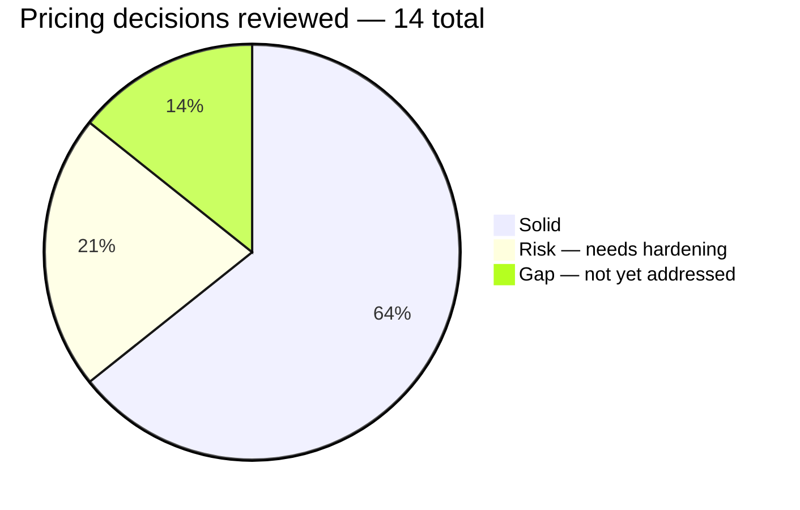
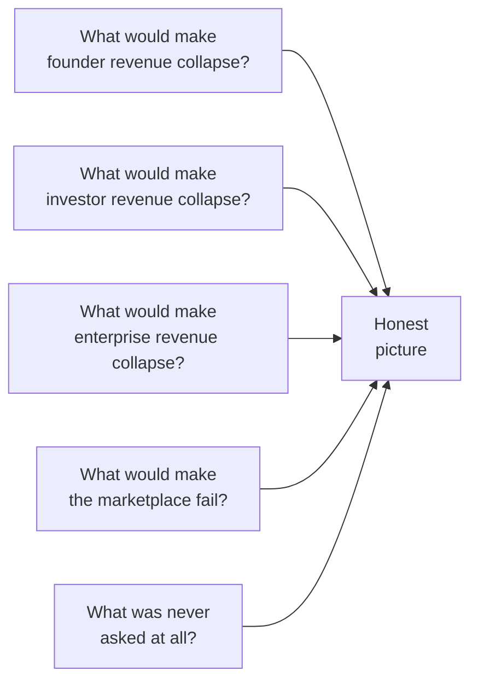
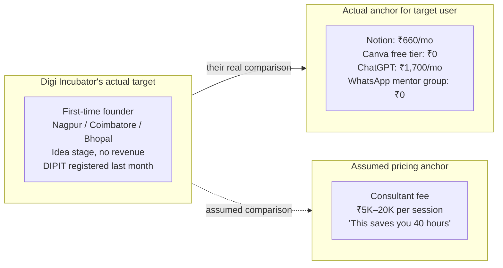
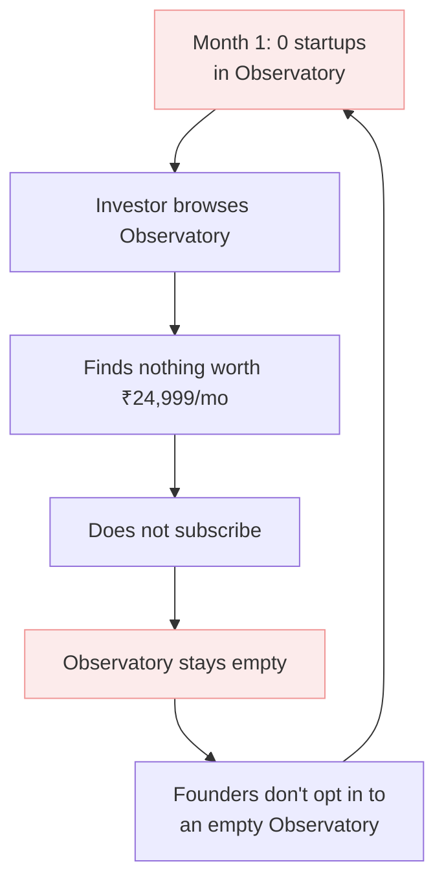
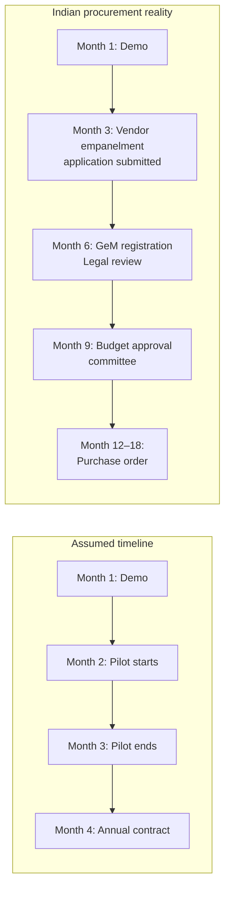
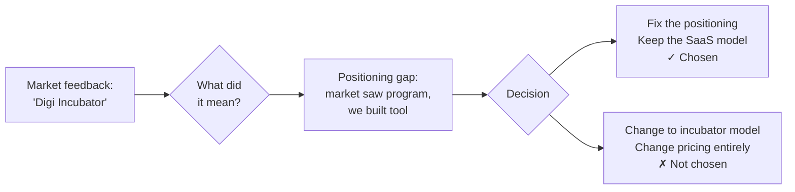

# 11 — Inversion Analysis: Pricing

> **Method:** Instead of asking "is this price correct?", ask "under what conditions does this entire pricing model collapse?" Every assumption treated as potentially wrong.
>
> **Standing decision:** Digi Incubator stays a SaaS tool. Pricing architecture is maintained. The inversion findings inform what needs to be hardened, not what needs to be replaced.
>
> **Result:** ~80% of the pricing model is correct and holds under inversion. The 20% gap is in launch sequencing, missing operational metrics, and one positioning-related ambiguity now resolved.


## Summary scorecard




## The inversion method applied to pricing

Standard pricing review asks: is the price right?

Inversion asks:




## Inversion 1 — Founder willingness to pay

### The assumption being tested

> "₹1,999/month is the right price. Founders compare it to hiring a consultant."

### What inversion reveals

The consultant comparison holds for a funded, metro-based founder at MVP stage. It is the wrong mental anchor for the actual target market.



**The churn gap:** Revenue projections assume 20,000 paid founders by Year 3. At 40% annual churn (India SMB SaaS average), you need ~50,000 cumulative paid signups to net 20,000 active. The GTM cost for that volume is never calculated.

**What's completely absent:** CAC (Customer Acquisition Cost) is mentioned nowhere across all 11 documents. Revenue projections without a cost-of-acquisition model cannot confirm whether unit economics work.

### What this means

The price point may need a lower entry tier — ₹799–₹999/mo — specifically for Tier 2/3 idea-stage founders, with the ₹1,999 Builder tier positioned for founders with at least some revenue or external funding. This is a **go-to-market decision**, not a structural pricing change.


## Inversion 2 — The cold-start problem

### The assumption being tested

> "Investors will pay ₹24,999/month from launch."

### What inversion reveals

Investor WTP is real at steady state. It is wrong at launch.



The flywheel is correct at scale. It does not spin at launch without deliberate intervention.

**Year 1 investor projection:** 20 VC firms × ₹25K/mo = ₹5L/month. This assumes 20 firms are willing to pay full price before the Observatory has density. Under inversion: 20 firms paying ₹0 in exchange for founding member status and testimonials is more likely — and more strategically correct.

### What this means

A **founding member pricing tier** is needed for the first 6 months:

| Founding member offer | Details |
|---|---|
| Who | First 20 VC firms, first 50 angel investors |
| Price | Free or deeply discounted (₹4,999/mo instead of ₹24,999) |
| What they get | Full access + "Founding Investor" badge + input into Observatory features |
| What Digi Incubator gets | Testimonials, referrals, Observatory density, proof of concept |
| Duration | First 6 months only — full pricing after |

This is not in the current pricing doc and must be added before launch.


## Inversion 3 — Enterprise sales timeline

### The assumption being tested

> "3-month paid pilot → 70%+ conversion to annual contract."

### What inversion reveals

Indian government procurement does not happen in 3 months.



**Additional gap — RBI compliance:** Banks cannot integrate a third-party data platform without:
- Formal vendor risk assessment
- Data localisation confirmation (data stored in India)
- RBI IT framework compliance check
- CISO approval

None of this appears anywhere in the pricing or persona documentation. This is not a pricing problem — it is a pre-sales legal requirement that must be resolved before any bank pilot can begin.

### What this means

- Year 2 enterprise revenue (2 bank deals) assumes sales cycles started in Month 1 of Year 1
- A realistic risk-adjusted projection separates base case (no enterprise Year 2) from upside (2 deals)
- RBI compliance and data localisation must be addressed as a product/legal workstream, not just a sales conversation


## Inversion 4 — Mentor marketplace differentiation

### The assumption being tested

> "Mentors will prefer Digi Incubator over existing alternatives at 15% commission."

### What inversion reveals

| Platform | Commission | Audience |
|---|---|---|
| Topmate | 5–10% | Large, established Indian audience |
| Mentorcruise | 20% | Global, niche but high-value |
| iMentor | 0% (nonprofit) | Mission-driven mentors |
| LinkedIn + Calendly | 0% | Direct, zero intermediary |
| **Digi Incubator** | **15%** | **Pre-qualified startup founders (the moat)** |

The moat claim is valid — but only if the founder base is large enough and motivated enough that mentors cannot get equivalent quality inbound directly. In Year 1 with 500–1,000 founders, the moat is thin.

**The supply problem:** Quality mentors — ex-Flipkart PMs, serial founders, ex-CFOs — will not join a marketplace with 500 founders when LinkedIn gives them 5,000 followers for free. The marketplace needs a critical mass of quality founders before quality mentors will prefer it.

### What this means

Mentor marketplace at 5% of Year 3 revenue is the correct projection — it reflects the actual ramp time. The structure (zero subscription, 15% commission) is right. The timeline expectation is already conservative enough to hold.

No structural change needed. Monitor the ratio of quality mentor sign-ups vs active bookings in Year 1 before deciding whether to increase or decrease the commission.


## Inversion 5 — The name signal (resolved)

### The assumption that was tested

> "FounderOS as a name correctly positions the product in the market."

### What the market said

"Digi Incubator."

### What it meant

The market was perceiving the product as a support program (incubator model) rather than a software tool (SaaS model). This revealed a positioning gap — not a pricing gap. The product and its pricing were built for a SaaS mental model. The market was arriving with an incubator mental model.

### The decision made

**Stay SaaS.** The product is a tool, not a program. The name change to Digi Incubator is accepted. The pricing model is maintained.



### What remains to be done

The name change alone does not close the positioning gap. The product narrative — how the landing page, onboarding flow, and first impressions describe what Digi Incubator is — must clearly communicate "this is a tool you use" rather than "this is a program you join." This is a product and marketing workstream, not a pricing workstream.


## What's missing entirely

### Gap 1 — CAC model

**Absent from all 11 documents.**

Revenue projections exist. The cost of acquiring each customer does not.

| Persona | Missing metric |
|---|---|
| Founder | CAC — what does it cost to acquire one paying founder? |
| Investor | Sales cost per firm — who closes enterprise deals and at what salary? |
| Enterprise | Full sales cycle cost — demos, legal, compliance, contracting |
| Mentor | Acquisition cost — how do you find and onboard quality mentors? |

Without CAC, the LTV:CAC ratio of "5× by Month 18" cannot be validated. It is a target without a denominator.

### Gap 2 — Churn and LTV by cohort

**Absent from all 11 documents.**

Annual churn rate is never stated. LTV is never calculated. The Year 3 target of 20,000 active paid founders could require acquiring 50,000+ cumulative — or it could require 25,000 depending on the churn assumption. This difference changes the entire GTM budget.

**Minimum required before fundraising:**

```
Founder LTV = ARPU × (1 / monthly_churn_rate)
             = ₹1,999 × (1 / 0.05)           ← assuming 5% monthly churn
             = ₹39,980

LTV:CAC = 5× → CAC must be < ₹7,996

If actual CAC > ₹7,996, the unit economics do not work at current pricing.
```


## Full decision scorecard

| Decision | Status | Note |
|---|---|---|
| Supply vs demand pricing logic | ✅ Solid | Subsidise founders, charge investors — correct framework |
| Freemium gate — volume not features | ✅ Solid | Volume gates convert better than feature gates |
| Observatory always free for founders | ✅ Solid | Non-negotiable — never gate this |
| Investor per-firm not per-seat | ✅ Solid | Per-seat kills team engagement |
| Mentor commission at 15% | ✅ Solid | Right entry rate — raise only with pricing power |
| Students free forever | ✅ Solid | 2–3 year founder acquisition funnel |
| Enterprise pilot-first model | ✅ Solid | Right structure — timeline assumptions are the risk |
| 4 revenue streams logic | ✅ Solid | Each stream is correctly modelled in isolation |
| Stay SaaS — no incubator model | ✅ Solid | One revenue model, build it right, pivot if needed |
| Founder ₹1,999/mo price point | ⚠️ Risk | May be too high for Tier 2/3 idea-stage founders |
| Investor pricing at launch | ⚠️ Risk | Cold-start problem — founding member tier needed |
| Enterprise Year 2 timeline | ⚠️ Risk | Indian procurement cycles are 2–4× longer than assumed |
| CAC model | ❌ Gap | Revenue projections have no cost-of-acquisition model |
| Churn and LTV by cohort | ❌ Gap | Unit economics cannot be confirmed without these |

---

## Decisions this analysis leaves open

These are not answered here — they need a decision from the team:

1. **Founding member investor tier** — free or deeply discounted for first 20 VC firms? If yes, for how long?

2. **Tier 2/3 founder pricing** — introduce a ₹799/mo entry tier for idea-stage founders in smaller cities? Or keep current structure and accept lower conversion in those geographies?

3. **RBI compliance workstream** — when does this start? Before or after the first bank pilot conversation?

4. **CAC modelling** — who owns this? GTM lead or founder? What channels will be used and at what cost?


*Back to [[index|Index]] · See also: [[09-pricing-architecture|Pricing Architecture]] · [[10-inversion-tenancy|Tenancy Inversion Analysis]]*
