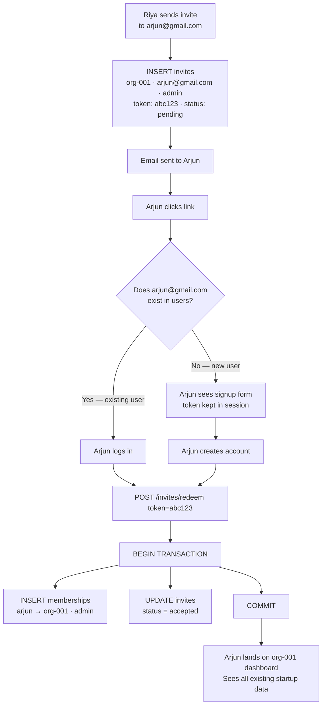
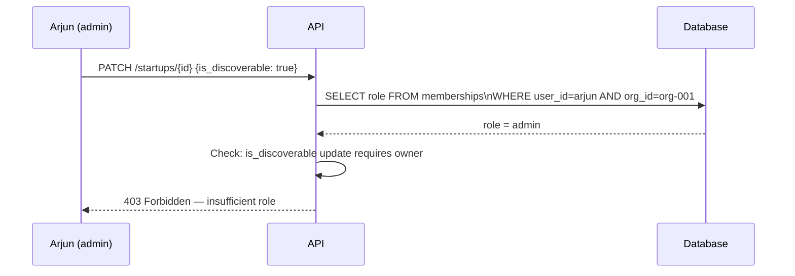

# Flow 02 — Multi-User Invite

> How a second person joins an existing org — existing or new user.

## The two paths through one flow

## What Arjun sees vs what he owns

Arjun can see everything in org-001 the moment he joins. But ownership of existing data does not change.

| Data | Owner |
|---|---|
| Market research run by Riya 2 weeks ago | org-001 (shared) |
| New market research run by Arjun today | org-001 (shared) |
| `user_id` on each agent_run | Records who triggered it |
| `org_id` on each agent_run | Records who owns it |

Both runs belong to the startup. `user_id` is the audit trail, not the owner.

## Role permissions after joining

Arjun joins as `admin`. There is one action he cannot perform — flipping `is_discoverable`. Only the `owner` can do that.

*Back to [[index|Index]] · Next: [[03-second-idea|Second Idea]]*
