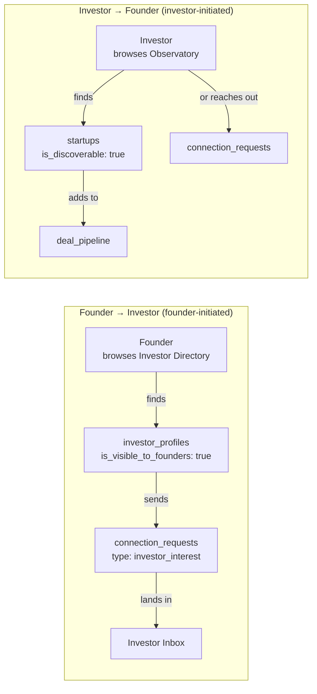
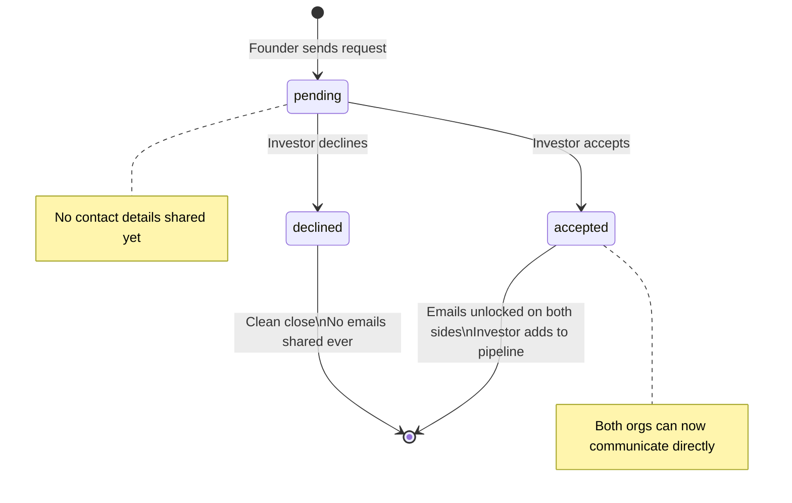
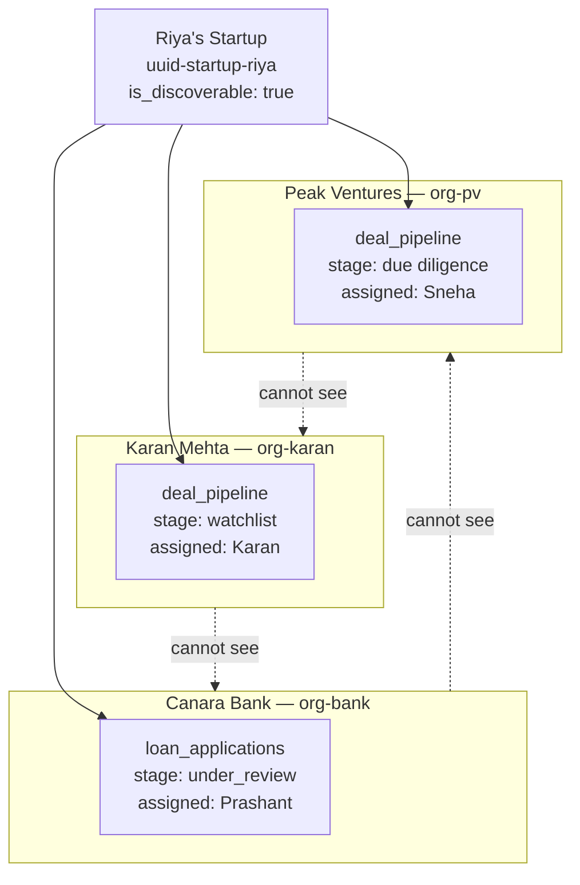

# Flow 04 — Two-Way Discovery

> Investors find founders. Founders find investors. Both sides stay in control.

## The two discovery directions

## The connection_requests handshake

## What is visible before and after acceptance

| Data | Before acceptance | After acceptance |
|---|---|---|
| Startup name, sector, score | ✓ Visible | ✓ Visible |
| Public milestones | ✓ Visible | ✓ Visible |
| Founder's email | ✗ Hidden | ✓ Visible |
| Investor's email | ✗ Hidden | ✓ Visible |
| Investor's deal pipeline | ✗ Hidden | ✗ Still hidden |
| Startup's private agent_runs | ✗ Hidden | ✗ Still hidden |

Acceptance unlocks contact. It does not unlock private data. Private data is never accessible across tenants under any circumstance.

## Multiple investors tracking the same startup

Three separate institutions. Three separate pipeline rows. All pointing at the same `startup_id`. Complete isolation between them.

*Back to [[index|Index]] · Next: [[05-mentor-marketplace|Mentor Marketplace]]*
