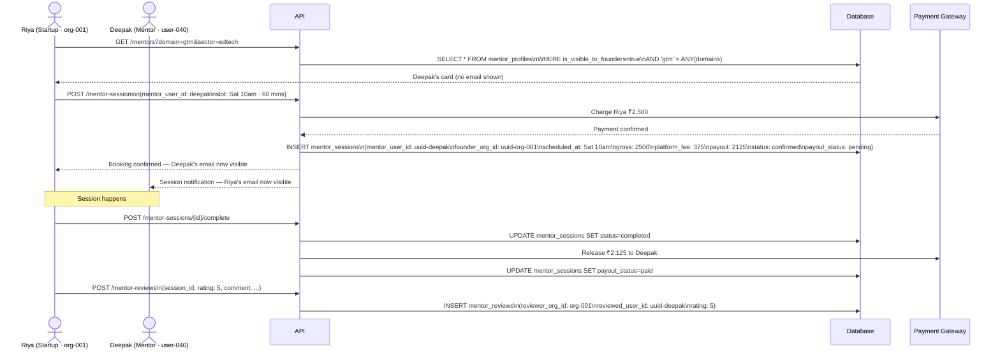
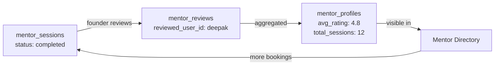

# Flow 05 — Mentor Marketplace

> How a founder books a mentor session and how the commission flows.


## End-to-end booking flow




## The commission calculation

```
gross_amount    = session_rate × (duration_mins / 60)
platform_fee    = gross_amount × 0.15   -- 15% commission
mentor_payout   = gross_amount - platform_fee
```

These values are calculated once at booking and stored as fixed integers. They do not change if the rate changes later. This makes refund and dispute logic unambiguous.


## The bridge row

`mentor_sessions` is the only table in Digi Incubator where both tenancy models appear in the same row:

```
mentor_sessions {
  mentor_user_id   → user-040  (user-scoped tenant)
  founder_org_id   → org-001   (org-scoped tenant)
}
```

This is deliberate. The mentor is personal (`user_id`). The startup booking the session is organizational (`org_id`). Neither model can be collapsed into the other here.


## Reviews build the mentor's public reputation

Reviews accumulate on the mentor's profile. They are shown to any founder browsing the Mentor Directory. More sessions → more reviews → higher placement in search results. This is the reputation flywheel for the marketplace.




*Back to [[index|Index]] · Next: [Security Model](../06-security-model.md)*
