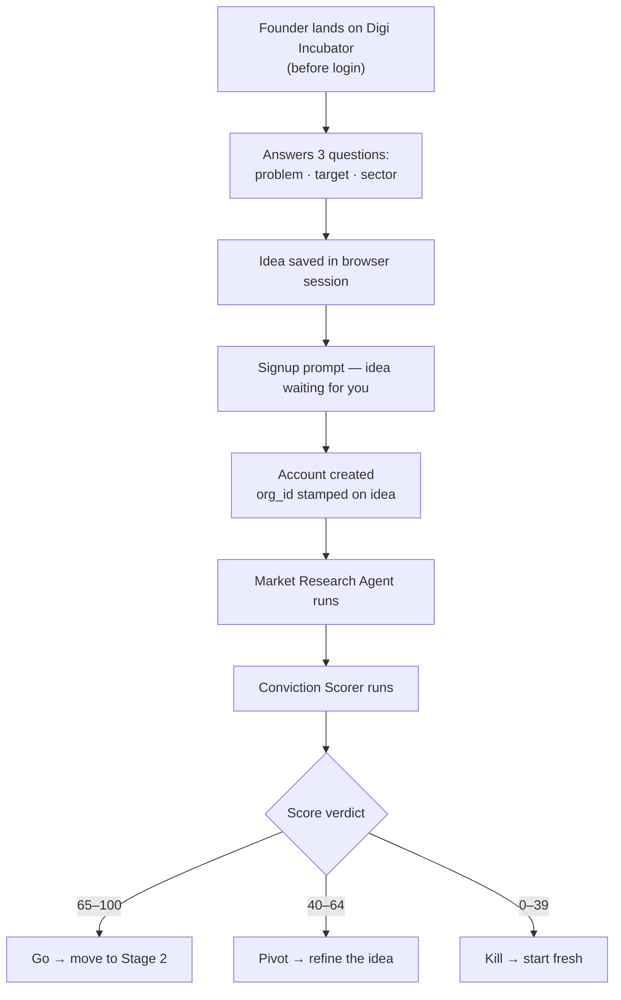

# Stage 01 — The Spark

> **Idea & Validation** · The first stage. You have a problem you want to solve. Now — is it real?

← Back to [[index|Journey Index]]

---

## The Story

Every startup begins with someone noticing something broken in the world. A farmer who can't sell his produce at fair price. A teacher spending more time on paperwork than teaching. A patient who can't get a simple diagnosis in a small town.

This stage is about testing whether your idea is worth building **before you build anything**. You describe your problem, the platform researches the market, and you get an honest score. Most founders never get this kind of unbiased feedback before spending months building something. You get it on day one.

---

## What Happens Here

---

## The Two Agents

### 1. Market Research Agent

Runs first. Reads your three answers and does in minutes what would take you hours.

- Maps existing competitors — direct and adjacent
- Sizes the market: TAM / SAM / SOM
- Reads macro trends — policy, funding rounds, technology readiness
- Flags risks specific to your sector and geography
- Hands everything to the Conviction Scorer as structured input

See [[agents/market-research-agent]] for the full breakdown.

### 2. Conviction Scorer

Runs second. Takes the research plus your answers and produces a single number: **0 to 100**.

| Score | Verdict | Meaning |
|---|---|---|
| 65–100 | **Go** | The idea is viable. Move to the Blueprint. |
| 40–64 | **Pivot** | Something is right here but something important is off. Refine first. |
| 0–39 | **Kill** | Fundamental issues. Start with a different problem. |

The score lives on the `startups` table — it belongs to the startup, not to any individual. If you re-run it three months later with new data, both runs are saved. Neither is deleted.

See [[agents/conviction-scorer]] for scoring dimensions and re-run behaviour.

---

## Data the Platform Captures Here

| Field | Where it lives | Purpose |
|---|---|---|
| Idea description | `startup_ideas` | Seed for all agents |
| Sector | `startups.sector` | Agent context + Observatory filter |
| Target customer | `planning_data` | Pre-fills Lean Canvas Stage 2 |
| Conviction score | `startups.conviction_score` | Investor Observatory signal |
| Market research output | `planning_data` (panel: `market_research`) | Feeds Conviction Scorer + Lean Canvas |

---

## Who Is Involved

At Stage 1, it is just you and the AI. No investors, no banks, no government. The platform is private by design until you choose otherwise at [[05-the-proof|Stage 5]].

---

## Pricing at This Stage

| Plan | What you get |
|---|---|
| **Explorer (Free)** | 1 Market Research run + 1 Conviction Score run — no card required |
| **Builder (₹1,999/mo)** | Unlimited re-runs — needed if you pivot and want to re-score |

The first conviction score is always free. This is a hard rule — it is the product's best demonstration of value. A founder who never experiences it will never upgrade.

---

## The Important Detail — Idea Before Login

The platform captures your idea **before** it asks you to sign up. This is intentional.

Forcing signup before idea capture loses ~60% of founders at the top of the funnel. By capturing the idea first, you have a reason to complete registration — your idea is already there waiting.

Technically: the idea is held in `startup_ideas` with a `session_id` from the browser. The moment signup completes, `org_id` is stamped on it and `session_id` is retained as an audit trail.

---

## What Stage 1 Produces

By the time you leave Stage 1, the platform knows:
- What problem you're solving
- Whether the market timing is right
- Who your competitors are
- What your conviction score is (and why)
- Whether you should build at all

That is more than most founders know after three months of their own research.

---

*Next: [[02-the-blueprint|Stage 02 — The Blueprint]]* · *Back to [[index|Journey Index]]*
