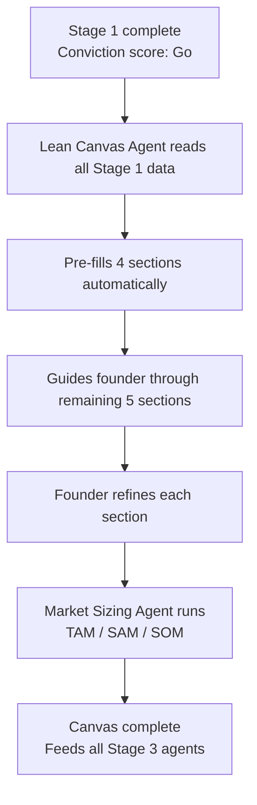
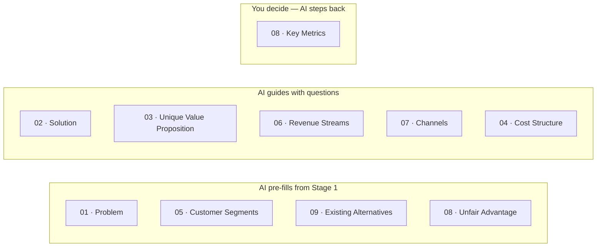

# Stage 02 — The Blueprint

> **Plan Your Business** · You have the idea. Now figure out the business behind it.

← [[01-the-spark|Stage 01]] · [[index|Journey Index]] · [[03-the-build|Stage 03]] →

---

## The Story

An idea is not a business. A business needs a plan — not a 50-page document, but a clear picture of who you're serving, what you're offering them, how money flows, and what makes you different from everyone else.

This is where you fill out your **Lean Canvas** — a single page that captures the core of your startup. The AI pre-fills what it already knows from Stage 1 and guides you through the rest. When you're done, you have the foundation that every downstream agent builds on.

---

## What Happens Here

---

## The Lean Canvas — 9 Sections

The agent plays three different roles depending on how much it already knows.

### Section Details

| # | Section | AI Role | The question it forces you to answer |
|---|---|---|---|
| 01 | Problem | Pre-fills | What are the top 3 specific, observable, painful problems — not broad ones? |
| 02 | Solution | Guides | One solution per problem — the smallest thing that genuinely solves the pain |
| 03 | Unique Value | Guides | In one sentence, why should your customer care — and what do no competitors offer? |
| 04 | Unfair Advantage | Pre-fills | What do you have that cannot be bought or copied in 6 months? |
| 05 | Customer Segments | Pre-fills | Who exactly — specific enough that you could name them? |
| 06 | Revenue Streams | Guides | Who pays, how much, and how often? |
| 07 | Channels | Guides | What is the realistic path to your first 100 customers — not your first million? |
| 04 | Cost Structure | Guides | What does it cost to build, run, and acquire one customer — honestly? |
| 08 | Key Metrics | You decide | The one number that tells you this startup is alive and growing |

---

## The Customer Discovery Checkpoint

> ⚠️ **Before you finish Stage 2 and move to Stage 3**, the platform asks:
> *"Have you spoken to at least 5 people who have this problem?"*

This is not a hard gate — you can proceed without it. But it is a visible, encouraged checkpoint. A Lean Canvas filled without real customer conversations is sophisticated guessing. The AI knows this and says so.

---

## How Edits Are Stored

The platform saves two separate things for every canvas:

| Field | What it holds |
|---|---|
| `output_data` | Everything the AI generated — the original suggestions |
| `user_selections` | Everything you changed or added on top |

This means you can always see what the AI originally suggested and what you chose to override. Your reasoning is preserved alongside the AI's reasoning. This matters when you re-run the canvas months later — you can see exactly what changed and why.

---

## Market Sizing Agent

Runs after the canvas is complete. Produces three numbers:

- **TAM** — Total Addressable Market (the whole global pie)
- **SAM** — Serviceable Addressable Market (the realistic India portion)
- **SOM** — Serviceable Obtainable Market (your realistic slice in years 1–3)

These numbers feed directly into the Financial Projections Agent at [[03-the-build|Stage 3]].

See [[agents/lean-canvas-agent]] · [[agents/market-research-agent]]

---

## What Stage 2 Produces

By the time you leave Stage 2:
- A complete 9-section Lean Canvas
- TAM / SAM / SOM numbers
- A defined revenue model and cost structure
- A customer segment specific enough to name
- A key metric you'll track from here on

All of this flows directly into the GTM Agent and Financial Projections Agent at Stage 3. Fill it carelessly and those agents will be off. Fill it thoughtfully and Stage 3 practically writes itself.

---

## Pricing at This Stage

| Plan | What you get |
|---|---|
| **Explorer (Free)** | 1 Lean Canvas run — enough to complete the Blueprint |
| **Builder (₹1,999/mo)** | Unlimited re-runs — most founders re-run after first customer conversations |

Most founders re-run the canvas after talking to their first real customers. Almost every conversation changes at least two or three sections. The canvas is not a document you finish once — it is a living understanding of your business.

---

*Next: [[03-the-build|Stage 03 — The Build]]* · *Back to [[index|Journey Index]]*
