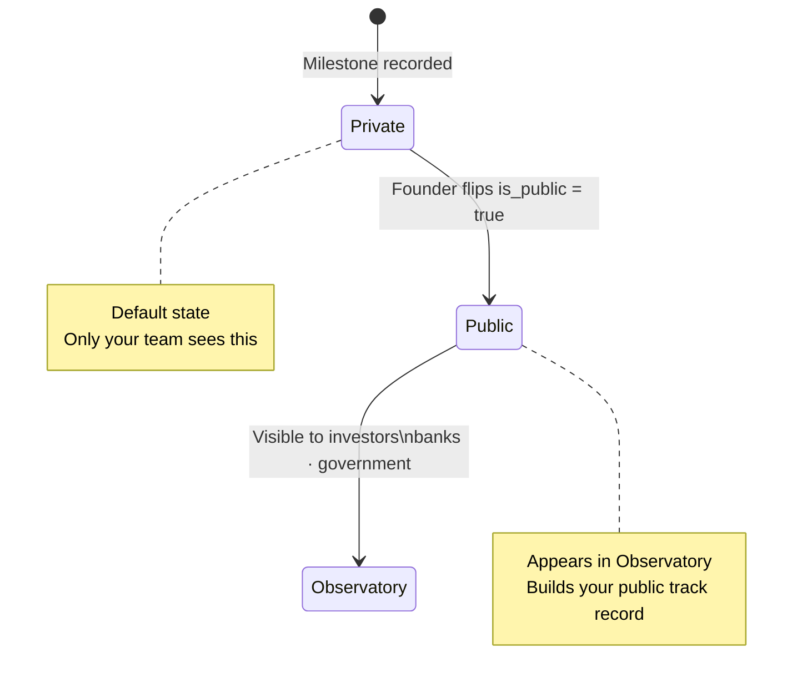

# Stage 04 — The First Yes

> **Early Customers & Revenue** · Find the first people who pay you. That changes everything.

← [[03-the-build|Stage 03]] · [[index|Journey Index]] · [[05-the-proof|Stage 05]] →

---

## The Story

Nothing is more clarifying than getting someone to part with their money for what you've built. Your first customers are not just buyers — they are proof that your idea has value in the real world.

At this stage, you're looking for 10 to 100 paying customers (or patients, or users, or clients — whatever fits your world). You learn from each one. What do they love? What frustrates them? What did they expect that you didn't deliver?

---

## The Milestone System

Everything real that happens in Stage 4 gets recorded as a milestone.

### Milestone examples — by business type

| Business type | Early milestones to record |
|---|---|
| SaaS | First paid signup · First 10 active users · First renewal |
| Physical product | First 100 units sold · First retail stockist · First reorder |
| Service | First paying client · First referral client · First repeat engagement |
| Marketplace | First transaction on both sides · First repeat transaction · First organic supply listing |
| Deep tech | First PoC partner signed · First grant received · TRL level advancement |

---

## Data That Starts Mattering

The following fields get populated here — and they become critical Observatory signals later:

| Field | What it means downstream |
|---|---|
| `mrr` | Bank loan eligibility filter — banks require min MRR |
| `gstin` | CGTMSE loan eligibility — required by most banks |
| `dpiit_number` | Government scheme eligibility — required for most grants |
| `startup_milestones` | Investor trust signal — shows progress over time |

Fill these in accurately. They are not admin checkboxes — they are the signals that make you eligible for capital at Stage 6.

---

## The 1 vs 10 Customer Distinction

> **One sale is a data point. Ten sales to strangers is a signal.**

The platform distinguishes between these two:

- Record whether each customer was a **personal contact** or a **cold acquisition**
- A single paying friend is not product-market fit
- Ten unrelated strangers paying you is early evidence that something is working

This distinction matters when investors evaluate your traction at Stage 5.

---

## Stage Transition Nudge

If you have been in Stage 3 or 4 for more than **8 weeks** without recording a new milestone or customer interaction, the platform surfaces a nudge:

> *"You've been building for 8 weeks. Have you shown this to anyone yet?"*

This is the platform doing its actual job — not just providing tools, but guiding founders toward the behaviour that leads to success.

---

*Next: [[05-the-proof|Stage 05 — The Proof]]* · *Back to [[index|Journey Index]]*
