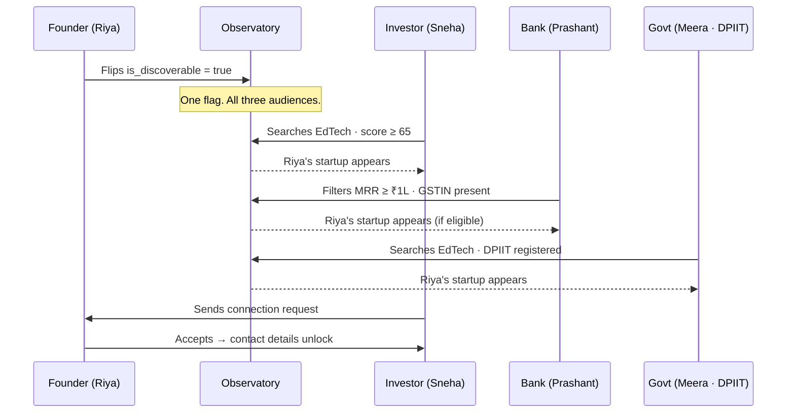
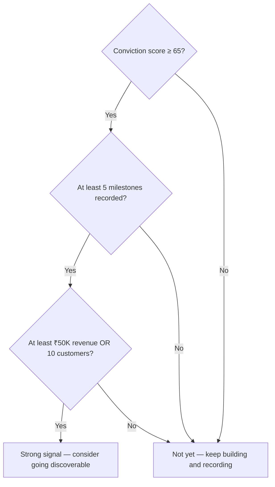

# Stage 05 — The Proof

> **Traction & Growing** · Show the world this thing works — with real numbers.

← [[04-the-first-yes|Stage 04]] · [[index|Journey Index]] · [[06-the-fuel|Stage 06]] →

---

## The Story

You've sold to a few people. Now you need to show that you can do it again, and again, and again — more efficiently each time. Traction is proof that your startup is not just a good idea but a real, growing business.

This is when you flip the switch. One toggle on your dashboard — **"Make my startup discoverable"** — opens your profile to investors, banks, and government simultaneously. You didn't pitch anyone. You just showed your traction — and the right people came to you.

---

## The Observatory — How It Works

One boolean. Three audiences. Different filters, same data, same flag.

---

## What Each Audience Sees

| Field | Investors | Banks | Government |
|---|---|---|---|
| Startup name & sector | ✓ | ✓ | ✓ |
| Conviction score | ✓ | ✓ | ✓ |
| Public milestones | ✓ | ✓ | ✓ |
| MRR | ✓ | ✓ (filter) | ✓ |
| GSTIN present (yes/no) | — | ✓ (filter) | — |
| DPIIT number | — | ✓ | ✓ (filter) |
| Private agent runs | ✗ | ✗ | ✗ |
| Lean canvas notes | ✗ | ✗ | ✗ |
| Financial projections | ✗ | ✗ | ✗ |

Private data is **never** accessible via the Observatory. The `connection_requests` table is the only controlled bridge between two orgs — and contact details only unlock after the founder explicitly accepts.

---

## When to Flip the Toggle

The platform does not force this. But it gives guidance:

There is no perfect moment. But going discoverable too early (score of 42, no customers) means getting ignored. Going too late (score of 85, ₹5L MRR) means missing months of inbound interest.

---

## The Mentor Bridge — Before You Go Discoverable

> **Consider booking a mentor session before flipping the toggle.**

Mentors who are known in the ecosystem are warm introduction pathways, not just coaches. A mentor who knows investors in your space can make a single introduction that converts — something a cold connection request through the Observatory may not.

This is the explicit bridge between Stage 5 and Stage 6 that the platform makes visible.

---

## Agents Active at Stage 5

- All previous agents available for unlimited re-runs (Builder plan)
- **Pitch Generator** — investor-ready deck built from your canvas, milestones, and market research
- **Conviction Scorer re-run** — updated score with real customer data reflects much higher than Stage 1

---

*Next: [[06-the-fuel|Stage 06 — The Fuel]]* · *Back to [[index|Journey Index]]*
