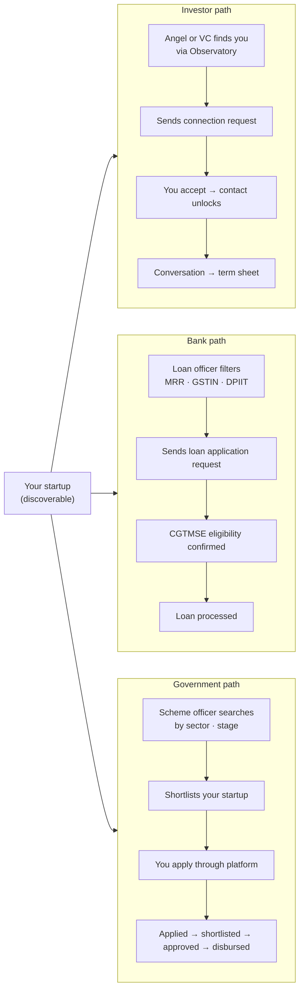
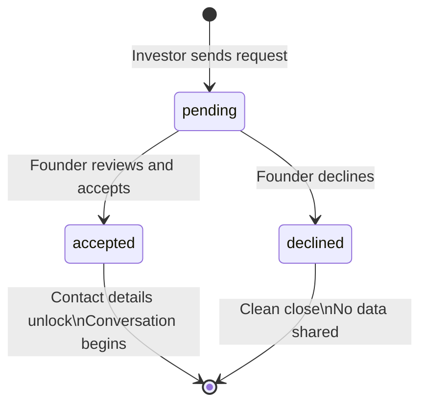

# Stage 06 — The Fuel

> **Funding & Scale** · Bring in the resources to grow 10x — capital, partners, and reach.

← [[05-the-proof|Stage 05]] · [[index|Journey Index]] · [[07-operate-and-grow|Stage 07]] →

---

## The Story

You've built something real. Now it's time to pour fuel on it. The data you built since Stage 1 does the work. An investor who sends a connection request already knows your conviction score, your MRR, your public milestones, your market size. You're not explaining your startup from scratch. You're talking about terms.

---

## Three Capital Paths — All Through the Platform

---

## How Connection Requests Work

The `connection_requests` table is the **only** controlled surface where two organisations can interact. No investor or bank ever has direct access to your private data.

Once accepted: both sides see each other's contact details. Nothing else is automatically shared. The founder controls what they choose to share next.

---

## What Investors, Banks & Govt Each Bring

| Persona | What they offer | What they need from you |
|---|---|---|
| **Angel investor** | ₹10L–₹1Cr, mentorship, network | Early traction, strong founder-market fit |
| **VC firm** | ₹1Cr–₹20Cr, portfolio support | Scalable model, conviction score ≥ 70 |
| **Bank (CGTMSE)** | Collateral-free loan | MRR ≥ ₹1L, GSTIN, DPIIT number |
| **Government scheme** | Grant ₹5L–₹50L, non-dilutive | DPIIT registration, sector match, deadline |

---

## Agents Active at Stage 6

| Agent | What it does |
|---|---|
| **Pitch Generator** | White-label investor deck from your canvas + milestones + research |
| **Financial Projections** | Updated model for investor due diligence |
| **All previous agents** | Unlimited re-runs — every number in your pitch should be fresh |

---

## The Moment Stage 6 Ends

Stage 6 closes when capital arrives — a signed term sheet, a disbursed loan, or an approved grant. The platform immediately opens [[07-operate-and-grow|Stage 7]].

This is not an ending. It is the beginning of the hardest part.

---

*Next: [[07-operate-and-grow|Stage 07 — Operate & Grow]]* · *Back to [[index|Journey Index]]*
