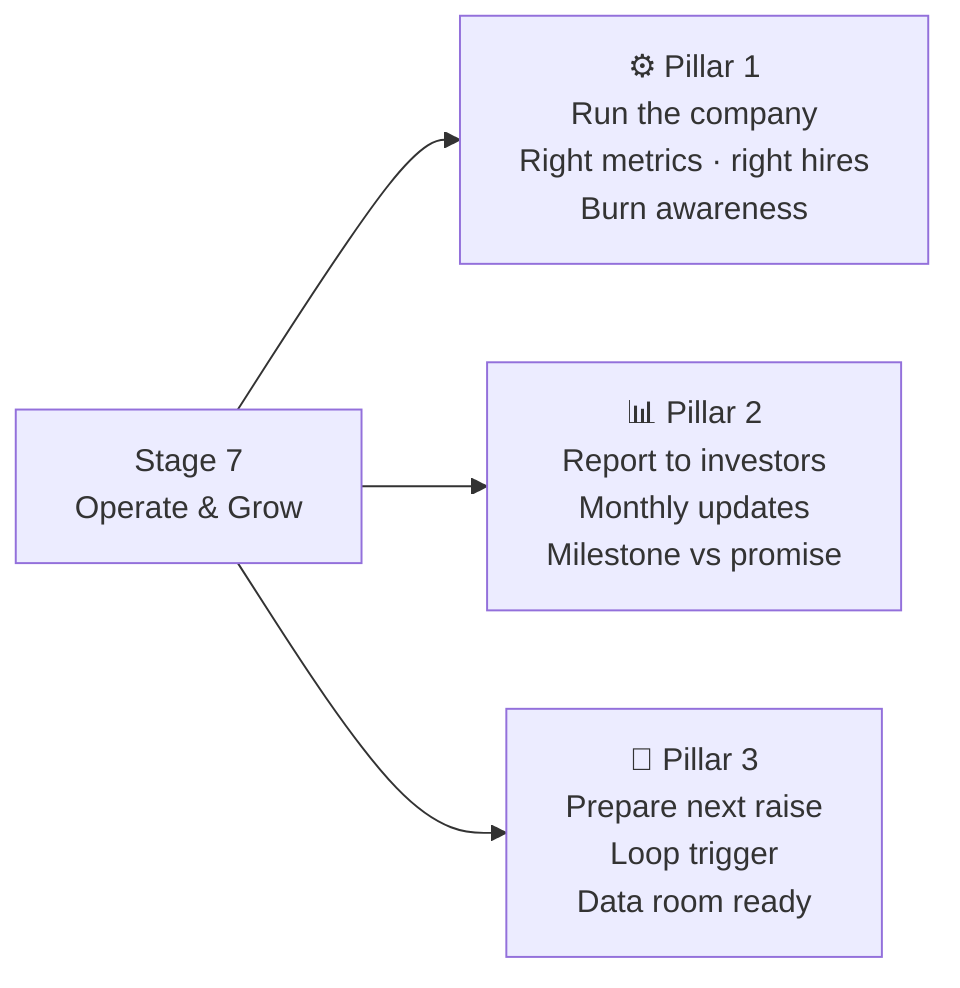
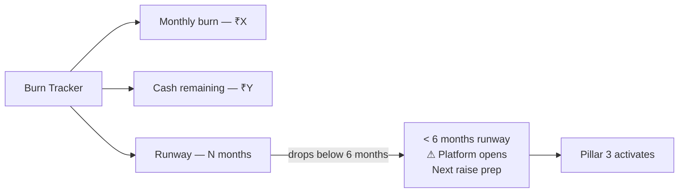
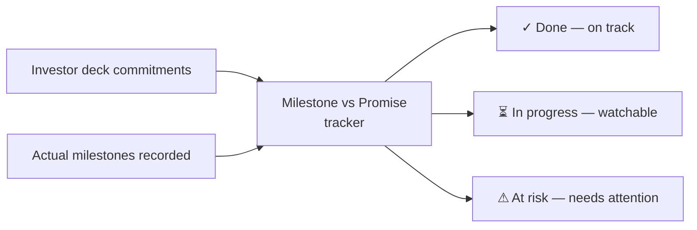
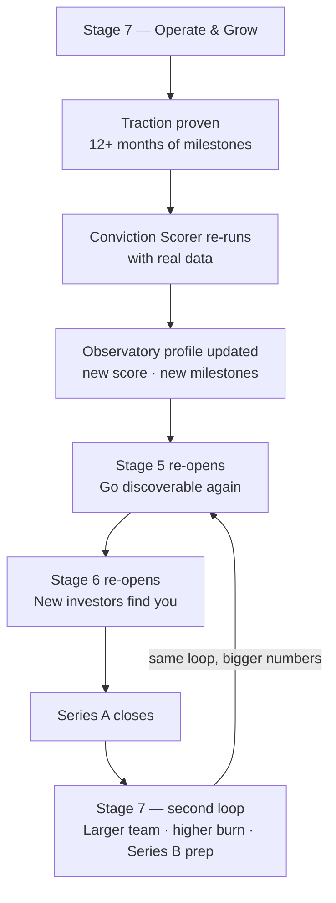

# Stage 07 — Operate & Grow

> **Post-Funding Operations** · You raised money. Now you have to earn it.

← [[06-the-fuel|Stage 06]] · [[index|Journey Index]]

---

## The Story

Stage 6 closes with a cheque. Stage 7 opens with a question no one prepared you for: *what do you do on Monday morning?*

The platform doesn't disappear after funding. It shifts — from helping you get the money to helping you deploy it well. Before funding, you were asking "will this work?" After funding, you are asking "how do I not waste what I just got?" That is a different question, and it needs different tools.

Stage 7 runs three things in parallel from day one.

---

## The Three Pillars

---

## Pillar 1 — Run the Company

### Unit Economics Monitor

Tracks the one number that tells you your business is healthy — but the number is different depending on what kind of business you are.

| Business type | The metric that matters most | What the agent asks |
|---|---|---|
| [[business-types/saas\|SaaS]] | Net Revenue Retention | Are customers from 3 months ago still paying — and paying more? |
| [[business-types/physical-product\|Physical product]] | Gross margin per SKU | Are you making enough per unit after distributor margins? |
| [[business-types/service\|Service]] | Utilisation rate | What % of your capacity is booked? At what % are you profitable? |
| [[business-types/marketplace\|Marketplace]] | Liquidity rate | What % of supply actually transacts each month? |
| [[business-types/deep-tech\|Deep tech]] | Runway vs milestone progress | Are you on track to hit investor milestones before money runs out? |

See [[agents/unit-economics-monitor]]

### Hiring Plan Agent

Answers the hardest early-stage question: **who do you hire first?**

| Business type | First hire | Why |
|---|---|---|
| SaaS | Engineer 2 + Customer Success | More product and customer retention |
| Physical product | Supply chain coordinator + D2C marketer | Stock risk and brand building |
| Service | Second delivery person | Revenue cannot grow without capacity |
| Marketplace | Supply onboarding + demand acquisition (two people) | Both sides need dedicated focus |
| Deep tech | Second researcher + part-time regulatory consultant | Science depth + compliance clarity |

See [[agents/hiring-plan-agent]]

### Burn Rate Tracker

Always visible. Always current.

You should never be surprised by running out of money. The platform flags it before anyone has to ask.

---

## Pillar 2 — Report to Investors

### Investor Update Agent

Generates a monthly investor update by reading your milestones, burn tracker, and unit economics. You review, edit, and send. What used to take 3 hours takes 20 minutes.

**Standard update structure:**
- **Highlights** — what happened this month (from milestones)
- **Metrics** — key number vs target (from Unit Economics Monitor)
- **Runway** — months remaining (from Burn Tracker)
- **Focus next month** — what you're working on
- **Ask** — one specific thing the investor can help with

See [[agents/investor-update-agent]]

### Milestone vs Promise Tracker

When you raised money, you told your investor what you'd achieve in 12–18 months. This tracker compares promise against reality — week by week.

Not to shame you. To keep you honest with yourself before the next board call — when it is still easy to course-correct.

---

## Pillar 3 — Prepare for the Next Raise

### Next Round Readiness Agent

Re-runs the Conviction Scorer and Financial Projections Agent — but now with real data instead of estimates.

Your conviction score at Stage 1 was based on market research. Your conviction score at Stage 7 is based on 12+ months of actual customers, actual revenue, and actual market response. The gap between those two scores is your growth story.

**The loop trigger:** When runway drops below 6 months AND unit economics are trending positively, the agent opens Stage 5 and Stage 6 — and the journey begins again, bigger.

See [[agents/next-round-readiness-agent]]

### Series A Data Room Agent

Assembles your due diligence package from everything the platform has stored since Stage 1 — every agent run, every milestone, every financial projection.

Standard sections produced:
1. Business overview and market opportunity
2. Traction evidence (milestones with timestamps)
3. Financial model — actuals vs projections
4. Team and hiring plan
5. Use of funds — current round deployment
6. Ask — what you're raising and why

See [[agents/series-a-data-room-agent]]

---

## The Loop — How Stage 7 Feeds Back to Stage 5

The journey is a **spiral**, not a line.

---

## What Stage 7 Adds to the Platform

| New | Carried forward |
|---|---|
| Unit Economics Monitor | All Stage 1–6 agent run history |
| Hiring Plan Agent | Complete milestone timeline |
| Burn Rate Tracker | Observatory profile (updated) |
| Investor Update Agent | Mentor marketplace access |
| Milestone vs Promise Tracker | All investor / bank / govt connections |
| Next Round Readiness Agent | `business_model_type` awareness throughout |
| Series A Data Room Agent | Scale plan — no upgrade needed |

---

## Why Stage 7 Exists

The inversion analysis found that Stage 6 was a dead end. A funded founder had no reason to stay subscribed. The platform was losing its best customers — the ones who just raised money and could now afford anything — right at the moment when they needed the most help.

Stage 7 fixes this. A funded founder is the platform's most active user: weekly agent runs, monthly investor updates, constant milestone recording, burn tracking every day. That is peak subscription value at the Scale plan rate.

See [[decisions/stage-7-rationale]] for the full reasoning.

---

*Back to [[06-the-fuel|Stage 06]]* · *Back to [[index|Journey Index]]*
