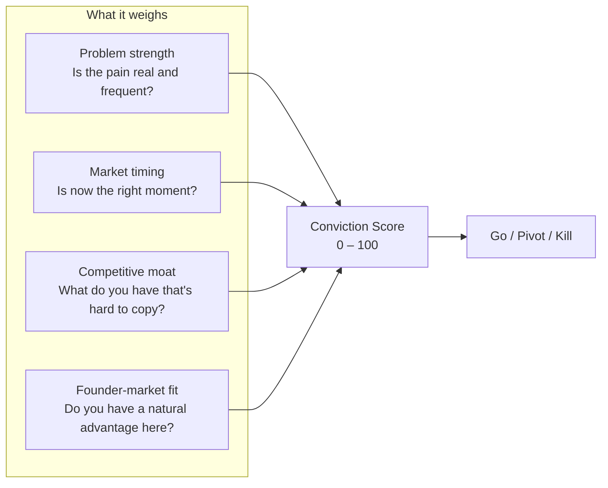

# Conviction Scorer™

> Runs at [[../01-the-spark|Stage 1]] and again at [[../07-operate-and-grow|Stage 7]]. Turns market research into a single honest number.

← [[journey-index|Journey Index]]

---

## Scoring Dimensions

## Verdicts

| Range  | Verdict   | Meaning                                                 |
| ------ | --------- | ------------------------------------------------------- |
| 65–100 | **Go**    | Viable. Move to [[../02-the-blueprint\|Stage 2]].       |
| 40–64  | **Pivot** | Something is right, something important is off. Refine. |
| 0–39   | **Kill**  | Fundamental issues. Start with a different problem.     |

## Important Rules

- The score lives on the `startups` table — it belongs to the **startup**, not to any individual
- Every run creates a new row in `planning_data` — old runs are never deleted
- The active score (shown to investors in the Observatory) is always the **most recent** run
- History is always visible — you can see how conviction changed over time

## The Score at Stage 7

When re-run at [[../07-operate-and-grow|Stage 7]] with real traction data, the score reflects what you've actually built — not what you hoped to build. The gap between your Stage 1 score and your Stage 7 score is your growth story.

*Used at: [[../01-the-spark|Stage 1]] · [[../07-operate-and-grow|Stage 7]]* · *Back to [[journey-index|Journey Index]]*
