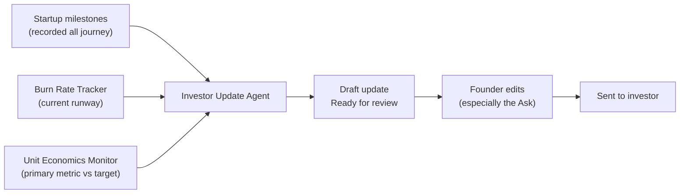

# Investor Update Agent

> New at [[../07-operate-and-grow|Stage 7]]. Generates a monthly investor update from your existing platform data. What used to take 3 hours takes 20 minutes.

← [[journey-index|Journey Index]]

---

## How It Works

## Standard Update Structure

1. **Highlights** — what happened this month (pulled from milestones)
2. **Metrics** — key number vs. target (from Unit Economics Monitor)
3. **Runway** — months remaining (from Burn Tracker)
4. **Focus next month** — what you're working on
5. **Ask** — one specific thing the investor can help with *(you write this)*

## The One Rule

The "Ask" is always written by the founder. The agent deliberately leaves it blank. Investors pay attention to updates that ask for something specific. Generic updates get filed without being read.

*New at: [[../07-operate-and-grow|Stage 7]]* · *Back to [[journey-index|Journey Index]]*
