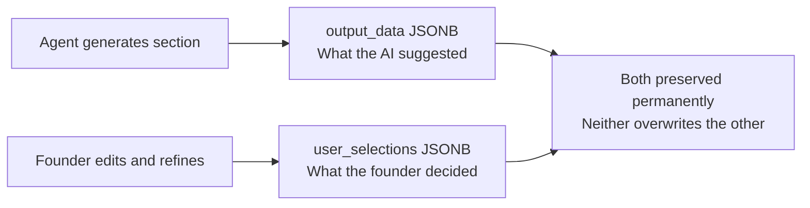

# Lean Canvas Agent

> Runs at [[../02-the-blueprint|Stage 2]]. Builds a 9-section business plan with you, not for you.

← [[journey-index|Journey Index]]

---

## The Three Modes

| Mode | Sections | What the agent does |
|---|---|---|
| Pre-fills | Problem · Customer Segments · Existing Alternatives · Unfair Advantage | Reads Stage 1 data and generates starting content |
| Guides | Solution · UVP · Revenue Streams · Channels · Cost Structure | Asks targeted questions and builds from your answers |
| Steps back | Key Metrics | Offers suggestions, insists you decide |

## How Edits Are Stored

## What It Feeds Downstream

The completed canvas is the primary input for:
- [[gtm-agent|GTM Agent]] — reads Channels and Customer Segments
- [[financial-projections-agent|Financial Projections Agent]] — reads Revenue Streams and Cost Structure
- [[series-a-data-room-agent|Series A Data Room Agent]] — reads everything

*Used at: [[../02-the-blueprint|Stage 2]]* · *Back to [[journey-index|Journey Index]]*
