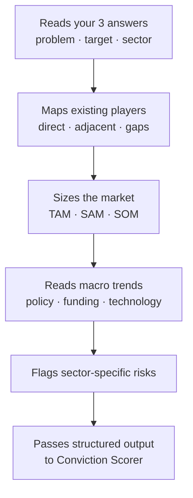

# Market Research Agent

> Runs at [[../01-the-spark|Stage 1]]. Maps the world around your idea before you've committed to building anything.

← [[journey-index|Journey Index]]

---

## What It Does — In Order

## Key Outputs

| Output | What it tells you |
|---|---|
| Competitor map | Who else exists, what they do, what gap you might fill |
| Market size (TAM/SAM/SOM) | How big the opportunity is realistically |
| Trend direction | Whether timing is with you or against you |
| Risk flags | What is likely to be hard specific to your sector |

## Re-Run Behaviour

Every run creates a new row in `planning_data`. The previous run is never deleted. The dashboard shows all runs newest-first — you can compare what the market looked like when you first ran it vs. three months later.

See [[../decisions/non-saas-agent-design]] for how this agent adapts to different business types.

*Used at: [[../01-the-spark|Stage 1]]* · *Back to [[journey-index|Journey Index]]*
