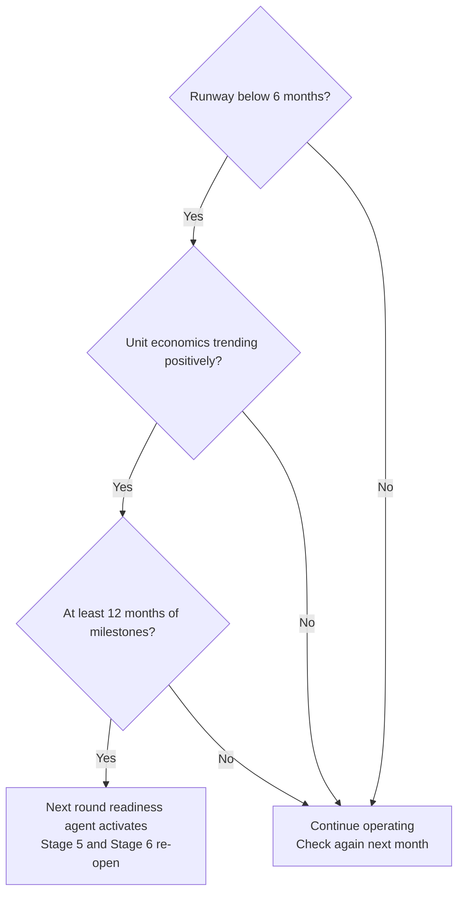

# Next Round Readiness Agent

> New at [[../07-operate-and-grow|Stage 7]]. The loop trigger. Re-scores your startup with real data and opens the path to the next raise.

← [[journey-index|Journey Index]]

---

## What It Does

Runs a fresh [[conviction-scorer|Conviction Scorer]] and [[financial-projections-agent|Financial Projections Agent]] — but this time with 12+ months of actual data instead of estimates.

The gap between your Stage 1 score and your Stage 7 score is your growth story.

## The Trigger Conditions

## Why 6 Months

Starting a raise when you have 2 months of runway is negotiating from desperation. Starting at 6 months gives you time to talk to 20 investors, hear 18 nos, and still close a round before the money runs out. The platform forces this discipline.

*New at: [[../07-operate-and-grow|Stage 7]]* · *Back to [[journey-index|Journey Index]]*
