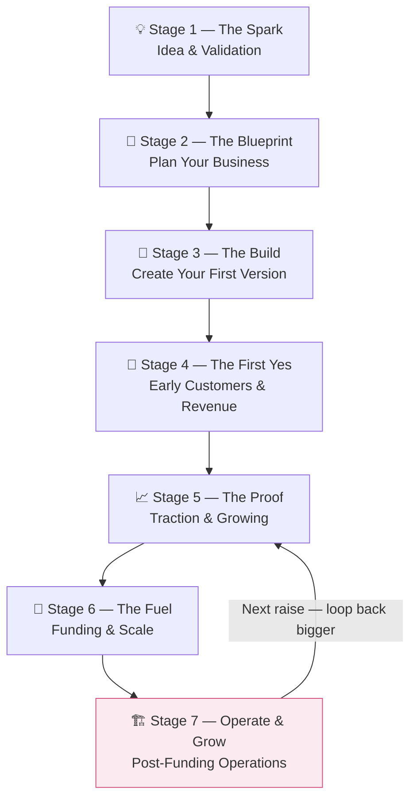

# The Startup Journey — Digi Incubator

> A complete map of every stage a founder travels through on the platform — from a raw idea to a funded, operating company. Built for all startup types, not just SaaS.

---

## The 7 Stages at a Glance



---

## File Map

```
journey/
│
├── index.md                        ← you are here
│
├── 01-the-spark.md                 ← idea capture, market research, conviction score
├── 02-the-blueprint.md             ← lean canvas, market sizing, business model
├── 03-the-build.md                 ← GTM plan, financial projections, first version
├── 04-the-first-yes.md             ← first customers, milestones, early revenue
├── 05-the-proof.md                 ← observatory, traction, ecosystem discovery
├── 06-the-fuel.md                  ← funding, connections, scale
├── 07-operate-and-grow.md          ← post-funding operations, investor reporting, next raise
│
├── agents/
│   ├── market-research-agent.md    ← how the research agent works
│   ├── conviction-scorer.md        ← scoring, verdicts, re-runs
│   ├── lean-canvas-agent.md        ← 9 sections, pre-fill logic
│   ├── gtm-agent.md                ← business-type aware GTM planning
│   ├── financial-projections-agent.md ← financial modelling by business type
│   ├── unit-economics-monitor.md   ← stage 7 operations tracker
│   ├── hiring-plan-agent.md        ← first hire decisions by type
│   ├── investor-update-agent.md    ← monthly update generator
│   ├── next-round-readiness-agent.md ← loop trigger, re-scored conviction
│   └── series-a-data-room-agent.md ← due diligence package assembler
│
├── business-types/
│   ├── saas.md                     ← software / subscription metrics
│   ├── physical-product.md         ← units, margins, distribution
│   ├── service.md                  ← capacity, utilisation, referrals
│   ├── marketplace.md              ← GMV, two-sided growth, take rate
│   └── deep-tech.md                ← grants, TRL, runway, commercialisation
│
└── decisions/
    ├── non-saas-agent-design.md    ← why and how agents branch by business type
    ├── stage-7-rationale.md        ← why the journey needed a post-funding stage
    └── inversion-analysis.md       ← what the inversion review found and fixed
```

---

## Stage Summary Table

| Stage | Name | What happens | Key agents | Who joins |
|---|---|---|---|---|
| [[01-the-spark\|01]] | The Spark | Idea described, market researched, conviction scored | Market Research, Conviction Scorer | — |
| [[02-the-blueprint\|02]] | The Blueprint | Lean Canvas built, market sized, business model defined | Lean Canvas, Market Sizing | — |
| [[03-the-build\|03]] | The Build | GTM plan, financial model, first version | GTM, Financial Projections | Mentors |
| [[04-the-first-yes\|04]] | The First Yes | First customers, milestones recorded, revenue starts | Conviction re-run, Financial update | Mentors |
| [[05-the-proof\|05]] | The Proof | Observatory live, ecosystem finds you, traction visible | Pitch Generator, all agents | Investors, Banks, Govt |
| [[06-the-fuel\|06]] | The Fuel | Capital arrives, connections accepted, team scales | Pitch Generator, Data Room | Investors, Banks, Govt |
| [[07-operate-and-grow\|07]] | Operate & Grow | Operations, investor reporting, next raise prep | Unit Economics, Investor Update, Next Round | All personas |

---

## The Key Design Decision

Every agent from Stage 3 onwards asks one question first:

> **"What kind of business are you building?"**

The answer is stored as `business_model_type` on the `startups` table. All agents read it before running. See [[decisions/non-saas-agent-design]] for the full reasoning.

The five business types:

- [[business-types/saas|Software / SaaS]]
- [[business-types/physical-product|Physical product]]
- [[business-types/service|Service business]]
- [[business-types/marketplace|Marketplace]]
- [[business-types/deep-tech|Deep tech / R&D]]

---

## The Loop

The journey is not a straight line. It is a spiral.

After Stage 7, when the Next Round Readiness Agent detects that runway is dropping and traction is strong, the platform re-opens Stage 5 and Stage 6. The founder goes through them again — but now with 12–18 months of real data, a re-scored conviction, and an auto-assembled data room.

First loop: Seed round.
Second loop: Series A.
Third loop: Series B.

The platform grows with the founder. That is the retention engine.

See [[decisions/stage-7-rationale]] for the full reasoning.

---

*Last updated: 2026 · Part of the Digi Incubator platform documentation*
