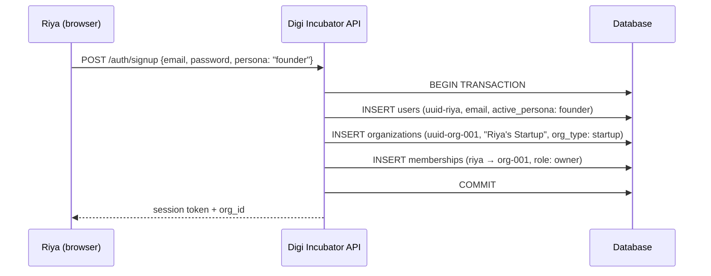
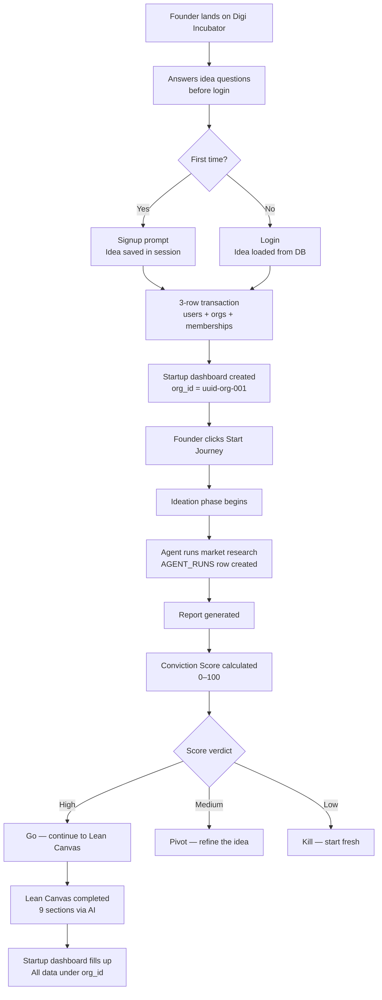
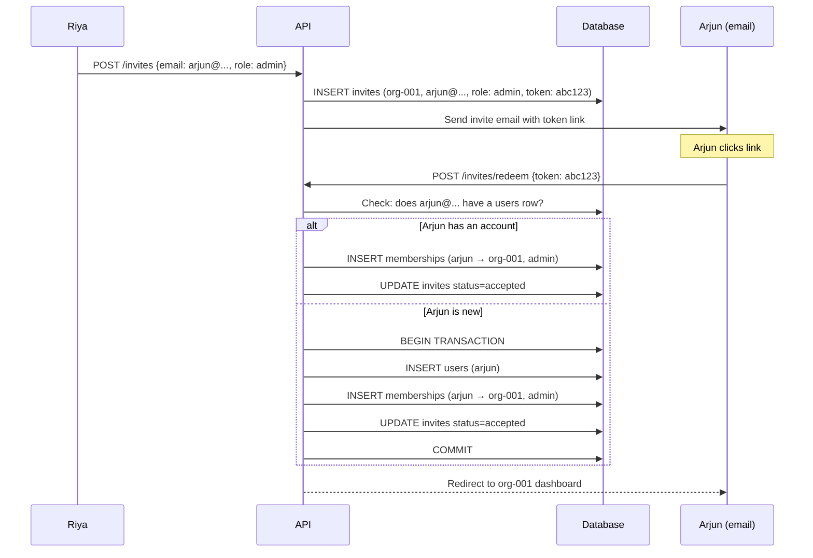
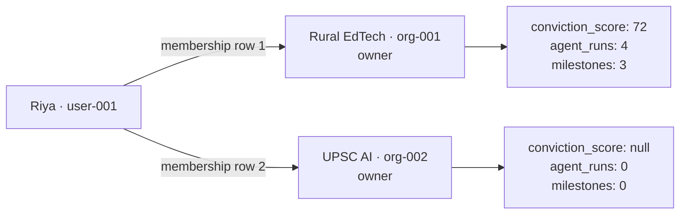

# Persona 01 — Founder

> The primary persona. Everything else on the platform exists to serve or observe the founder's journey.


## Who is this?

An entrepreneur building a startup. Could be solo or have a team. The startup — not the individual — is the tenant.

**Real example used in this documentation:** Riya, a teacher from Pune building an offline-first EdTech app for rural Maharashtra.


## Signup creates three rows simultaneously



All three inserts happen in one transaction. If any step fails, all three roll back. No ghost accounts, no orphaned orgs.


## The ideation journey



## Key data decisions

### planning_data always has two IDs

```
org_id  = who OWNS the output  (the startup)
user_id = who TRIGGERED the run (the individual member)
```

This table is called `planning_data` in the codebase — it is the direct equivalent of the `agent_runs` concept. One row per agent execution, never overwritten.

If Riya runs market research and Arjun runs it again two weeks later — two rows, same `org_id`, different `user_id`. Neither is deleted. The startup sees a chronological history of all runs, labelled by who triggered them.

| Column | What it holds |
|---|---|
| `panel` | The agent type: `market_research`, `lean_canvas`, `conviction_scorer`, `gtm`, `financial_projections`, `market_sizing` |
| `output_data` | JSONB — the AI agent's full output |
| `user_selections` | JSONB — the founder's edits and choices on top of the AI output |
| `minio_key` | Object storage key for large outputs (PDFs, slide decks) |
| `org_id` | Tenant key — the startup org that owns this run |
| `user_id` | Who pressed the button — audit trail, not ownership |

### is_discoverable controls all external visibility

One boolean on the `startups` table. When `false` (default), the startup is invisible to investors, banks, and government. When `true`, it appears in the Observatory for all three audiences simultaneously. No separate opt-in per audience.

### conviction_score lives on the startup, not the user

If Riya leaves and Arjun continues, the score travels with the startup. It is an assessment of the idea, not the person.


## Multi-user flow

When a second founder joins:



The invite redemption path is identical whether Arjun has an account or not. The only difference is whether a `users` row is created first.


## Role permissions

| Action | owner | admin | member |
|---|---|---|---|
| View all startup data | ✓ | ✓ | ✓ |
| Run AI agents | ✓ | ✓ | ✓ |
| Invite members | ✓ | ✓ | ✗ |
| Flip is_discoverable | ✓ | ✗ | ✗ |
| Delete the startup | ✓ | ✗ | ✗ |
| Remove members | ✓ | ✓ | ✗ |


## Multiple startups (second idea)

One user, multiple orgs:



Switching workspaces changes the active `org_id` in the session. All queries instantly reflect the new org. Data never bleeds between orgs.


## Business model

Founders are on the **freemium → paid subscription** model. They are the supply side of the platform — the data they create makes Digi Incubator valuable for every other persona. Pricing is deliberately generous.

### Plans

| Plan | Price | Who it's for |
|---|---|---|
| Explorer | Free — no card, no time limit | First-time founders exploring the platform |
| Builder | ₹1,999/mo · ₹19,999/yr | Active founders building and iterating |
| Scale | ₹4,999/mo · ₹49,999/yr | Funded startups with a growing team |

### What's gated vs free

| Feature | Explorer | Builder | Scale |
|---|---|---|---|
| AI agent runs | 3 total | Unlimited | Unlimited |
| Conviction score | 1 run | Unlimited | Unlimited |
| GTM + financial agents | Locked | Included | Included |
| Pitch deck generator | Locked | Included | Included |
| Observatory opt-in | **Always free** | **Always free** | **Always free** |
| Investor connection requests | 2/month | Unlimited | Unlimited |
| Team members | 1 | Up to 3 | Unlimited |
| Storage | 500MB | 10GB | Unlimited |
| API access | — | — | Included |

### The upgrade moment

Riya uses her free market research run, gets a detailed report, and is impressed. Two weeks later she has new data and wants to re-run. She hits the limit. At that moment she is a motivated buyer — she has seen the value, she wants more. That is the correct freemium conversion path.

### How the subscription is stored

```
subscriptions {
  org_id    = uuid-org-001   ← the startup pays, not Riya personally
  plan_tier = 'starter'      ← or 'pro', 'enterprise'
  status    = 'active'
  expires_at = ...
}
```

The subscription belongs to the **org**, not the user. If Arjun joins as co-founder, he immediately gets Builder-tier access too — no extra seat charge. When the subscription lapses, all members of the org are downgraded simultaneously.

### The Observatory is always free — by design

`is_discoverable` costs founders nothing on any plan. If founders had to pay to be discovered, fewer would opt in. Fewer startups in the Observatory means less value for investors — which directly harms the highest-margin revenue stream. Never gate this.


*Back to [[index|Index]] · Next: [[02-investor-vc|Investor — VC]]*
