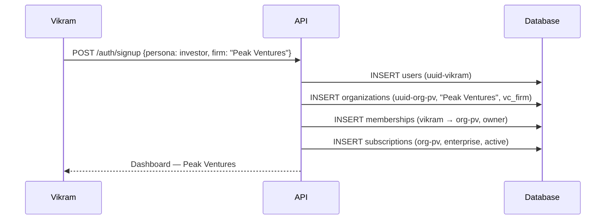
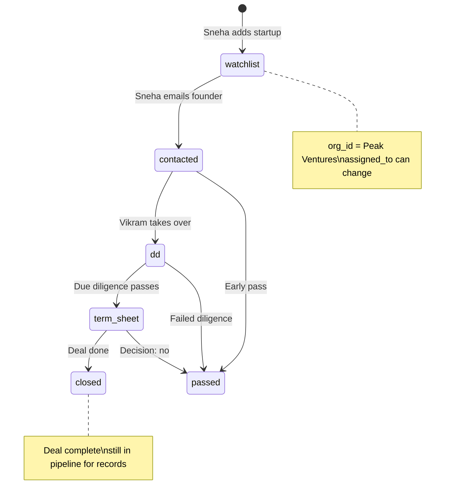
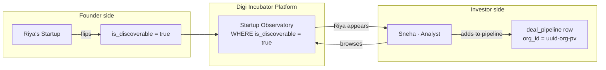
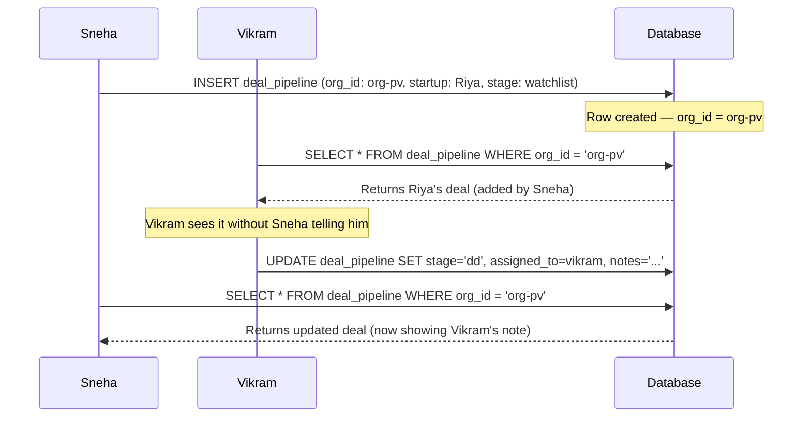
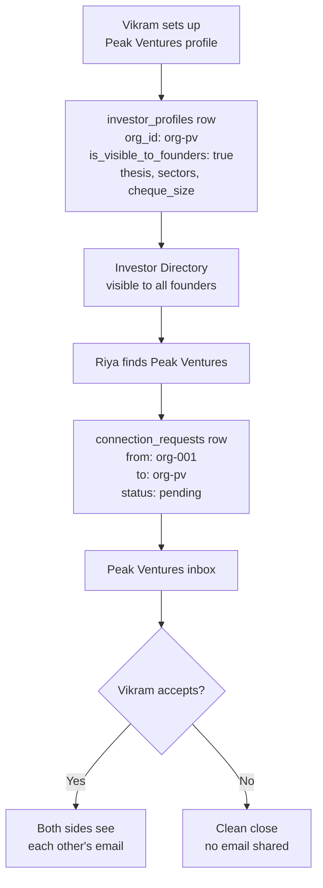

# Persona 02 — Investor (VC Firm)

> A multi-person investment firm. The firm owns the pipeline, not any individual analyst.


## Who is this?

A venture capital firm with multiple team members — partners, principals, analysts. The firm is the tenant. Every deal added by any team member belongs to the firm.

**Real example:** Peak Ventures. Vikram (Principal) and Sneha (Analyst) are both members. The deal pipeline belongs to Peak Ventures, not to either person.


## Signup

Same three-row transaction as a founder, with `org_type = 'vc_firm'`:




## The deal pipeline

The pipeline belongs to the firm (`org_id = uuid-org-pv`). `assigned_to` tracks which analyst is currently working the deal — but this is not ownership, it is assignment.



### Key field distinction

| Field | Meaning | Can change? |
|---|---|---|
| `org_id` | Who owns this deal | Never |
| `assigned_to` | Who is working it now | Anytime |

If Sneha leaves Peak Ventures, Vikram reassigns her deals in one UPDATE per row. The org retains all pipeline history.


## Two-sided discovery



### What investors can see vs cannot see

| Visible in Observatory      | Hidden always                        |
| --------------------------- | ------------------------------------ |
| Startup name, sector, stage | Private market research (agent_runs) |
| Conviction score            | Lean canvas notes                    |
| Public milestones           | Financial projections                |
| MRR (if public)             | Private team notes                   |


## Shared pipeline — both Vikram and Sneha see the same data



Same `org_id` → same results for both. This is the firm-level pipeline working correctly.


## Investor Directory (reverse discovery)

Founders can also find and reach out to investors. Firms opt in via `investor_profiles`:



## Business model

VC firms are on a **firm-level B2B subscription**. The firm pays one subscription — all team members get access. Pricing scales by firm size and feature depth, not by headcount.

### Plans

| Plan | Price | Who it's for |
|---|---|---|
| VC Firm | ₹24,999/mo · ₹2,49,999/yr | 2–5 person investing teams |
| VC Firm — Large | ₹49,999/mo · ₹4,99,999/yr | 10+ analyst firms |

### What's included vs gated

| Feature | VC Firm | VC Firm — Large |
|---|---|---|
| Observatory access | Full + advanced filters | Full + custom filters |
| Deal pipeline | Unlimited deals | Unlimited deals |
| Team members | Up to 5 | Unlimited |
| Bulk sector + stage filters | Included | Included |
| Portfolio analytics | Included | Included |
| Conviction score trends | Included | Included |
| API + data export | — | Included |
| Dedicated account manager | — | Included |

### Why per-firm, not per-seat

Per-seat pricing creates incentives to limit access within a firm — partners avoid giving analysts accounts to save money. This reduces engagement and hurts deal pipeline quality. Per-firm pricing aligns everyone's incentives: the more team members use the platform, the more value the firm gets.

### How the subscription is stored

```
organizations { id: uuid-org-pv, org_type: 'vc_firm' }

subscriptions {
  org_id    = uuid-org-pv   ← the firm pays
  plan_tier = 'enterprise'
  status    = 'active'
}

memberships {
  user_id = uuid-vikram  → org_id = uuid-org-pv  role: owner
  user_id = uuid-sneha   → org_id = uuid-org-pv  role: member
}
```

Both Vikram and Sneha are covered by the same subscription row. Adding a third analyst costs nothing extra — it is one `INSERT` into `memberships`.

### Revenue per firm

At ₹24,999/month, one VC firm subscription = ₹2,99,988/year. One good investment sourced through Digi Incubator — say a startup returning 10× — makes the entire lifetime subscription cost look like rounding error. This is why investor subscriptions can and should be priced significantly higher than founder subscriptions.


*Back to [[index|Index]] · Next: [[03-investor-solo|Solo Investor]]*
