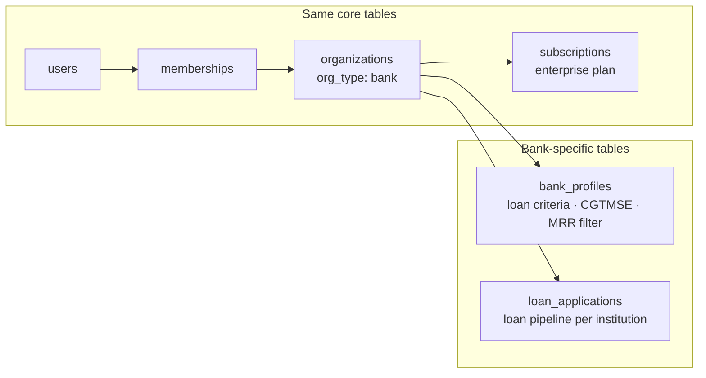
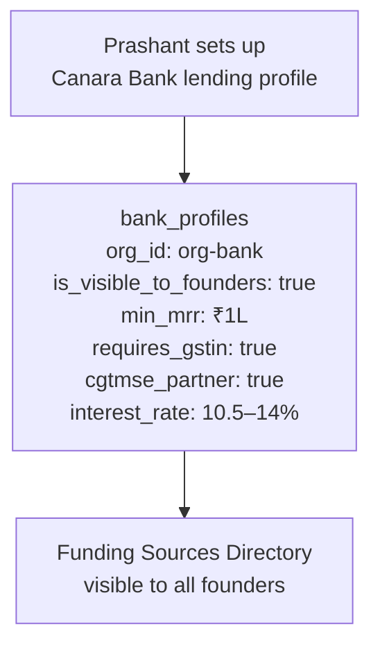
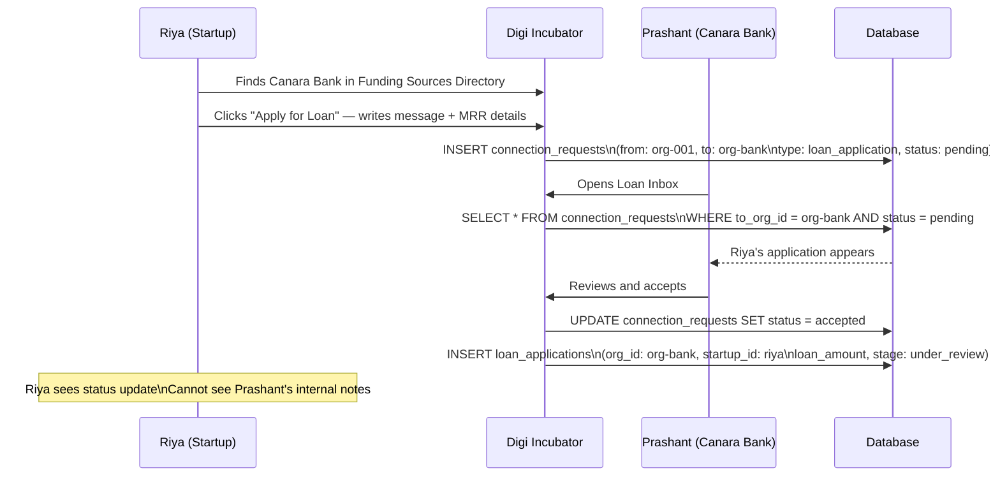
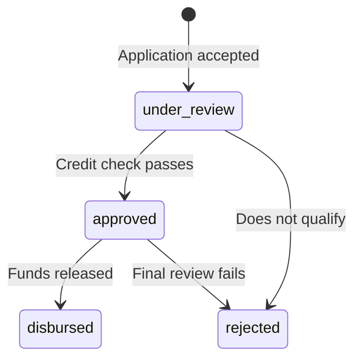
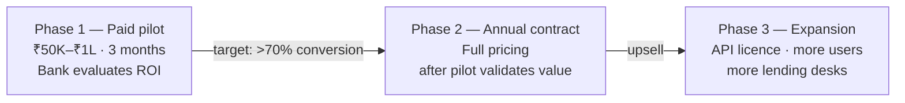

# Persona 04 — Bank / Lending Institution

> Finds loan-ready startups using real financial signals. CGTMSE-native.


## Who is this?

An MSME lending desk at a bank or NBFC. Multiple loan officers sharing a loan pipeline. The institution is the tenant.

**Real example:** Prashant, Loan Officer at Canara Bank's MSME desk.


## What's the same as VC

Everything at the org level is identical — same signup flow, same invite flow, same membership model. `org_type = 'bank'` is the only difference in the core tables.




## Bank profile — the lending criteria made discoverable




## How banks discover startups

Banks use the same Observatory as investors, with different filters:

```
-- Investor filter
SELECT * FROM startups
WHERE is_discoverable = true
AND sector = 'edtech'
AND conviction_score >= 65

-- Bank filter
SELECT * FROM startups
WHERE is_discoverable = true
AND mrr >= 100000
AND gstin IS NOT NULL
AND dpiit_number IS NOT NULL
```

Same `is_discoverable` flag. Same `startups` table. Different WHERE clause. Riya flips one toggle and becomes visible to investors, banks, and government all at once.


## Loan application flow




## Loan pipeline stages




## Privacy wall

| Riya can see | Riya cannot see |
|---|---|
| Her application status | Prashant's credit scoring notes |
| Whether she was approved | Other startups' applications |
| Disbursement amount | Internal bank risk ratings |
| Bank's contact (after acceptance) | Loan officer's personal email before acceptance |


## Business model

Banks are on **annual enterprise contracts**. There is no self-serve pricing page for this persona. The price is determined through a sales conversation and signed as a formal contract with a purchase order.

### Pricing ranges

| Package | Annual price |
|---|---|
| Pilot — MSME desk (3 months, paid) | ₹50K–₹1L flat fee |
| Small bank — MSME lending access | ₹3L–₹5L/yr |
| Full MSME lending integration | ₹8L–₹15L/yr |
| API + data feed licence | ₹20L–₹50L/yr |

### The 3-phase sales model



Never ask a bank to sign an annual contract before a paid pilot. The pilot removes procurement risk. If your pilot-to-contract conversion is below 70%, that is a product problem, not a pricing problem.

### How the subscription is stored

```
subscriptions {
  org_id        = uuid-org-bank
  plan_tier     = 'enterprise'
  billing_cycle = null          ← contract handled outside platform
  status        = 'active'      ← set manually by Digi Incubator team on contract signing
}
```

`billing_cycle` is null for enterprise contracts. The payment is handled via invoice and bank transfer, not through an in-app payment flow. The Digi Incubator team sets `status = 'active'` after the contract is signed and payment is confirmed.

### ROI anchor for bank sales conversations

One bad MSME loan written off costs ₹25L+. One year of Digi Incubator enterprise access costs ₹8L–₹15L. A single avoided bad loan pays for the entire year's subscription. Lead with this in every bank sales conversation.


*Back to [[index|Index]] · Next: [[05-government|Government]]*
