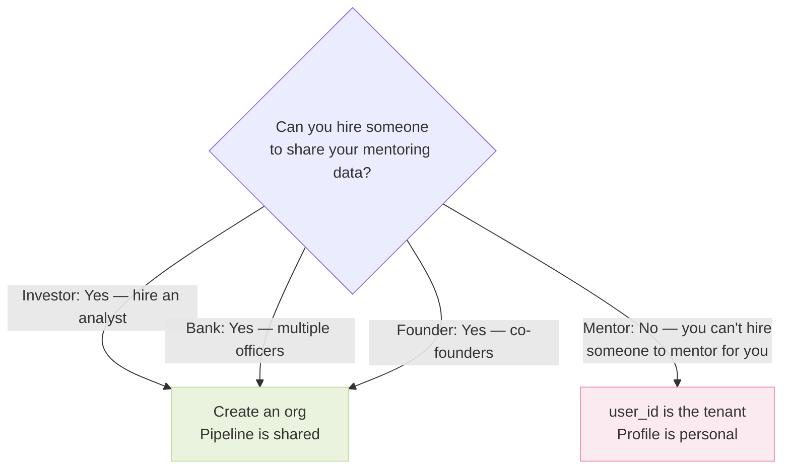
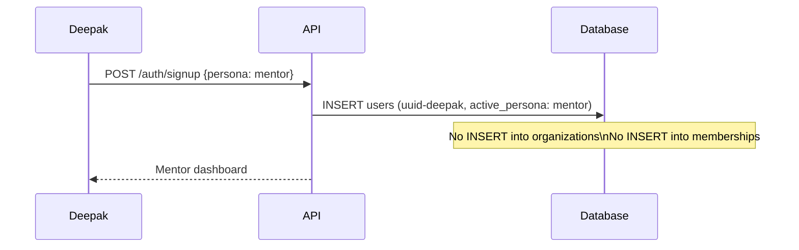
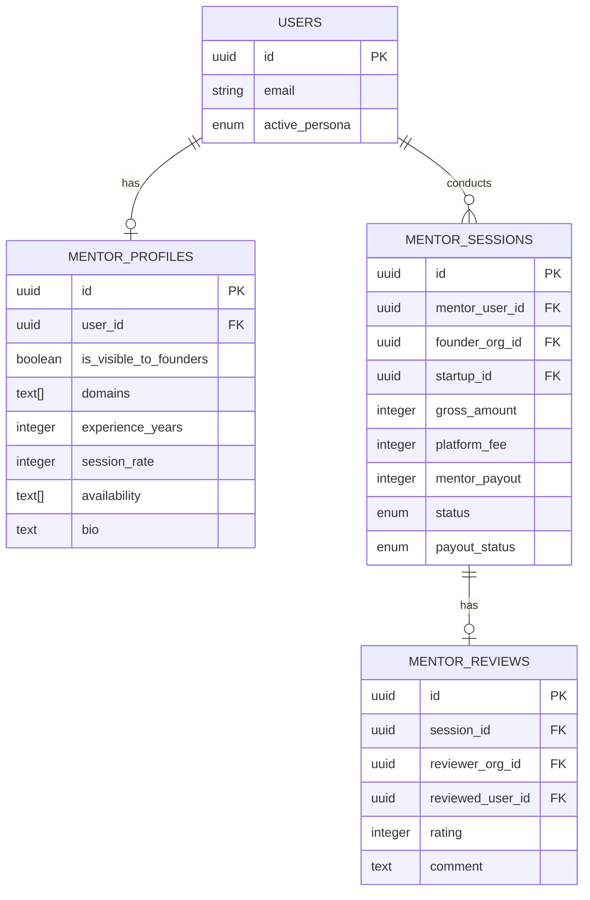
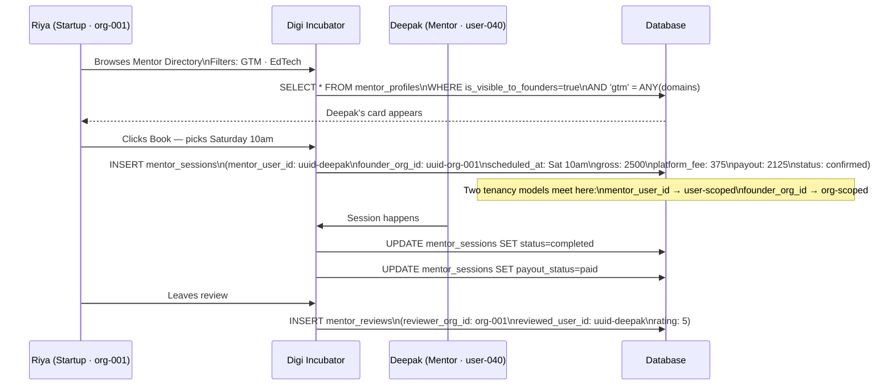
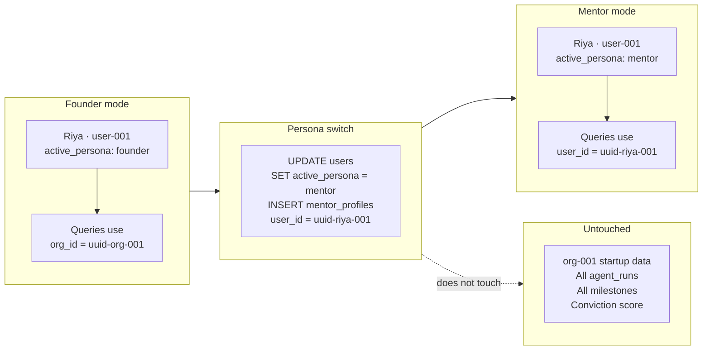
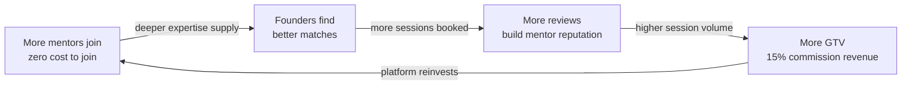

# Persona 06 — Mentor

> The one genuine exception to the org-as-tenant rule.


## Who is this?

An experienced professional offering paid advisory sessions to founders. Could be a product manager, a former founder, a CFO, a marketing expert. Mentoring is personal — the mentor IS the product.

**Real example:** Deepak, Senior PM at Flipkart, mentoring EdTech founders on product strategy and GTM.


## Why user_id and not org_id

This is the most important design decision in the mentor persona. Every other persona gets an org. Mentors do not.



Mentoring is inherently personal. The mentor's expertise, reputation, and sessions belong to them as an individual — not to an "organization". There is no scenario where a second person joins a mentor's account to share their sessions.


## Signup — the simplest of all personas



One table. One row. The simplest signup in the system.


## Mentor profile — keyed on user_id



`mentor_profiles.user_id` is the only foreign key in the domain tables that points to `users` directly instead of `organizations`.


## The booking flow — where two tenancy models meet

`mentor_sessions` is the only table in the entire system that bridges both tenancy models:




## Commission model

|                                 | Amount |
| ------------------------------- | ------ |
| Riya pays                       | ₹2,500 |
| Digi Incubator commission (15%) | − ₹375 |
| Deepak receives                 | ₹2,125 |

`platform_fee` is calculated and locked at booking time. Refund and payout logic reads from this fixed value — no recalculation needed later.


## Sequential persona switch — Riya becomes a mentor

A founder can switch to mentor mode. This is sequential — one active persona at a time.



One UPDATE + one INSERT. All startup data is completely preserved. She switches back to founder mode by updating `active_persona` — her mentor profile goes dormant but is not deleted.


## Business model

Mentors are on the **commission model**. There is no subscription, no monthly fee, no barrier to join. Digi Incubator earns only when the mentor earns — 15% of every session booked through the platform.

### Commission structure

| | Amount (₹2,500 session example) |
|---|---|
| Founder pays | ₹2,500 |
| Digi Incubator commission (15%) | ₹375 |
| Mentor receives | ₹2,125 |

### Why zero subscription — always

| Approach | What happens |
|---|---|
| Monthly subscription | Mentors hesitate before earning anything — low join rate, high churn |
| Commission only | Zero barrier to join — Digi Incubator earns only when mentors earn |

The commission model perfectly aligns incentives. If Digi Incubator drives no bookings, it earns nothing from that mentor. This creates a direct product incentive to build features that drive session volume.

### Mentor session rate ranges

| Mentor type | Typical rate |
|---|---|
| Domain expert (early career) | ₹500–₹1,500/hr |
| Senior professional | ₹1,500–₹3,500/hr |
| Serial founder / ex-CXO | ₹3,500–₹10,000/hr |

### How the commission is stored and locked

```
mentor_sessions {
  mentor_user_id = uuid-deepak-040
  founder_org_id = uuid-org-001
  gross_amount   = 2500    ← session rate × hours
  platform_fee   = 375     ← locked at 15% at booking time
  mentor_payout  = 2125    ← locked at booking time
  payout_status  = 'pending'  → 'paid' after session completes
}
```

`platform_fee` and `mentor_payout` are calculated **once at booking** and stored as fixed integers. Refund and dispute logic always reads from these stored values — no recalculation, no ambiguity about what the mentor is owed.

### The marketplace flywheel



### Future lever — optional premium listing

At scale, once mentors have consistent bookings, introduce an **optional** premium listing at ₹499/mo. This pushes the mentor's profile to the top of search results. It is never mandatory — existing mentors can decline without losing access. Introduce this only when mentors are already earning consistently and have a reason to invest in visibility.

### No subscriptions row for mentors

Unlike every other persona, mentors do not get a `subscriptions` row. They are individual users, not orgs. Their revenue relationship with Digi Incubator is entirely through `mentor_sessions.platform_fee`. If you need to report mentor-related revenue, query:

```sql
SELECT SUM(platform_fee)
FROM mentor_sessions
WHERE status = 'completed'
AND created_at BETWEEN :start AND :end;
```


*Back to [[index|Index]] · Next: [[01-onboarding-ideation|Flows →]]*
